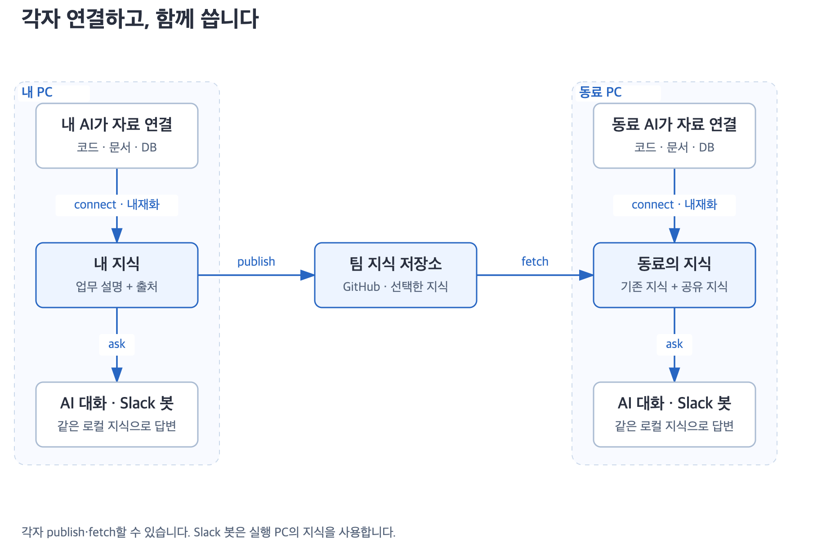

# Dougle · 더글

**내가 연결한 업무 지식을, 팀의 AI와 Slack에서 함께 씁니다.**

코드·문서·DB를 연결하면 평소 쓰는 AI가 업무 지식으로 정리합니다. 각자의 PC에 쌓인 지식은 GitHub로 주고받고, 질문할 때 필요한 원본을 확인해 답합니다.

<picture>
  <source media="(max-width: 650px)" srcset="docs/diagrams/archify/overview-mobile.png">
  
</picture>

[구조 이해하기](docs/design.md) · [설치하기](docs/skills/install.md) · [Slack에서 쓰기](dougle-bot/README.md) · [전체 문서](docs/README.md)

서버 운영을 준비하신다면 [서버 전환 설계 · TO-BE](docs/server/README.md)를 읽어 주세요. 지식 동기화, 병렬 질문, 운영 조회, 권한, 복구와 개발 순서를 정리한 구현 전 명세입니다.

## 연결하고 질문하세요

Claude Code 대화창에서 설치합니다.

```text
/plugin marketplace add thisisnew/dougle
/plugin install dougle@dougle-marketplace
```

`연결할_URL`을 원하는 자료 링크로 바꿔 주세요.

```text
/dougle:dougle-connect 연결할_URL을 읽고 업무 지식으로 정리해 줘.
/dougle:dougle-ask 회송과 폐기는 어떻게 달라?
```

지식은 로컬에 남습니다. 새 세션이나 다른 폴더에서도 다시 쓰고, 질문에 필요한 자료가 바뀌면 해당 부분을 갱신합니다.

<details>
<summary>Codex에서 설치하기</summary>

```text
https://github.com/thisisnew/dougle 저장소의 skills/에 있는
모든 스킬을 참조 파일까지 설치해 줘.
```

새 세션에서 `$dougle-connect`, `$dougle-ask`를 사용합니다.

</details>

## 팀과 나누세요

```text
/dougle:dougle-publish 팀_지식_저장소_URL에 입하 업무 지식을 공유해 줘.
/dougle:dougle-fetch 팀_지식_저장소_URL의 지식을 가져와 합쳐 줘.
```

**publish는 보내기, fetch는 가져와 합치기입니다.** 동료의 지식과 내 정정을 보존하고, 충돌하는 설명은 근거와 함께 남깁니다. 민감정보 검사를 통과한 지식만 공유합니다. [공유 방식](docs/skills/sharing.md)

## 같은 지식으로 Slack에서도 답합니다

```text
/dougle:dougle-bot
```

처음에는 설치와 채널 설정을 안내합니다. 이후 `@dougle 질문`에 답하고, 개발자 확인이 필요한 문의는 내부 DM으로 이어갑니다. 봇은 **실행 중인 PC의 지식**을 사용합니다. [봇 시작하기](dougle-bot/README.md)

[업데이트하기](docs/skills/install.md#새-버전으로-업데이트하기) · [0.8.20 Preview](https://github.com/thisisnew/dougle/releases/tag/v0.8.20-skills-preview.1) · [변경·검증 결과](docs/dougle-bot/verification-repair.md) · [개발·검증](docs/skills/development.md)
