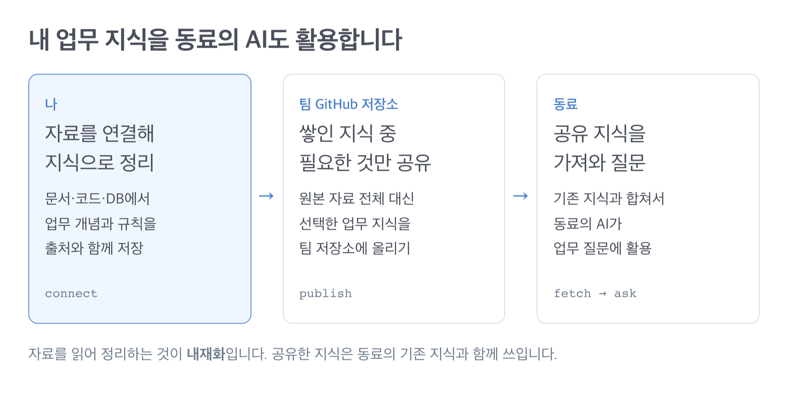
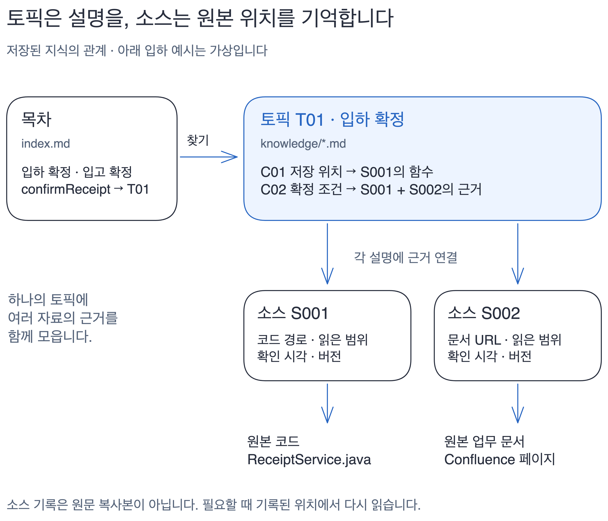

# Dougle · 더글

**내가 연결한 업무 지식을 쌓고, 팀과 함께 쓰세요.**

더글은 평소 쓰는 Claude Code·Codex에서 자료를 읽고 업무 지식으로 내재화하는 스킬입니다.



**publish**로 내가 쌓은 지식을 공유하고, **fetch**로 동료의 지식을 가져와 함께 활용합니다.

공유 전 토큰·비밀번호·개인정보 후보를 검사하고, 발견되거나 검사를 완료하지 못하면 게시를 중단합니다.

[처음 설치](#1-설치하기) · [바로 질문](#3-질문하기) · [이미 설치했다면](#업데이트하기) · [구조·설계 그림으로 보기](docs/design.md)

## 1. 설치하기

**Claude Code 대화창**에 두 줄을 차례로 입력하세요.

```text
/plugin marketplace add thisisnew/dougle
/plugin install dougle@dougle-marketplace
```

**Codex 대화창**에는 아래 요청을 붙여 넣으세요.

```text
https://github.com/thisisnew/dougle 저장소에서
skills/dougle-connect, skills/dougle-ask, skills/dougle-reload,
skills/dougle-publish, skills/dougle-fetch, skills/dougle-schedule, skills/dougle-bot, skills/i-have-adhd를 참조 파일까지 설치해 줘.
```

## 2. 자료 연결하기

**연결하고 싶은 자료의 URL을 알려주세요.** 아래 `연결할_URL`을 실제 링크로 바꿔 입력하세요.

```text
/dougle:dougle-connect 연결할_URL 이 자료를 읽고 입하 업무를 정리해 줘.
```

더글은 연결한 자료에서 확인한 업무 개념·규칙·관계를 내부적으로 정리하고 저장해 **업무 지식으로 내재화합니다.** 이후 질문하면 이 지식과 원본 근거를 찾아 답합니다.

코드 폴더나 DB도 자연어로 연결을 요청할 수 있습니다. 같은 자료를 다시 연결하면 기존 기록을 찾아 갱신합니다.

해당 서비스에 접근할 수 있는 조회 도구와 권한이 필요합니다. 연결이 안 되면 필요한 설정을 안내합니다. [연결 문제 해결](docs/skills/connections.md)

## 3. 질문하기

```text
/dougle:dougle-ask 입하 확정할 때 어느 테이블에 데이터가 들어가?
```

같은 대화에서 **“어느 코드를 보면 돼?”**처럼 이어서 물어보세요.

**결론 → 필요한 설명 → 출처** 순서로 존댓말로 답합니다. ask는 질문마다 `i-have-adhd` 스킬 적용을 확인합니다. 자세한 설명이 필요하면 “전체 흐름을 자세히 설명해 줘”라고 요청하세요.

<details>
<summary>답변 예시 보기</summary>

> 아래 파일과 동작은 가상입니다.
>
> 입하 확정은 `receipt` 테이블에 기록합니다. [1]
>
> 흐름은 `confirmReceipt()`부터 보면 됩니다. [1]
>
> **출처** · [1] `src/ReceiptService.java` — `confirmReceipt()`

답변 정리용 i-have-adhd도 함께 설치됩니다. [호스트별 활성화 방식](docs/skills/skill-activation.md)

</details>

## 4. 쌓인 지식을 팀과 공유하기

공유할 GitHub 저장소 주소와 범위를 알려주세요.

```text
/dougle:dougle-publish 팀_지식_저장소_URL에 입하 업무 지식을 공유해 줘.
```

동료는 같은 저장소에서 지식을 가져와 질문에 활용할 수 있습니다.

```text
/dougle:dougle-fetch 팀_지식_저장소_URL의 지식을 가져와 내 지식과 합쳐 줘.
/dougle:dougle-ask 입하 확정에서 주의할 예외는 뭐야?
```

fetch는 기존 지식을 통째로 덮어쓰지 않고 출처·정정·충돌을 보존해 합칩니다. 공유 대상은 선택한 정제 지식이며, 저장소 접근 권한이 있는 팀원이 사용할 수 있습니다. [공유와 병합 자세히 보기](docs/skills/sharing.md)

## 필요한 명령 찾기

| 하고 싶은 일 | Claude 플러그인 | Codex |
|---|---|---|
| 자료 연결 | `/dougle:dougle-connect` | `$dougle-connect` |
| 업무 질문 | `/dougle:dougle-ask` | `$dougle-ask` |
| 자료 즉시 갱신 | `/dougle:dougle-reload` | `$dougle-reload` |
| 팀에 지식 공유 | `/dougle:dougle-publish` | `$dougle-publish` |
| 팀 지식 가져오기 | `/dougle:dougle-fetch` | `$dougle-fetch` |
| Slack 봇 시작·중지·채널 추가 | `/dougle:dougle-bot` | `$dougle-bot` |
| Slack 문의 확인·답변 준비 | `/dougle:dougle-schedule` | `$dougle-schedule` |

## Slack에서 @dougle로 질문하기

```text
/dougle:dougle-bot
```

처음에는 설정을 안내하고, 이후에는 **1. 시작 / 2. 상태 확인 / 3. 중지 / 4. 채널 추가**를 보여 줍니다.

`@dougle 질문`이 오면 `:dougle:`과 ⏳가 함께 붙고, 게시가 끝나면 ⏳만 ✅로 바뀝니다. 회사 이모지가 없으면 상태 이모지만 표시합니다. 승인자 DM의 같은 카드에 진행 상태와 초안을 보여 줍니다. **[게시]를 누를 때만** 원래 스레드에 답합니다. 게시 답변은 쉬운 업무 설명으로 정리하며 출처·서명은 붙이지 않습니다. 근거는 승인 DM에 남습니다. 중지 중 올라온 질문은 재시작해도 가져오지 않습니다.

Slack 앱과 로컬 봇 실행 환경은 봇을 사용할 때만 준비합니다. [처음 설정·실행 방법](dougle-bot/README.md)

## Slack 문의 답변 준비하기

전용 AI 세션에서 실행하세요. **기본 2분마다 새 문의를 확인하고, 승인한 답변만 게시합니다.**

```text
/dougle:dougle-schedule
```

기존 Slack MCP와 호스트의 주기 실행 기능이 필요합니다. 더글이 작성하는 Slack 댓글 끝에는 **✦ dougle**을 붙입니다.

실행하면 **1. 목록 / 2. 등록 / 3. 삭제 / 0. 나가기** 메뉴가 나옵니다. Slack 채널 URL을 붙여 실행하면 기본2분으로 바로 등록합니다. 설정·이력·대기 초안은 로컬에 남고, 목록에서 번호를 골라 재개할 수 있습니다. [사용법·VDI 조회·지원 환경](docs/skills/schedule.md)

## 질문에서 답변까지

**목차에서 토픽을 찾고 → 설명과 근거를 읽고 → 필요하면 원본을 확인합니다.**



- **토픽**에는 업무 설명·규칙·조건·예외가 있습니다.
- **소스 기록**에는 그 설명을 확인한 원본 위치·범위·시각이 있습니다. 원본 전체를 복사해 둔 것은 아닙니다.
- 기본 **1시간**이 지났거나 근거가 부족하면 관련 원본을 확인합니다. 구현 원인은 코드로, 현재 DB 상태·최신 설정은 새 조회로 확인합니다.

충분하고 최근에 확인한 근거는 안정적인 업무 질문에 재사용합니다. 따로 지정한 갱신 주기는 유지합니다.

[지식 구조·봇의 대화 모델·승인 흐름](docs/design.md) · [저장·검색 방식](docs/skills/topic-navigation.md)

## 업데이트하기

<details>
<summary>이미 설치했다면: 모델별 업데이트 명령과 문제 해결</summary>

### Claude Code 플러그인

**1. 일반 터미널**에서 실행하세요.

```sh
claude plugin marketplace update dougle-marketplace
claude plugin update dougle@dougle-marketplace
```

**2. Claude 대화창**에서 실행하세요.

```text
/reload-plugins
```

지원하지 않는 버전이면 Claude를 종료하고 평소 쓰는 실행 명령으로 다시 여세요. `/dougle:`을 입력해 스킬 목록을 확인합니다.

**새 명령이 안 보이면**, 터미널에서 상태를 확인하세요.

```sh
claude plugin list
```

| 확인 결과 | 실행할 명령·대처 |
|---|---|
| dougle이 없음 | `claude plugin install dougle@dougle-marketplace` |
| 마켓플레이스를 못 찾음 | `claude plugin marketplace add thisisnew/dougle` 후 업데이트 |
| 비활성 상태 | `claude plugin enable dougle@dougle-marketplace` 후 리로드 |
| Scope가 project 또는 local | 해당 프로젝트에서 업데이트 명령에 `--scope project` 또는 `--scope local` 추가 |
| 설치됐는데 계속 안 보임 | 대화창의 `/plugin` → Errors 확인. 개인 스킬·플러그인 중복 설치 여부 확인 |

이 명령들도 회사 실행명이 다르면 `claude` 대신 그 이름을 쓰세요. 관리자가 관리하는 설치는 관리자에게 업데이트를 요청하세요.

### Codex 또는 Claude 개인 스킬 폴더

**1. AI 대화창**에 붙여 넣으세요.

```text
https://github.com/thisisnew/dougle 의 최신 main으로
dougle-connect, dougle-ask, dougle-reload, dougle-publish, dougle-fetch, dougle-schedule, dougle-bot, i-have-adhd를 갱신해 줘.
실제로 로드되는 설치 경로를 확인하고 SKILL.md와 참조 파일을 함께 업데이트해.
개인 수정본은 보존하고 ~/.dougle/의 업무 지식은 건드리지 마.
```

**2. AI를 다시 실행**하고 Codex는 `$dougle-fetch`, Claude 개인 설치는 `/dougle-fetch`를 확인하세요.

안 보이면 아래를 요청하세요.

```text
dougle-fetch가 안 보여. 실제 스킬 검색 경로의 SKILL.md와 참조 파일,
이전 설치본과의 중복, 형식 오류를 확인해 줘. 업무 지식은 변경하지 마.
```

**업데이트는 새 스킬 파일을 받는 것, 리로드는 받은 파일을 다시 읽는 것**입니다. `dougle-reload`는 회사 자료를 갱신하는 별도 기능입니다.

</details>

저장된 지식은 세션을 닫아도 남습니다. [구동 방식 자세히 보기](docs/skills/how-it-works.md)

[사용 예시](docs/skills/usage.md) · [팀 지식 공유](docs/skills/sharing.md) · [전체 문서](docs/README.md) · [다운로드](https://github.com/thisisnew/dougle/releases/tag/v0.8.4-skills-preview.1)
