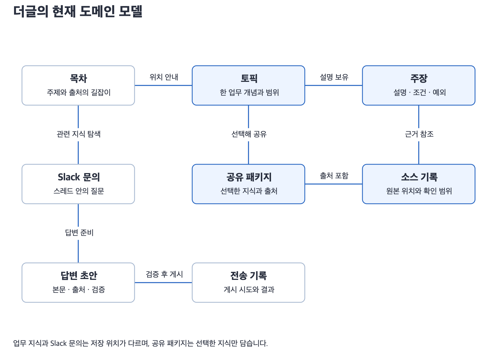

# Dougle · 더글

**내가 연결한 업무 지식을, 팀의 AI와 Slack에서 함께 씁니다.**

코드·문서·DB를 연결하면 평소 쓰는 AI가 업무 지식으로 정리합니다. 각자의 PC에 쌓인 지식은 GitHub로 주고받고, 질문할 때 필요한 원본을 확인해 답합니다.

<picture>
  <source media="(max-width: 650px)" srcset="docs/diagrams/archify/overview-mobile.png">
  
</picture>

[구조 이해하기](docs/design.md) · [설치하기](docs/skills/install.md) · [Slack에서 쓰기](dougle-bot/README.md) · [전체 문서](docs/README.md)

서버 운영을 준비하신다면 [서버 전환 설계 · TO-BE](docs/server/README.md)를 읽어 주세요. 지식 동기화, 병렬 질문, 운영 조회, 권한, 복구와 개발 순서를 정리한 구현 전 명세입니다.

## 연결하고 질문하세요

Claude Code 대화창에서 설치합니다.

```text
/plugin marketplace add thisisnew/dougle
/plugin install dougle@dougle-marketplace
```

`연결할_URL`을 원하는 자료 링크로 바꿔 주세요.

```text
/dougle:dougle-connect 연결할_URL을 읽고 업무 지식으로 정리해 줘.
/dougle:dougle-ask 회송과 폐기는 어떻게 달라?
```

지식은 로컬에 남습니다. 새 세션이나 다른 폴더에서도 다시 쓰고, 질문에 필요한 자료가 바뀌면 해당 부분을 갱신합니다.

<details>
<summary>Codex에서 설치하기</summary>

```text
https://github.com/thisisnew/dougle 저장소의 skills/에 있는
모든 스킬을 참조 파일까지 설치해 줘.
```

새 세션에서 `$dougle-connect`, `$dougle-ask`를 사용합니다.

</details>

## 내재화한 지식은 어떻게 갱신하나요?

처음 연결할 때는 요청한 자료를 읽고 업무 설명, 원본 위치, 확인한 범위를 로컬 지식에 기록합니다. 이후에는 **관련 질문이 들어올 때 필요한 범위만** 다시 확인합니다. 기본 주기는 관련 질문마다 한 번이며, 사용자가 자료별 확인 주기를 지정했다면 그 설정을 따릅니다.

1. **찾기:** 질문의 주제와 범위를 목차에서 찾아 관련 토픽, 주장, 소스 기록을 고릅니다.
2. **비교하기:** 필요한 원본의 현재 버전이나 신뢰할 수 있는 내용 기준을 기존 기록과 비교합니다. 파일명, 수정 시각, HTTP 응답 성공만으로 내용이 같다고 판단하지 않습니다.
3. **그대로라면 재사용하기:** 원본이 그대로이고 저장된 근거가 질문에 충분하면 설명을 다시 쓰지 않습니다. 확인에 성공한 범위의 기록만 갱신합니다.
4. **바뀌었다면 다시 읽기:** 달라진 부분과 관련 조건·예외·의존 관계를 읽습니다. 영향을 받은 주장만 고치고, 아직 확인하지 못한 관계는 재확인 대상으로 남깁니다. 기존 사용자 정정과 충돌 기록은 보존합니다.
5. **결과 기록하기:** 실제 읽기와 지식 저장이 모두 끝난 범위만 확인 완료로 표시합니다. 접근 실패나 일부 확인은 마지막 성공 시각을 앞당기지 않고, 답변에 필요한 미확인 범위를 밝힙니다.

### 버전은 어떻게 비교하나요?

소스 기록에 남긴 마지막 성공 확인 범위와 `verified_revision`을, 이번에 읽기 도구가 확인한 **같은 원본·같은 범위**의 버전 또는 내용과 대조합니다. 기록된 버전이 없거나 비교할 수 없다면 필요한 원문을 다시 읽습니다.

| 자료 | 비교 기준 |
| --- | --- |
| 등록한 GitHub 코드 | 지정된 원격 브랜치·ref의 현재 커밋을 확인하고, 그 커밋에 고정해 관련 파일의 내용이나 blob 해시를 비교합니다. 로컬 작업 폴더의 커밋만으로 원격 버전을 판단하지 않습니다. |
| 로컬 코드 | 관련 파일의 내용과 커밋되지 않은 수정·새 파일·삭제까지 확인합니다. `HEAD`가 같아도 파일이 달라질 수 있습니다. |
| 문서·웹 자료 | 읽기 도구가 제공하는 신뢰할 수 있는 버전이나 확인 대상 내용으로 비교합니다. 제목·크기·수정 시각·HTTP 성공 응답만으로는 동일하다고 판단하지 않습니다. |
| DB·운영 상태 | 문서나 스키마 버전으로 현재 값을 판단하지 않고, 허용된 범위에서 실제 시스템을 새로 조회합니다. |

버전이 같아도 기존 근거가 질문에 충분해야 재사용합니다. 새로 생기거나 이동한 자료까지 답에 필요하다면 해당 범위의 목록도 확인합니다. 읽기와 지식 저장이 모두 성공한 범위만 마지막 성공 시각과 버전을 갱신하며, 일부만 확인했거나 실패했다면 나머지는 미확인으로 남깁니다.

코드의 실제 동작을 묻거나 현재 운영 상태를 물으면 해당 구현이나 시스템을 직접 확인합니다. 이 절차는 질문할 때 실행되며 백그라운드 감시나 자동 `publish`를 시작하지 않습니다. [자세한 갱신 규칙](docs/skills/freshness.md)

## 팀과 나누세요

```text
/dougle:dougle-publish 팀_지식_저장소_URL에 입하 업무 지식을 공유해 줘.
/dougle:dougle-fetch 팀_지식_저장소_URL의 지식을 가져와 합쳐 줘.
```

**publish는 보내기, fetch는 가져와 합치기입니다.** 동료의 지식과 내 정정을 보존하고, 충돌하는 설명은 근거와 함께 남깁니다. 민감정보 검사를 통과한 지식만 공유합니다. [공유 방식](docs/skills/sharing.md)

새로 정리하거나 명시적으로 이전하는 주장에는 선택적 `Fact-v1` 항목으로 주어·동작·시점·조건·예외를 기록할 수 있습니다. 퍼블리시할 때 같은 근거로 확인된 항목이 모두 같으면 표현 차이를 구분할 수 있습니다. 한 항목이라도 불명확하면 기존처럼 두 설명을 보존합니다. 원본과 사용자 정정은 바꾸지 않으며, 설치만으로 기존 지식을 일괄 이전하지 않습니다.

## 같은 지식으로 Slack에서도 답합니다

```text
/dougle:dougle-bot
```

처음에는 설치와 채널 설정을 안내합니다. 이후 `@dougle 질문`에 답하고, 개발자 확인이 필요한 문의는 내부 DM으로 이어갑니다. 봇은 **실행 중인 PC의 지식**을 사용합니다. [봇 시작하기](dougle-bot/README.md)

## 현재 도메인 모델

아래 그림은 현재 로컬 더글이 다루는 개념의 관계입니다.



| 영역 | 개념과 관계 |
| --- | --- |
| 업무 지식 | **목차**가 토픽과 소스를 찾도록 안내합니다. **토픽**은 업무 개념별 **주장**을 담습니다. 주장에는 확인한 근거와 해당하는 조건·예외를 기록하고, **소스 기록**에는 원본 위치와 실제 확인 범위를 남깁니다. 목차 자체는 답변 근거가 아닙니다. |
| 팀 공유 | **공유 패키지**는 사용자가 고른 토픽·소스 기록을 담습니다. `publish`로 팀 저장소에 올리고, `fetch`로 가져와 내 지식과 합칩니다. 원본 코드 전체나 봇 문의 기록은 옮기지 않습니다. |
| Slack 문의 | 한 **스레드**에 여러 **문의**가 생길 수 있습니다. 문의마다 작업과 답변 초안이 기록되고, 검증된 초안의 게시 시도는 **전송 기록**으로 남습니다. 개발자 확인 결과도 해당 문의에 연결합니다. |

업무 지식은 `~/.dougle/`의 Markdown에, 봇 문의와 전송 상태는 `~/.dougle-bot/`의 SQLite에 저장합니다. 그림은 개념 관계를 설명하며 실제 테이블의 모든 열을 나열하지 않습니다. [그림 원본](docs/diagrams/archify/domain.json) · [확대해서 보기](docs/diagrams/archify/domain.html) · [구현 근거](docs/design-reference.md)

[업데이트하기](docs/skills/install.md#새-버전으로-업데이트하기) · [0.8.29 배포](https://github.com/thisisnew/dougle/releases/tag/v0.8.29-skills-preview.1) · [원격 파일명 탐색](docs/dougle-bot/remote-file-discovery-cases.md) · [개발·검증](docs/skills/development.md)

[0.8.29 개선 내역과 검증·회사 적용 절차](docs/improvement-2026-11-09/PROGRESS.md): 비용 계측, 범위 읽기, 근거 연결, 게시 보존 검사와 고정 질문 평가를 정리했습니다.
