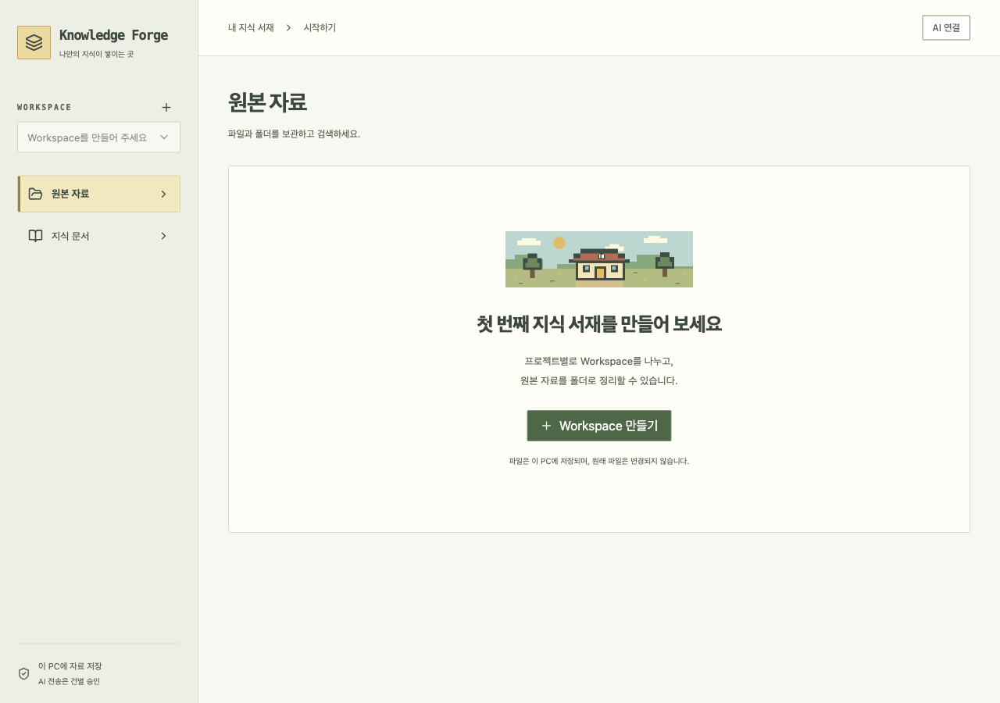
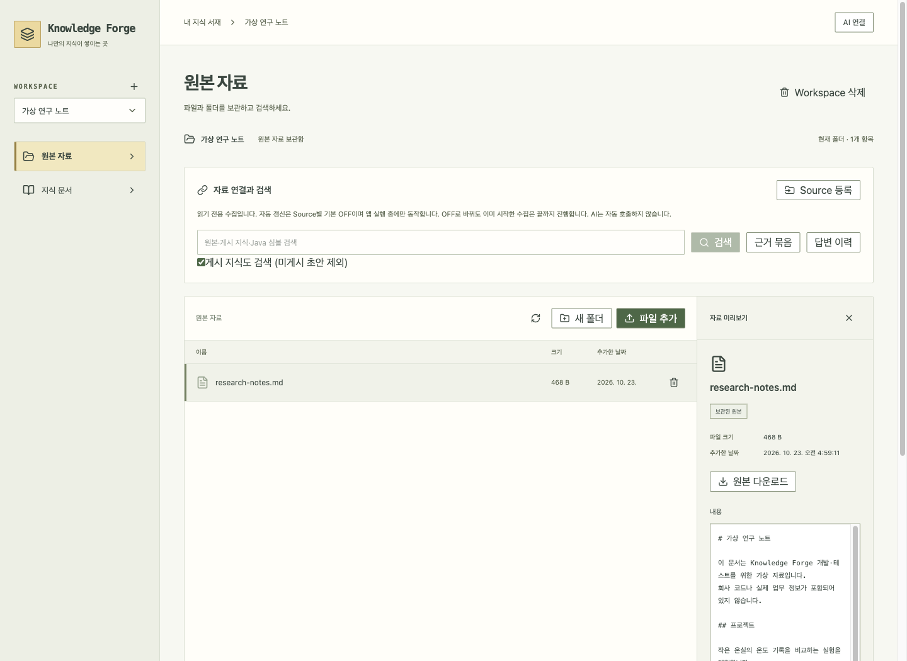

# Knowledge Forge

**흩어진 자료를 나만의 지식 서재로.**

파일·폴더·웹페이지를 모아 검색하고, 자료를 바탕으로 AI에게 질문하는 Mac 앱입니다.
답변의 출처를 확인하고, 필요한 내용을 문서로 정리해 보관할 수 있습니다.

## 설치하기

**[Mac 설치 파일 다운로드](https://github.com/thisisnew/knowledge-forge/releases/tag/v0.1.3-preview.1)**

1. 내 Mac에 맞는 파일을 받습니다. **M 시리즈는 `arm64`**, **Intel은 `x86_64`**입니다.
2. 받은 `.dmg` 파일을 열고 **Knowledge Forge**를 **Applications(응용 프로그램)**로 옮깁니다.
3. 앱을 열고 **Workspace 만들기**로 첫 서재를 만듭니다.
4. 파일을 추가하고 검색해 보세요. AI는 상단 **AI 연결 → Codex**를 고르고 로그인합니다.

Java와 Codex 실행 도구는 앱에 포함되어 있습니다.
0.1.3부터 새 버전을 앱에서 알려 줍니다. 안내에 따라 설치하고 다시 시작하면 됩니다. [업데이트 안내](docs/automatic-updates.md)
앱이 열리지 않거나 기존 앱을 업데이트하려면 [자세한 설치 안내](docs/macos-install.md)를 확인하세요.

## 기술 스택

| 구분 | 사용 기술 |
|---|---|
| 데스크톱 앱 | Tauri 2 |
| 화면 | React · TypeScript · Vite · Tailwind CSS · shadcn/ui |
| 서버 | Java 21 · Spring Boot 4.1 |
| 저장·검색 | SQLite · Apache Lucene 10 · Nori |
| 자료 분석 | Apache Tika · JavaParser |
| AI 연결 | Codex · Claude Code |

## 더 알아보기

[사용 방법](docs/how-it-works.md) · [설계도](docs/design-map.md) · [개발 환경](docs/development.md) · [전체 문서](docs/README.md)
