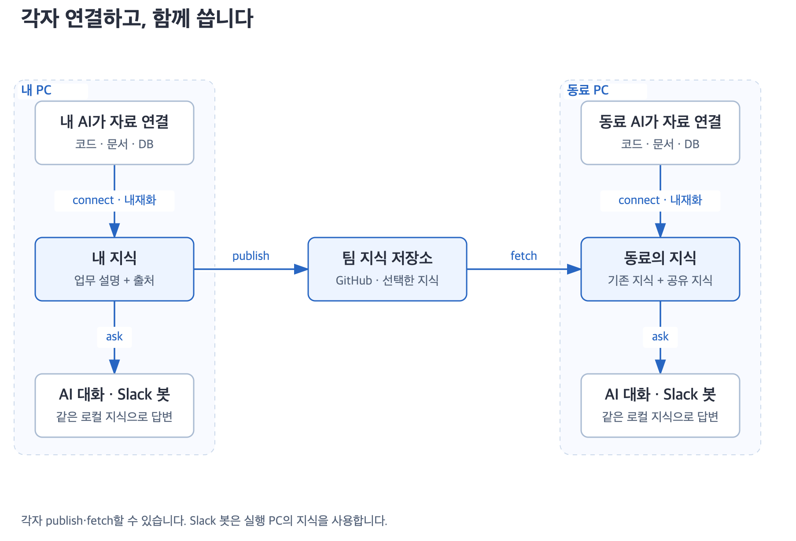

# 더글 문서

**자료 연결부터 팀 공유, Slack 답변까지 같은 지식을 사용합니다.**

<picture>
  <source media="(max-width: 650px)" srcset="diagrams/archify/overview-mobile.png">
  
</picture>

## 처음 쓰신다면

| 순서 | 읽을 문서 |
|---|---|
| 구조부터 이해하기 | [더글이 작동하는 방식](design.md) |
| 내 AI에 설치하기 | [설치·업데이트](skills/install.md) |
| 자료를 연결하고 질문하기 | [사용 예시](skills/usage.md) · [자료 연결](skills/connections.md) |
| 동료와 지식 나누기 | [publish·fetch](skills/sharing.md) |
| Slack에서 질문받기 | [봇 설정·실행](../dougle-bot/README.md) |

## 동작을 자세히 보려면

| 궁금한 점 | 읽을 문서 |
|---|---|
| 토픽·소스·목차의 역할 | [지식 저장](skills/architecture.md) · [검색 순서](skills/topic-navigation.md) |
| 자료가 바뀌면 어떻게 반영하나요? | [질문 시 갱신](skills/freshness.md) |
| 자료가 많으면 어디서 느려지나요? | [검색 성능](skills/search-performance.md) · [대용량 처리](skills/large-corpus.md) |
| 답변을 어떻게 검증하나요? | [출처](skills/answer-sources.md) · [스킬 활성화](skills/skill-activation.md) · [봇 근거 검사](dougle-bot/research-verification.md) |
| 운영 조회를 대신 해야 하나요? | [개발자 확인 요청](dougle-bot/internal-handoff.md) |
| 공유 전에 무엇을 검사하나요? | [민감정보 차단](skills/publish-sensitive.md) |

## 개발과 검증

[서버 전환 설계 · TO-BE](server/README.md): 목표 구조와 지식 갱신, 병렬 처리, 운영 DB 접근, 배포·복구, 수용 테스트를 연결한 구현 전 명세입니다.

[개발 안내](skills/development.md) · [저장소 구성](repository.md) · [설계 참고](design-reference.md) · [봇 실행 계약](../dougle-bot/SPEC.md)

[검증 범위](skills/verification.md) · [사용 시나리오 1,066개](scenarios/README.md) · [회사 PC 체크리스트](dougle-bot/company-acceptance.md)

시나리오 목록, 가짜 서비스 테스트, 실제 모델 평가, 회사 연동 확인은 서로 다른 검증입니다. 결과와 한계는 각 기록에 남깁니다.

기존 기능·설계안·이전 기록

- [schedule: 기존 채널 폴링](skills/schedule.md). 호스트 타이머와 초안별 승인을 사용하는 별도 기능입니다.
- [멘션 없는 문의 감지](dougle-bot/channel-detection-design.md). 현재 봇 기능과 구분한 설계안입니다.
- [이전 기록](history.md) · [초기 봇 시험 설계](dougle-bot/TEST_PLAN.md).
- [그림 원본과 제작 방법](diagrams/README.md).

