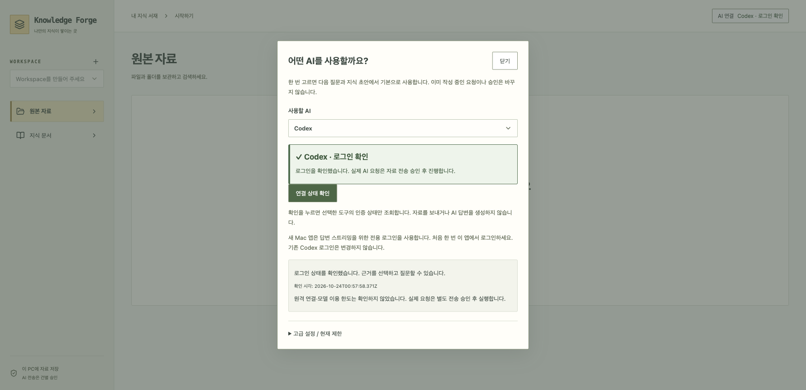

# AI 연결 상태 한눈에 보기

상단 **AI 연결**을 누르면 선택된 AI의 로그인 상태를 자동으로 확인합니다. 자료나 질문은 전송하지 않습니다.

가상 인증 도구로 촬영한 실제 UI입니다. 실제 계정이나 원격 AI 성공을 보여 주는 화면은 아닙니다.

| 표시 | 뜻 |
|---|---|
| 초록색 ✓ 로그인 확인 | 선택한 도구에 로그인되어 있습니다 |
| 로그인 필요 | 안내에 따라 앱에서 로그인하세요 |
| 실행 도구 없음 | 선택한 도구가 준비되지 않았습니다 |
| 확인 중… | 인증 상태를 확인하고 있습니다 |
| 확인 실패 | 다시 확인하거나 오류 안내를 확인하세요 |

창을 닫아도 상단에 마지막 결과가 남습니다. 다시 열면 새로 확인합니다. AI를 바꾸거나 고급 설정을 닫으면 이전 결과를 지우며, 앱을 다시 시작할 때 성공 상태를 복원하지 않습니다.

**로그인 확인은 실제 AI 응답 성공이나 사용량 잔여 확인이 아닙니다.** 자료 전송은 기존처럼 건별 승인이 필요합니다.

## 구현 대조

- `App → ProviderConnectionPanel(checkOnOpen) → POST /ai/providers/{provider}/connection`으로 인증만 확인합니다.
- 확인/로그인 결과를 `onConnectionChange → App`의 메모리 상태에 전달합니다. 인증 정보는 UI에 저장하지 않습니다.
- 색뿐 아니라 아이콘·텍스트·live status로 상태를 표시합니다. 늦게 도착한 이전 제공자 결과는 기존 AbortController로 무시합니다.
- UI 테스트는 자동 조회·확인 중·성공·통신 오류·제공자 변경·창 닫은 뒤 상단 표시를 검사합니다. 원격 AI 호출은 없습니다.
