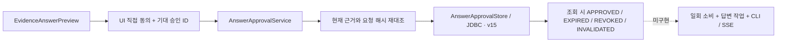

# 답변 요청 승인 — 이 요청만, 10분 동안

## 지금 되는 것

미리 본 요청문에 대해 **명시적으로 동의하고, 승인을 저장하거나 철회**할 수 있습니다.
아직 답변 전송·CLI 실행·SSE는 없습니다. 승인 버튼을 누른다고 AI가 호출되지는 않습니다.
기존 지식 초안 생성의 승인과는 별개입니다.

1. 근거 묶음을 열고 제공자·모델을 골라 요청 미리보기를 만듭니다.
2. 요청 전문을 읽습니다. 인용문에 민감한 정보가 있는지도 확인합니다.
3. **승인 상태 확인**을 누르고 동의 체크박스를 직접 선택합니다.
4. **이 요청 승인 저장 (전송 안 함)**을 누릅니다.
5. 취소하려면 **저장된 승인 철회**를 누릅니다. 미리보기 없이도 조회·철회할 수 있습니다.

Codex/Claude는 외부 서비스이며 현재 코딩 대화 세션을 공유하지 않습니다.
조건 변경 시 UI의 동의는 초기화됩니다. 기존 서버 승인은 자동 철회되지 않지만 **다른 요청에는 사용할 수 없습니다**.
화면을 닫으면 대기만 중단합니다. 서버가 이미 받은 승인 저장까지 취소한다고 보장하지 않으므로 다시 열어 조회·철회하세요.

## 안전 규칙

- 승인 저장 시 근거와 요청문을 다시 만들고 미리보기 digest와 비교합니다.
- Workspace·묶음·인용문·제공자·해석된 모델·요청문에 묶인 승인입니다. 빈 모델은 CLI 기본값이며 실제 실행 모델의 증명은 아닙니다.
- 서버 설정값으로 미리봤더라도 승인된 모델 문자열을 고정 저장합니다. 이후 서버 기본값 변경으로 다른 모델에 승인하지 않습니다.
- 유효 기간은 서버 승인 시각부터 10분입니다. 조회나 같은 요청의 재시도는 만료를 연장하지 않습니다.
- 재승인은 새로운 ID로 기존 승인을 교체합니다. 이전 ID를 가진 화면은 교체·철회할 수 없고 409를 받습니다.
- 철회는 같은 ID에 한해 멱등입니다. 철회 시각을 다시 쓰지 않습니다.
- 상태 조회 때 현재 근거·요청문을 재검사합니다. 원본 삭제 등은 `INVALIDATED`, 시간 초과는 `EXPIRED`입니다.
- 상태는 **확인 시점** 기준입니다. 자동 타이머/원격 갱신/영구적인 사실 검증이 아닙니다.
- 아직 승인 소비·전송 기능이 없습니다. 후속 구현은 전송 직전 재검증, 일회 소비와 작업 예약의 원자성, 재시도 멱등성을 반드시 추가해야 합니다. `APPROVED` 응답만 보고 CLI를 호출하면 안 됩니다.

## 모델과 코드 대조



| 코드/모델 | 실제 책임 |
|---|---|
| `conversation/domain/AnswerApproval` | 승인 ID, 묶음 ID, 제공자/모델/요청 해시, 승인·만료·철회 시각 |
| `conversation/application/AnswerApprovalService` | 트랜잭션 안에서 Workspace 격리·명시 동의·기대 ID·현재 요청 검사 |
| `conversation/application/AnswerApprovalStore` | 저장 포트. 도메인에 HTTP/JDBC 의존성 없음 |
| `conversation/adapter/JdbcAnswerApprovalStore` | 묶음당 현재 승인 한 개 저장·교체·철회 |
| `conversation/adapter/AnswerApprovalController` | 조회/승인/철회 HTTP 경로 |
| `frontend/src/AnswerApprovalPanel.tsx` | 자동 승인 없음, 상태 확인 후 체크박스, 오류 시 성공 표시 제거 |

SQLite **v14→v15**는 `answer_approval` 테이블만 추가합니다. 기존 원본·지식·묶음을 변경하지 않습니다.
묶음 FK로 연결하므로 묶음/Workspace 삭제 시 승인도 삭제됩니다. 원본만 삭제하면 승인 기록은 남되 조회 시 무효입니다.
묶음당 최대 한 행이며 교체 전 승인 이력은 보관하지 않습니다. 감사 로그가 아닙니다.
요청문 자체는 중복 저장하지 않고 식별 해시만 저장합니다. 해시는 암호화나 사용자 인증이 아닙니다.
동시성은 기존 단일 SQLite 연결과 트랜잭션/기대 승인 ID로 보호합니다. 다중 앱 프로세스 공유는 지원 범위가 아닙니다.

## API

접두사: `/api/workspaces/{workspaceId}/evidence-bundles/{bundleId}/answer-approval`

| 메서드 | 경로 | 요청 | 성공 |
|---|---|---|---|
| GET | 접두사 | 없음 | 200 State |
| POST | 접두사 | 아래 JSON | 200 State |
| DELETE | `접두사/{approvalId}` | 없음 | 200 State (REVOKED) |

```json
{"provider":"CODEX","requestedModel":"선택한-모델-ID","digest":"미리보기의-요청-digest","acknowledged":true,"expectedApprovalId":null}
```

`requestedModel`은 미리보기 응답의 해석된 값을 그대로 보내세요. 모델의 유효 식별자 규칙은 기존과 같습니다.
처음 승인할 때 `expectedApprovalId`는 null, 교체할 때는 조회한 승인 ID입니다. 이전 승인이 철회/만료됐어도 ID를 보내야 합니다.
POST/DELETE는 `X-Forge-Client: 1`과 기존 로컬 Origin/Host 방어를 적용합니다.
State는 `{status,approval}`이며 승인 없음은 `{status:"NONE",approval:null}`입니다.
approval은 `{id,bundleId,provider,requestedModel,digest,approvedAt,expiresAt,revokedAt}`입니다.

400: 동의 없음·잘못된 제공자/모델. 403: 로컬 요청 방어 위반. 404: 없는/다른 Workspace의 묶음·없는 승인.
409: 오래된 승인 ID·미리보기 해시 불일치·변경/삭제된 근거. 413: 요청 길이 초과.
GET은 만료·철회·무효 상태를 200으로 반환합니다. 응답 200이 승인 유효라는 뜻은 아닙니다.

## 검증과 남은 범위

가상 자료 테스트만 실행합니다. 실제 외부 AI는 호출하지 않습니다.
새 통합 테스트는 명시 동의·해시 바인딩·10분 만료·오래된 화면 충돌·철회·근거 삭제·격리·삭제 cascade·HTTP 방어를 검사합니다.
v14→v15 보존과 재시작, UI 동의/철회/오류/닫기 테스트를 추가했습니다.
초기 통합 테스트에서 읽기 전용 미리보기의 예상 409가 바깥 상태 조회까지 rollback-only로 만들었습니다.
단순 `noRollbackFor`는 중첩된 404의 롤백과 충돌해 전체 회귀 테스트에서 실패했습니다.
최종 수정은 읽기 전용 `EvidenceAnswerPreview.current`가 자기 트랜잭션 경계 안에서 예상 409/413을 빈 결과로 바꾸는 방식입니다.
404와 예상하지 못한 오류는 계속 전파하고, 승인 저장 유스케이스도 실패 시 계속 롤백합니다.

### 최종 실행 결과 (2026-10-21)

| 실행 | 결과 |
|---|---|
| `bash scripts/maven.sh clean verify` | 백엔드 211개 통과, 실제 CLI opt-in 1개 skip, UI 포함 실행 JAR 빌드 성공 |
| `npm --prefix frontend test -- --maxWorkers=2` | UI 112개 통과 |
| `npm --prefix frontend run build` | TypeScript/Vite 빌드 성공 |
| `node scripts/smoke.mjs` | 승인 저장 → 재시작 후 동일 기록 → Source 삭제 후 INVALIDATED → 철회 확인 |
| 실제 브라우저 | 묶음 저장 → 요청 미리보기 → 상태 조회·직접 동의 → 승인 → 철회 → 재승인 → 원본 삭제 후 무효 표시 확인 |

새 백엔드 9개와 v14→v15 마이그레이션 1개, UI 6개를 추가했습니다. 기존 전체 회귀 테스트도 통과했습니다.
가상 파일 100개 검색 30회 p95 13.81ms. [원시 측정](performance-phase3-foundation.json).
소규모 로컬 순차 검색 측정이며 실제 AI·승인 처리량·대용량 동시 요청 성능이 아닙니다.

다음 핵심 단위는 **승인 일회 소비·답변 작업·중단 → CLI 답변 → 근거 우선 SSE**입니다.
그 뒤 Phase 5 선택적 자동 갱신, Phase 6 Mac 설치형으로 이어집니다.
Phase 2/3의 비공개 저장소·대용량 처리·자동 의미 검증 등 운영 확장도 별도로 남아 있습니다.
