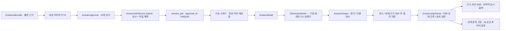

# 근거로 답변 받기 — 승인 후 별도로 전송

후속 [Claude 미검증 임시 출력](partial-answer.md), [선택적 Codex 스트리밍](codex-streaming.md), [선택 문맥 이어 질문](context-requests.md)을 추가했습니다. 최종 답변 저장 정책은 유지합니다. 0.1.5의 [강제 종료 복구](crash-recovery.md)는 중단 이력·소비된 승인 재사용 차단을 실제 JAR로 검사합니다.

## 이제 되는 것

저장한 근거를 확인하고 승인한 뒤 **실제 Codex/Claude CLI에 별도 요청**을 보낼 수 있습니다.
답변을 로컬 작업 기록으로 남기며 중단·재조회할 수 있습니다. 지식 문서를 만들거나 게시하지 않습니다.
최종 답변은 **검사 완료 후 한 번에 확정 표시**합니다. [작업 관측 SSE API](answer-events.md)와 [화면 연결](answer-events-ui.md)은 최종 답변과 미검증 임시 출력을 구분합니다. 실제 외부 서비스 호환성 검증은 별도입니다.

1. 근거 묶음에서 자료와 요청 미리보기를 읽습니다.
2. **승인 상태 확인 → 동의 → 이 요청 승인 저장**을 누릅니다. 여기까지는 외부 호출이 없습니다.
3. **승인한 요청을 지금 외부 AI에 전송합니다**를 체크합니다.
4. **승인한 요청 전송·답변 시작**을 누릅니다. 이때부터 외부 전송될 수 있습니다.
5. 기다리면 답변과 `[R1]`, `[R2/E1]` 같은 인용 번호가 나옵니다. 위에 표시된 근거와 비교하세요.
6. 중단하려면 **답변 중단**을 누릅니다. 다시 열었다면 **답변 작업 조회·새로고침**으로 찾습니다.

Codex/Claude 로그인과 사용 한도가 필요합니다. 현재 코딩 대화 세션을 사용하는 기능이 아닙니다.
CLI 기본값은 실행 모델을 확정하지 못하므로 필요한 경우 모델 ID를 직접 선택하세요.
답변은 생성 당시 근거 기준의 AI 결과이며, 인용 번호 존재 검사는 사실 검증이 아닙니다.

## 중복 전송과 중단 규칙

- 승인 ID 하나는 **작업 하나에만** 사용할 수 있습니다. 작업 생성과 승인 소비를 같은 DB 트랜잭션으로 처리합니다.
- 같은 작업 ID·묶음·승인·요청 해시로 재요청하면 이전 작업을 반환합니다. 실패·취소·재시작 중단이어도 자동 재전송하지 않습니다.
- 새 작업에는 새 승인이 필요합니다. 다른 요청에 같은 ID를 재사용하면 409입니다.
- 제출 때와 실제 CLI 호출 직전에 근거·모델·해시·승인 유효 기간을 다시 검사합니다.
- 실행 중에는 DB 연결을 잡아두지 않습니다. 결과 저장 전에도 근거와 승인 철회/교체를 확인합니다.
- 취소 후 늦게 도착한 결과는 버립니다. 승인 철회·교체와 묶음/Workspace 삭제는 500ms 간격 검사로 실행 중단을 요청합니다.
- 이미 외부로 보낸 자료를 회수할 수는 없습니다. 최종 검사와 프로세스 시작 사이의 극히 짧은 경합도 원격 전송 취소를 보장하지 않습니다.
- 화면 닫기·Workspace 전환은 **관측 연결만** 멈춥니다. 작업은 계속되므로 중단 버튼을 명시적으로 누르세요. [현재 SSE 정책](answer-events-ui.md).
- 재시작 시 진행 중 작업은 `INTERRUPTED`가 됩니다. 자동 재실행하지 않습니다.
- 앱당 답변 작업은 한 개씩 실행합니다. 기존 지식 초안 생성 작업과의 전역 동시 실행 제한은 아직 통합하지 않았습니다.

## 모델링과 실제 코드

| 코드 | 실제 책임 |
|---|---|
| `conversation/domain/AnswerJob` | ID·Workspace·묶음·승인·모델·해시·상태·답변·오류·시각 |
| `AnswerJobStore` / `JdbcAnswerJobStore` | 영속 작업, 승인 ID 유일성, 활성 상태에서만 결과 갱신 |
| `AnswerJobService` | 예약·멱등·단일 실행·재검증·취소·늦은 결과 차단 |
| `AnswerModel` / `CliAnswerModel` | 검색과 분리된 답변 포트. 기존 CuratorModel의 CLI 전송 어댑터만 재사용 |
| `AnswerOutput` | 구조화 JSON의 claims와 실제 허용된 R/E 번호 확인, 일반 텍스트 답변 구성 |
| `AnswerJobController` | 작업 시작/조회/취소 API |
| `AnswerJobsPanel.tsx` | 추가 전송 확인, SSE 상태 관측, 재조회·중단, HTML 실행 없는 답변 표시 |

기존 CLI 실행기의 임시 디렉터리, 도구/MCP/훅 제한, 출력 크기 제한, 120초 타임아웃, 프로세스/관측한 자식 프로세스 종료를 재사용합니다.
명령줄 인자는 서버가 구성하고 요청문은 stdin으로 전달합니다. 실제 실행 모델·완전한 OS 프로세스 감독은 아직 보장하지 않습니다.
이 단계는 모델별 실시간 스트림 프로토콜을 새로 구현한 것이 아닙니다.

## 출력과 저장 정책

요청 전문에 `title`, `claims[{text,evidenceIds}]` JSON 형식을 안내했습니다. 따라서 미리보기 목적은 `ANSWER_PREVIEW_V2`입니다.
구버전 미리보기/승인 해시는 새 요청과 맞지 않아 새로 확인해야 합니다. 예전 기록을 지우지는 않습니다.
title은 답변에 쓰지 않습니다. claims가 비면 고정 안내 **제공된 근거로 답변할 수 없습니다**를 표시합니다.
최대 30개 주장, 주장당 2,000 UTF-16자, 결과 20,000자, 원시 응답 65,536자 제한입니다. 토큰 예산은 아닙니다.
모든 주장은 허용된 인용이 필요합니다. 원본은 R 번호, 게시 문서는 원문 출처 R/E 번호만 허용합니다.
잘못된 형식·없는 인용·인용 없는 주장은 실패 처리하며 원시 출력을 저장/로그하지 않습니다.
프롬프트 주입이나 의미적 환각 방어가 검증됐다는 뜻은 아닙니다. 실제 모델 평가가 별도로 필요합니다.

SQLite **v15→v16**은 `answer_job`만 추가합니다. Workspace·묶음 FK cascade이며 승인 ID는 UNIQUE입니다.
승인 행은 교체될 수 있으므로 작업의 승인 ID는 변경 가능한 승인 행의 FK가 아닌 당시 식별자입니다.
원본만 삭제하면 과거 답변·묶음은 남습니다. 묶음 또는 Workspace를 삭제하면 해당 작업 기록도 삭제됩니다.
Workspace당 100개 작업 한도이며 개별 작업 삭제 API는 없습니다. 불필요한 묶음 삭제 전에 보존 필요성을 확인하세요.
암호화 저장·감사 로그·무제한 대화 이력이 아닙니다.

## API

기본 접두사: `/api/workspaces/{workspaceId}`. 변경 요청은 `X-Forge-Client: 1`이 필요합니다.

| 메서드 | 경로 | 성공 |
|---|---|---|
| POST | `/evidence-bundles/{bundleId}/answer-jobs` | 202 AnswerJob, 재시도는 기존 상태 |
| GET | `/answer-jobs` | 200 Workspace의 최근 순 전체 작업 (최대 100개) |
| GET | `/answer-jobs/{id}` | 200 AnswerJob |
| POST | `/answer-jobs/{id}/cancel` | 200 AnswerJob, 보통 CANCELLING 또는 이미 끝난 상태 |

시작 JSON: `{"requestId":"클라이언트-생성-UUID","approvalId":"승인-ID","digest":"승인된-요청-해시","approved":true}`.
requestId는 영문·숫자·하이픈·밑줄 16~64자입니다. 사용자는 승인 저장과 별도로 실제 전송을 확인해야 합니다.
AnswerJob은 `{id,workspaceId,bundleId,approvalId,provider,requestedModel,digest,status,answer,error,createdAt,updatedAt}`입니다.
상태는 `QUEUED → RUNNING → SUCCEEDED/FAILED`, 취소는 `CANCELLING → CANCELLED`, 재시작 중단은 `INTERRUPTED`입니다.
기존 승인 조회에는 `CONSUMED`가 추가됐습니다. 이미 사용한 승인이며 과거 답변의 최신성을 나타내지 않습니다.

400: 작업 ID/입력 오류. 403: 명시적 전송 확인·승인 없음·로컬 요청 방어 위반.
404: 없는/다른 Workspace의 묶음·작업. 409: 소비한/만료된/교체된 승인, 근거 변경, 다른 활성 작업, 보관 한도, ID 충돌.
503: 종료 중·실행기 시작 실패. 실행 후 오류는 작업의 FAILED/error로 조회합니다.

## 검증 결과

외부 모델 대신 Mockito 및 **명시적 fake CLI fixture**로 검증합니다. 실제 회사 자료를 사용하지 않습니다.
새 테스트는 소비·재시도·변경/철회/만료 차단·중단·늦은 결과·격리·삭제·잘못된 인용·답변 유보를 검사합니다.
첫 테스트의 fixture timeout은 Mockito 재설정 시 이전 대기 응답이 호출된 문제였습니다. `doReturn/doAnswer`로 고쳤습니다.
최종 실행 결과 (2026-10-21, macOS Intel / Java 21):

| 실행 | 결과 |
|---|---|
| `bash scripts/maven.sh clean verify` | 225개 통과, 실제 CLI opt-in 1개 skip, UI 포함 실행 JAR 빌드 성공 |
| `npm --prefix frontend test -- --maxWorkers=2` | UI 118개 통과 |
| `npm --prefix frontend run build` | TypeScript/Vite 성공 |
| `node scripts/smoke.mjs` | 승인 소비 → fake CLI 인용 답변 → 동일 ID 재요청 → 재시작 후 답변/멱등 복원 → 원본 삭제 후 과거 답변 보존 확인 |
| 실제 브라우저 | 미리보기 → 승인 → 별도 전송 확인 → fake CLI 답변/인용 표시 → 새 승인·작업 → 중단됨 확인 |

새 백엔드 작업/출력 테스트 13개, v15→v16 마이그레이션 1개, UI 6개를 추가했습니다.
실제 외부 Codex/Claude 모델 호출·품질 검증은 이번에 하지 않았습니다. 브라우저도 지연시킨 fake CLI만 실행했습니다.
시작 5,711ms, 재시작 5,942ms, 가상 파일 100개 검색 30회 p95 12.78ms. [원시 측정](performance-phase3-foundation.json).
소규모 순차 로컬 검색 측정이며 실제 AI 응답 성능·대용량 동시 요청 성능이 아닙니다.

남음: 실제 CLI 서비스별 답변 품질 검증, 토큰 예산, 실제 토큰 스트림·대화 기록/연결 해제 시 생성 취소 정책, 검색 관계 확장, 선택적 자동 갱신, Mac 설치형.
