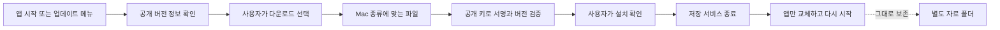

# 앱 업데이트

0.1.32 작업본은 앱 파일명과 식별자를 Dougle로 변경한다. 이전 이름의 앱에서 자동 교체하는 경로는 아직 승인하지 않았으며, 공개 업데이트 피드는0.1.16을 유지한다. 새 버전의 수동 DMG 설치·기존 자료 이전을 먼저 검증한다. 아래 일반 자동 업데이트 설명은 현재 최신 버전 제공을 보장하지 않는다.

0.1.17부터 앱 **왼쪽 아래**에 업데이트 버튼이 있습니다. 앱 시작 시와 실행 중 약 1시간마다 새 버전을 확인하고, 발견하면 **새 버전 업데이트 · 버전 번호**를 표시합니다. 자동 확인은 팝업이나 다운로드를 시작하지 않습니다. 버튼을 누른 뒤 다운로드·설치를 확인합니다.
Mac 상단 메뉴 **Dougle → 업데이트 확인…**도 유지합니다. 다운로드 진행률은 하단 버튼과 창 제목에 표시합니다.

0.1.2 이하에는 이 기능이 없으므로 최신 설치 파일을 한 번 직접 설치해야 합니다. 0.1.3 이상에서는 앱 안에서 업데이트합니다.
인터넷이 없거나 업데이트를 미루어도 기존 앱과 자료는 그대로 사용할 수 있습니다.

## 업데이트하는 순서

1. 앱이 버전 정보만 확인합니다. 원본 자료나 AI 대화는 보내지 않습니다.
2. **다운로드**를 선택하면 Mac 종류에 맞는 업데이트를 받습니다. 진행률은 창 제목에 표시합니다.
3. 서명과 버전을 확인합니다. 파일이 바뀌었거나 버전이 맞지 않으면 설치하지 않습니다.
4. **설치 후 다시 시작**을 누르면 저장 서비스를 종료하고 앱을 교체합니다. 자료 폴더는 별도로 보존합니다.

Apple 공증과 업데이트 서명은 별개입니다. 현재 Apple 공증은 제외합니다. 쓰기 권한이 필요한 설치 위치에서는 macOS가 권한을 요청할 수 있습니다.

## 개발·배포

공식 [Tauri Updater](https://v2.tauri.app/plugin/updater/)를 Rust에서만 사용합니다. 하단 UI에는 인자 없는 상태 조회·수동 확인 명령만 허용합니다. 두 명령은 main 창·현재 로컬 서비스 origin으로 제한하며 임의 URL이나 설치 경로를 받지 않습니다.
공개 키를 앱에 고정하고 `requireSignedVersion`을 사용합니다. 앱은 프로젝트의 GitHub HTTPS 패키지만 받습니다.
기본 버전 비교를 유지하여 구버전 자동 설치를 막습니다. [API 계약](https://docs.rs/tauri-plugin-updater/2.14.0/tauri_plugin_updater/struct.Update.html).

- 개인 서명 키: `~/.config/dougle/updater.key`. 기존 키의 디렉토리 이름만 이전했으며 키 자체를 새로 생성하지 않았습니다. 현재 Mac에만 저장하며 Git이나 설치 파일에 넣지 않습니다.
- 이 키는 별도 안전한 위치에 백업해야 합니다. 다른 빌드 PC에서는 같은 키를 안전하게 옮기고 `FORGE_UPDATER_PRIVATE_KEY`로 경로를 지정합니다. 기존 키를 지우거나 새 키로 덮어쓰지 마세요.
- `scripts/package-macos.sh`는 DMG·서명된 `.app.tar.gz`·`.sig`·체크섬을 만들고 공개 키와 서명된 버전을 재검증합니다.
- 두 CPU의 빌드 후 `node scripts/update-manifest.mjs`로 `release/latest.json`을 만듭니다.
- `bash scripts/verify-macos-update.sh release/Dougle_버전_CPU.app.tar.gz 버전 CPU`로 서명과 버전, 압축 해제한 앱의 CPU·ad-hoc 서명을 검사합니다. CPU는 `x86_64` 또는 `arm64`입니다.
- 검증된 두 CPU 설치 파일·서명·체크섬과 **`release/latest.json`**을 같은 새 GitHub Release에 올립니다. 버전 번호는 이전보다 높아야 합니다. Draft를 해제하면 0.1.17 이상 앱이 GitHub 공개 릴리스 목록에서 발견합니다. 메모만 올리거나 DMG만 올린 릴리스는 자동 설치 대상으로 표시하지 않습니다.
- GitHub 최근 공개 릴리스 20개 중 정확한 프로젝트 경로의 `latest.json`이 있는 가장 높은 숫자 버전을 고릅니다. preview 릴리스도 포함하고 draft·외부 자산 주소는 제외합니다. API 연결/제한 실패 시 기존 `updates/preview.json` 피드로 확인합니다. 실제 패키지는 다운로드 후 기존 공개 키·서명된 버전·CPU·허용 경로를 검증합니다.
- 구버전 앱 지원을 위해 공개 후 `node scripts/update-manifest.mjs --publish`도 실행합니다. 이 명령은 공개 자산의 해시/서명을 확인한 뒤 `updates/preview.json`을 만듭니다.
- 마지막으로 공개 피드 파일을 커밋·푸시합니다. 아직 공개되지 않은 다운로드를 앱에 알리지 않도록 이 순서를 지킵니다. GitHub Actions는 사용하지 않습니다.

일반 웹 브라우저에서는 설치 업데이트 버튼을 표시하지 않습니다. `node scripts/updater-smoke.mjs`는 임시 키·가상 앱·로컬 서버로 설치와 변조 차단을 검사하며, 실제 설치 앱을 교체하지 않습니다.

공개된 실제 앱의 0.1.6 → 0.1.7 교체·서명·재실행도 별도 임시 설치본으로 확인했습니다. 사용자 앱을 교체하거나 업데이트 메뉴를 클릭한 검사는 아닙니다. [쉽게 보는 검사 범위](published-update-check.md).
