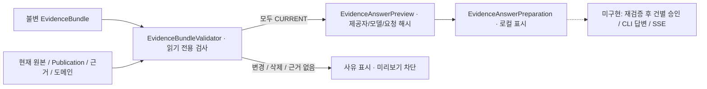

# 근거 재검증과 답변 요청 미리보기

## 쉽게 말하면

저장한 근거가 아직 같은 자료인지 확인한 뒤, AI에게 보낼 글을 **미리 보기만** 합니다.
이번 기능은 CLI 실행·외부 전송·승인·답변 생성을 하지 않습니다.

1. 검색창의 **근거 묶음**에서 저장한 묶음을 엽니다.
2. **근거 상태 다시 확인**으로 변경·삭제된 자료를 확인합니다.
3. Codex/Claude와 모델을 선택하고 **요청 미리보기 만들기 (전송 안 함)**를 누릅니다.
4. 요청문·문자 수·해시를 확인합니다. 문제가 있으면 자료를 확인하고 새 묶음을 만드세요.

창을 열기만 해서는 검사를 실행하지 않습니다. 미리보기 생성은 항상 다시 검사합니다.
제공자/모델을 바꾸거나 요청이 실패하면 이전 성공 결과를 지웁니다.

## 무엇을 검사하나요?

| 대상 | 통과 조건 |
|---|---|
| 원본 | 현재 자료 존재, 이름·원본 바이트·추출 텍스트 해시 일치, 분석 가능, 선택 도메인에 포함 |
| Source 원본 | Source ID+경로로 찾음. 동기화로 파일 ID/revision만 바뀌고 내용이 같으면 통과 |
| 게시 지식 | 같은 버전이 아직 게시 중이고 본문·제목·근거가 같으며 모든 출처가 CURRENT |
| 전체 묶음 | 자료가 하나 이상이고 모든 항목이 통과해야 함. 일부만 골라 자동 전송하지 않음 |

새 미게시 초안은 기존 게시본을 무효화하지 않습니다. 다른 버전을 게시하면 차단합니다.
검사는 **마지막 로컬 수집본 기준**입니다. 원격 사이트 최신성이나 사실성·답변 충분성을 보장하지 않습니다.
결과에 검사 시각을 표시하며, 검사 직후 자료가 다시 바뀔 수 있습니다.
저장된 묶음은 수정하지 않습니다. 재검증 결과/미리보기는 영속 저장하지 않으며 DB는 v14 그대로입니다.

## 실제 코드와 설계 대조

- `search/domain/BundleValidation`: 전체 상태와 R별 상태, E별 출처 상태.
- `search/application/EvidenceBundleValidator`: 기존 KnowledgeStore·PublicationStore·SearchCatalog 포트를 읽기 전용 트랜잭션에서 조회합니다. 검색 색인 잠금·재수집·재분석은 하지 않습니다.
- `search/application/EvidenceAnswerPreview`: 재검증 후 질문·근거를 JSON으로 만들고 요청 해시를 계산합니다. CuratorSettings의 모델 선택 규칙만 재사용하며 CuratorModel은 호출하지 않습니다.
- `search/adapter/EvidenceBundleController`: Workspace 범위의 검사/미리보기 HTTP 경로.
- `frontend/src/EvidenceAnswerPreparation.tsx`: 검사·미리보기·오류 표시, 조건 변경 시 초기화, 닫을 때 대기 취소.

## 요청 내용과 안전 경계

요청문에는 질문, R 번호·종류·제목·인용문, E 번호·출처 인용문만 넣습니다.
내부 Workspace/파일/카드 ID, 경로, Source 위치, 제외 후보 메타데이터는 넣지 않습니다.
다만 인용문 자체에 민감한 정보가 있다면 그대로 포함되므로 실제 전송 전 사람이 확인해야 합니다.
JSON 값은 지시가 아닌 자료로 취급하고, 도구/파일/네트워크 사용 금지와 근거 부족 시 답변 유보를 지시합니다.
이 지시문만으로 프롬프트 주입 방어가 검증된 것은 아닙니다. 실제 모델은 실행하지 않았습니다.

전체 요청은 JSON 이스케이프·질문·제목까지 **20,000 UTF-16 코드 단위**로 제한합니다.
묶음의 인용문 12,000자 제한과 다르며 실제 토큰 예산은 아닙니다. 초과하면 자르지 않고 413을 반환합니다.
SHA-256은 목적 `ANSWER_PREVIEW_V1`, Workspace, 묶음 ID/해시, 제공자, 해석된 모델, 요청문을 묶습니다.
검사 시각은 제외하므로 같은 입력과 자료는 재시작 후에도 같은 해시입니다.
**해시는 서명이나 전송 승인이 아닙니다.** 후속 전송 기능에서 재검증·해시 비교·명시적 승인을 다시 구현해야 합니다.
CLI를 사용하더라도 현재 코딩 대화 세션 공유가 아니라 별도의 요청입니다.

## API

공통 경로: `/api/workspaces/{workspaceId}/evidence-bundles/{id}`.

| 요청 | 결과 |
|---|---|
| `GET /validation` | 200 `{bundleId,digest,checkedAt,status,eligible,items}` |
| `POST /answer-preview` | 200 `{bundleId,bundleDigest,provider,requestedModel,digest,prompt,characters,maxCharacters,validation}` |

POST JSON: `{"provider":"CODEX","requestedModel":null}`. 제공자는 `CODEX` 또는 `CLAUDE`입니다.
모델 null/생략은 서버 설정, 빈 문자열은 CLI 기본값, 문자열은 명시적 모델입니다.
POST에는 `X-Forge-Client: 1`이 필요합니다. 모델은 기존 식별자 규칙과 128자 제한을 따릅니다.

전체 상태는 `CURRENT`, `BLOCKED`, `NO_EVIDENCE`입니다. HTTP 200 검사 결과가 항상 통과라는 뜻은 아닙니다.
항목은 `CURRENT`, `MISSING`, `ORIGIN_CHANGED`, `ANALYSIS_UNAVAILABLE`, `CONTENT_CHANGED`,
`TEXT_CHANGED`, `SCOPE_CHANGED`, `PUBLICATION_CHANGED`, `SUPPORT_CHANGED`, `INVALID_BUNDLE`을 반환합니다.
출처는 `CURRENT`, `STALE`, `MISSING`, `SUPPORT_CHANGED`입니다.
항목 응답은 `{label,status,currentEntryId,currentSourceRevision,supports}`이며 출처는 `{label,status}`입니다.

- 400: 제공자/모델 형식 오류
- 403: 변경 헤더 누락 또는 기존 로컬 요청 방어 위반
- 404: 다른 Workspace 또는 없는 묶음
- 409: 근거 없음/변경으로 미리보기 불가
- 413: 전체 요청 길이 초과

## 검증과 다음 단계

새 백엔드 테스트 10개는 변경·삭제·게시 교체·도메인 변경·동기화 ID 교체·모델 바인딩·용량·격리를 검증합니다.
모든 테스트에서 CuratorModel 미호출을 확인합니다. UI 테스트 6개는 명시적 실행·조건 초기화·오류·취소를 검증합니다.
UI 테스트 첫 실행의 hook timeout은 mock을 반환해 정리 함수로 실행되던 beforeEach를 반환 없는 함수로 수정했습니다.
전체 실행 결과(2026-10-21, macOS Intel/Java 21):

| 실행 | 결과 |
|---|---|
| `bash scripts/maven.sh clean verify` | 201개 통과, 실제 CLI opt-in 1개 skip, 실행 JAR 빌드 성공 |
| `npm --prefix frontend test -- --maxWorkers=2` | 106개 통과 |
| `npm --prefix frontend run build` | TypeScript/Vite 성공 |
| `node scripts/smoke.mjs` | 재시작 후 원본/게시 묶음 요청 해시 동일, Source 삭제 후 검사 차단·미리보기 409 확인 |
| 실제 브라우저 | 묶음 저장 → 재검증 → Codex 미리보기 → Claude/직접 모델 선택 → 요청문 확인 → 원본 삭제 후 차단·이전 미리보기 제거 확인 |

실제 AI·회사 자료를 사용하지 않았습니다. 기존 생성 회귀 smoke는 fake CLI입니다.
시작 5,876ms, 재시작 6,090ms, 가상 원본 100개 검색 30회 p95 13.19ms.
[원시 측정](performance-phase3-foundation.json)은 소규모 순차 검색 결과이며 실제 AI/대용량/동시 요청 성능이 아닙니다.

다음: 건별 승인과 전송 직전 재검증, 실제 토큰 예산, 별도 답변 작업·취소, 근거 선표시 SSE, Mac 패키징.
