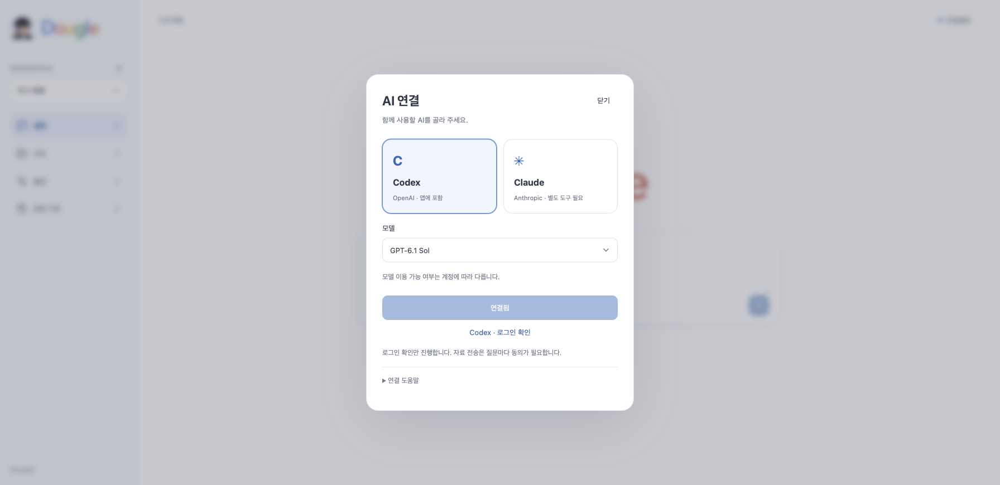
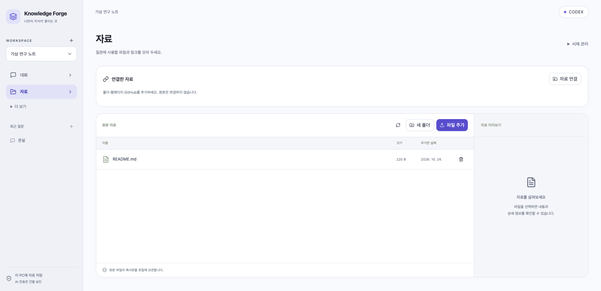
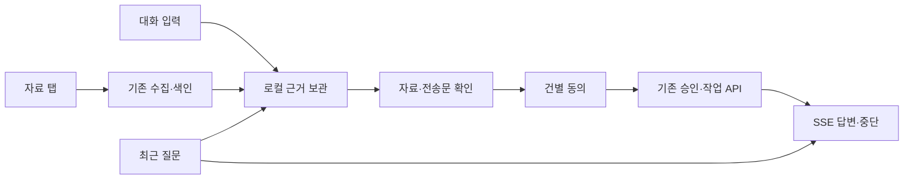
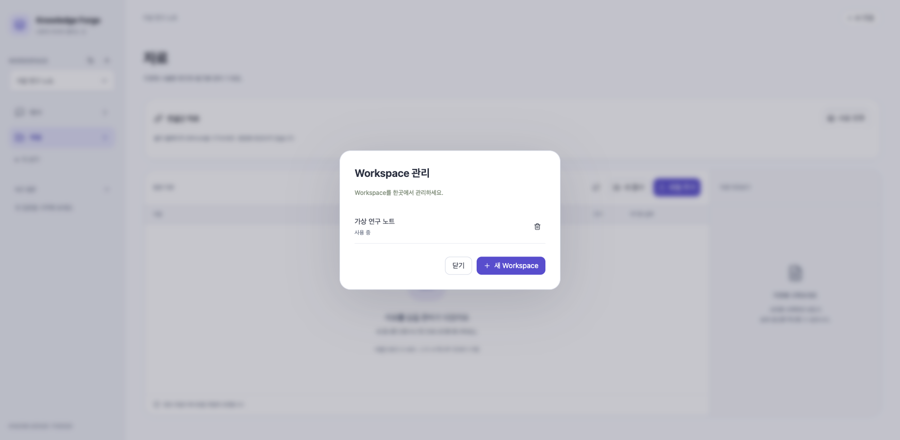

# 질문부터 시작하는 화면

## 사용법

1. **자료** 탭에 파일·폴더·링크를 넣습니다.
2. 오른쪽 위 **AI 연결**에서 Codex 또는 Claude와 모델을 고르고 **연결**을 누릅니다. 처음에는 브라우저 로그인이 필요할 수 있습니다.
3. 연결되면 오른쪽 위에 **CODEX / CLAUDE**가 표시됩니다. **대화**에서 질문을 입력하세요.
4. 참고 자료를 확인하고 **이 자료로 답변 준비**를 누릅니다. 전송에 동의하면 답변을 받습니다.
5. 왼쪽 **최근 질문**에서 지난 답변을 다시 읽습니다. **+**는 새 질문입니다.

연결 전에는 질문 입력·전송이 잠깁니다. 자료 추가와 이전 답변 열람은 그대로 사용할 수 있습니다. 창을 닫거나 화면을 옮겨도 접수된 생성 작업은 계속됩니다. 멈추려면 **답변 중단**을 누르세요.

## 바뀐 모습

누런 배경과 각진 테두리 대신 쿨 화이트·차콜·인디고와 둥근 모서리를 사용합니다. 픽셀 감성은 안경 없는 꼬마 탐정 아이콘에 남겼습니다. 자료 검색과 지식 문서 편집 화면은 기본 사용 경로에서 뺐습니다. 검색은 원본에서 추출한 내부 색인을 사용하며 기존 자료와 문서는 삭제하지 않습니다. [내부 검색 원리](internal-search.md).

질문 삭제는 해당 질문의 **질문 관리**에서 확인 후 진행합니다. 원본 자료는 유지됩니다. 여러 답변 작업과 기존 대화 정리 기능은 **더 보기 → 답변 관리**에서 볼 수 있습니다.

## 모델 선택

화면은 가상 자료와 가상 인증으로 촬영했습니다.

기본값 외에 모델별 선택 예시와 직접 입력을 제공합니다. 계정의 실시간 모델 목록을 조회한 것은 아니며 로그인 확인이 모든 모델의 이용 가능성을 보장하지 않습니다. 사용 권한·요금·한도는 제공자와 계정에 따릅니다.

- Codex 예시는 공식 문서에 나온 GPT-6.1 Sol·GPT-6 Luna·GPT-6 Astra 식별자를 사용합니다. [OpenAI 공식 모델 안내](https://learn.chatgpt.com/docs/models).
- Claude 예시는 Sonnet·Opus·Haiku 별칭입니다. 별칭의 실제 버전은 제공자가 선택합니다. [Claude Code 공식 모델 설정](https://code.claude.com/docs/en/model-config).

모델을 바꾸면 연결 상태를 다시 확인합니다. 선택은 다음 질문과 새 초안에 적용되며, 이미 접수된 작업의 모델은 바뀌지 않습니다. Claude는 호환 실행 도구가 별도로 필요합니다.

## 구현과 대조

| 화면/규칙 | 실제 코드 | 검사 |
|---|---|---|
| 대화 기본 화면·자료 탭·CODEX 표시 | `App.tsx` | `App.test.tsx`, 실제 브라우저/설치본 검사 |
| 최근 질문·이력 열람·근거 우선 | `ChatPanel.tsx` | `ChatPanel.test.tsx` |
| 연결 전 질문 차단·한글 조합 Enter 보호 | `ChatPanel.tsx` | `ChatPanel.test.tsx` |
| 모델·연결·성공 버튼 비활성화 | `ProviderConnectionPanel.tsx`, `modelPreference.ts` | `ProviderConnectionPanel.test.tsx` |
| 모델 지정·전송 동의·충돌 검사 | `QuickAnswerPanel.tsx` | `ChatPanel.test.tsx`, `QuickAnswerPanel.test.tsx` |
| 저장된 답변·SSE·중단 | `AnswerJobsPanel.tsx` | `AnswerJobsPanel.test.tsx` |

DB v21과 백엔드 API는 그대로입니다. `ChatPanel`은 전체 분류의 원본에서만 근거를 찾고(`includeKnowledge=false`) `QuickAnswerPanel`은 선택한 모델을 기존 미리보기→승인→작업 계약에 전달합니다. 질문 시 원본을 다시 수집·분석하지 않습니다. 이력 열람은 GET만 사용하며 새 AI 요청을 만들지 않습니다. 기본 입력은 **독립적인 새 질문**이며 지난 대화 전체를 자동 전송하지 않습니다. 예전 편집형 지식이 포함된 미완료 질문은 원본으로 다시 검색합니다.

[실제 검증·배포 상태](release-0.1.11-report.md)

## 간결한 문구와 Workspace 관리

메인 제목은 **무엇이 궁금하세요?**, 입력 안내는 **궁금한 점을 물어보세요**입니다. 왼쪽 하단은 설명 대신 작은 브랜드 표시만 둡니다. 전송 동의는 실제 AI 요청 단계에서 받습니다.

Workspace 선택 위의 **관리 아이콘**에서 전체 목록을 확인하고 삭제할 수 있습니다. 삭제할 Workspace 이름과 경고를 확인한 뒤 한 번 더 삭제를 눌러야 합니다. 취소하면 자료는 그대로입니다. 사용하지 않는 Workspace를 삭제해도 현재 선택은 유지합니다. 자료 화면에는 Workspace 삭제 버튼을 두지 않습니다.

구현: `App.tsx`의 관리 대화상자와 ID가 고정된 삭제 대상 → 기존 Workspace 삭제 API. `App.test.tsx`는 활성/비활성 Workspace 삭제 대상·취소·선택 보존을 검사합니다. DB/API 변경은 없습니다.
