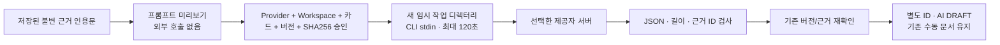

# 로그인된 CLI AI — 구현·사용·인수인계

**아래는 초기 개발 이력입니다.** 현재 설치본은 0.1.6/DB v21이며, 간편 연결은 [제공자 연결](provider-connection.md), 실제 외부 호출의 최신 결과는 [필수 검증](essential-verification.md)을 따릅니다. 2026-10-24 동봉 Codex의 실제 초안·근거 답변 검사를 통과했습니다.

후속 변경: [생성 작업 상태·취소·멱등·재시작 복구](generation-jobs.md)를 구현했습니다. 아래 초기 구현의
동기 API 제약은 호환 경로에만 해당하며 새 UI는 비동기 작업 API를 사용합니다. 현재 DB는 v4입니다.
최신 모델 고정·승인 바인딩·설치 진단과 검증 결과는 [모델 설정](cli-settings.md)에 있습니다.
이후 [건별 모델 선택](model-selection.md)에서 선택 UI·요청 모델 이력과 v5 마이그레이션을 추가했습니다.

2026-10-21. 사용자 요청으로 Ollama 기본 계획을 **Codex / Claude Code CLI** 방식으로 변경했습니다.
앱에 이 코딩 세션의 모델을 내장하는 것이 아닙니다. 같은 OS 사용자의 기존 CLI 로그인을 사용해
새 비대화형 요청을 실행합니다. 현재 대화 내용은 전송/이어받기하지 않습니다.
로그인 파일을 앱이 읽거나 토큰을 추출하지 않습니다. CLI가 자체 인증을 처리합니다.
계정의 사용 한도·요금·조직 정책이 적용되며 무료/무제한 사용을 보장하지 않습니다.

## 사용

1. 앱을 실행하는 사용자 계정으로 Codex 또는 Claude Code를 설치·로그인합니다.
   확인한 CLI 버전은 Codex 0.163.0, Claude Code 2.1.31입니다. 다른 버전 호환성은 별도 확인하세요.
2. `bash scripts/build.sh`, `bash scripts/run.sh`로 앱을 실행합니다.
3. 가상 파일 업로드 → 분석 영역에서 근거 행을 선택해 수동 초안 작성 → 지식 문서에서 열기.
4. AI 제공자 선택 → **전송 내용 미리보기** → 내용 검토 → 전송 동의 → **별도 AI 초안 생성**.
5. 새 카드의 `AI 생성 초안 / DRAFT`와 `[E1]` 근거를 확인합니다. 기존 수동 문서는 그대로 남습니다.

CLI는 앱 프로세스의 PATH에서 찾습니다. GUI에서 PATH가 다르면 서버 설정
`forge.ai.codex-command` / `forge.ai.claude-command`에 신뢰하는 실행 파일의 절대 경로를 지정합니다.
Spring 환경 변수는 `FORGE_AI_CODEXCOMMAND`, `FORGE_AI_CLAUDECOMMAND`입니다.
HTTP 요청으로 명령 경로나 임의 명령 인자를 받지 않습니다. 쉘 문자열 실행도 하지 않습니다.
사용자 모델 설정 파일은 제외합니다. 앱 시작 설정으로 모델을 명시할 수 있으며,
미지정 시 CLI 기본 선택을 사용합니다. 실제 실행 모델 ID는 아직 확인하지 않습니다.
미설치/인증 실패/비호환 옵션/한도 초과는 오류로 끝내며 다른 Provider로 자동 전송하지 않습니다.

## 실제 데이터 흐름



- `CuratorService` → `CuratorModel` 포트 → `CliCuratorModel` 어댑터.
- 외부 I/O는 트랜잭션 밖입니다. 저장 직전에 기존 카드/근거 상태를 다시 비교하고 변경 시 409.
- 프롬프트 최대 16,000자. 선택 인용문만 넣으며 경로·파일명·원본 전체·기존 Markdown은 넣지 않습니다.
- 출력 1~20개 주장과 유효한 근거 ID를 검사합니다. 형식 검사는 의미적 사실 검증이 아닙니다.
- 새 버전은 DRAFT, manuallyEdited=false. 사람이 편집하면 새 버전은 true. 지식 테이블은 v3 기반을 재사용하고 현재 DB는 v4입니다.
- Provider/기반 카드 ID/버전은 서버가 Markdown 머리말에 기록합니다. v4 작업 이력에는 Provider/기반 카드/버전/digest도 저장하지만 실제 모델 ID/CLI 버전은 아직 없습니다.

## 보안 및 운영 경계

- 선택 근거가 **외부 서버에 전송**됩니다. 회사 자료는 조직의 외부 AI 정책을 먼저 확인하세요.
- stdin으로 전달하여 명령행 인자에 자료가 남지 않게 합니다. 임시 디렉터리에 원본 파일은 복사하지 않습니다.
- Codex: 사용자 config 제외, ephemeral, read-only, 승인 요구 작업 거부, 웹 검색/쉘/앱/플러그인/
  훅/다중 에이전트/브라우저/컴퓨터/이미지/코드 도구 비활성화, 프로젝트 문서·호스트 스킬 검색 제한.
- Claude: 내장 도구 빈 목록, MCP 차단, 사용자/프로젝트 설정 제외, 훅·스킬·Chrome·세션 저장 비활성화.
- CLI는 신뢰하는 설치 프로그램과 관리 정책을 전제로 합니다. 이 옵션들은 별도 OS 보안 컨테이너나
  모든 CLI 버전의 무정보 유출 보장이 아닙니다. 기업 관리 설정/CLI 자체 진단·보존 정책은 별도 검토해야 합니다.
- 앱이 상속하는 환경 변수는 HOME/PATH/OS·locale/CODEX_HOME 등 허용 목록으로 제한합니다.
  API 키/외부 endpoint/사용자 hook 환경 변수는 전달하지 않습니다. CLI 자체 로그인 저장소는 CLI가 접근합니다.
- stdout/stderr 각각 256 KiB, Codex 결과 파일 64 KiB 제한. 타임아웃/실패 시 프로세스 트리 종료 시도,
  임시 파일 정리. 앱의 응답/로그에 CLI stderr 원문은 남기지 않습니다.
  앱 강제 종료 시 임시 결과 파일이 남을 수 있으며 보존 기한/시작 시 정리 작업은 아직 없습니다.
- 동시 생성은 앱 전체 한 개. 자동 재시도 없음. HTTP 연결 종료/화면 이동은 서버 취소가 아닙니다.
  새 UI에서는 AI 생성 작업의 명시적 중단 버튼을 사용할 수 있습니다.
  종료된 화면의 작업이 완료되어 카드가 생길 수 있으므로 목록을 새로고침하세요.
- 원본의 악성 지시를 따르지 않도록 프롬프트와 도구 제한을 적용하지만 모델의 의미적 오류는 가능합니다.
  따라서 자동 검증/게시하지 않습니다.

## 테스트 재현

일반 테스트는 외부 AI를 호출하지 않습니다.

```bash
bash scripts/maven.sh test
cd frontend && npm test && npm run build
```

실제 호출은 명시적 opt-in이며 테스트에 포함된 **가상 관측 문장 한 개**만 전송합니다.
로그인/네트워크/계정 사용량이 필요합니다. 정상 테스트에서는 이 테스트가 skip됩니다.

```bash
FORGE_LIVE_CLI=CODEX bash scripts/maven.sh test -Dtest=CliCuratorLiveTest
FORGE_LIVE_CLI=CLAUDE bash scripts/maven.sh test -Dtest=CliCuratorLiveTest
```

## 실제 실행 결과

- Codex 0.163.0 실제 호출 성공: 가상 관측 근거 → 모델 JSON → 출력 검사 → 별도 SQLite AI DRAFT.
  생성/저장 구간 **8,362 ms**, 결과 Markdown 112자. 한 번의 작은 샘플이며 일반 성능 보장은 아닙니다.
- Claude Code 2.1.31 실제 호출 시도는 **인증 오류로 실패**했습니다. 안전한 오류 분류를 추가해
  재실행해도 인증 오류(503)를 확인했습니다. 다른 Provider로 fallback하거나 인증 파일을 읽지 않았습니다.
  어댑터의 가짜 프로세스 계약 테스트와 실제 모델 성공은 구별해야 합니다. Claude 실제 생성 성공은 미검증입니다.
- 최초 집중 테스트의 실패 2건은 테스트 fixture 문제(throw stub 재설정, 필수 boolean 누락)로 수정했습니다.
- 제한된 샌드박스의 전체 빌드에서는 Mockito JVM attach와 자식 프로세스 실행이 실패했습니다.
  승인된 환경에서 `bash scripts/maven.sh clean verify` 재실행 성공: **65개 통과, 0 실패/오류,
  live opt-in 테스트 1개 skip**, 실행 JAR 빌드 성공.
- `bash scripts/build.sh`의 프런트엔드 단계: **20개 테스트 통과**, TypeScript/Vite 번들 성공.
  이 명령 전체는 위 샌드박스 백엔드 제한으로 실패했으므로 frontend 성공과 backend 재실행을 구분합니다.
- 새 테스트: Curator 통합 10개(승인·내용 결합·별도 카드·근거·충돌·삭제·격리·크기·동시 호출),
  CLI 가짜 프로세스 7개(인자·stdin·응답·오류 비노출·인증·타임아웃·용량), UI 3개(승인·Provider 변경·오류).
- `node scripts/smoke.mjs` 실제 JAR 검사 성공: 재시작·지식/근거 보존·검색·삭제,
  CLI 미리보기와 승인 거부(403)/잘못된 digest(409). 이 검사는 외부 AI를 호출하지 않았습니다.
  [최신 측정 JSON](performance-phase3-foundation.json): 시작 17,493 ms, 재시작 20,482 ms,
  100개 가상 파일 검색 p95 29.60 ms, 목록 p95 10.95 ms. 작은 순차 테스트이며 SLA가 아닙니다.
- 이번 변경의 실제 브라우저 수동 QA는 실행하지 않았습니다. UI는 자동 테스트와 번들 빌드로 검증했습니다.

## 남은 일

- P3-2 전체 완료 아님: 시작 설정 모델 고정·설치 버전 UI·승인 digest 기록은 추가했습니다.
  건별 모델 선택/저장 UI, 로그인 상태, 모델 실제 ID·생성 당시 CLI 버전의 구조화된 영속 이력은 남았습니다.
- 생성 작업 ID·취소·멱등·미완료 상태 복구는 후속 구현 완료. OS 강제 종료 시 고아 프로세스/잔여 임시 파일 감독은 남음.
- CLI 버전별 계약/관리 설정 테스트, 분리된 OS 사용자 또는 강한 격리 환경 검증, Windows 실행 검증.
- P3-3 문장-근거 의미 검증과 사람 검토 → VERIFIED → PUBLISHED, 이전 게시본 유지.
- Phase 4 검색 근거 선표시 SSE/질문/답변 중단은 아직 미구현. 현재 어댑터를 스트리밍 구현으로 오인하지 마세요.
- Mac 설치 앱/서명·공증은 Phase 6. Ollama를 다시 필수 의존성으로 넣지 마세요.

## 확인한 공식 인터페이스

로컬 `codex exec --help`, `claude --help`와 함께
[Codex 비대화형 실행](https://learn.chatgpt.com/docs/non-interactive-mode),
[Codex 설정](https://learn.chatgpt.com/docs/config-file/config-reference),
[Claude Code CLI](https://code.claude.com/docs/en/cli-reference)를 확인했습니다.
로그인 재사용은 현재 채팅 재개가 아니며, 설치된 CLI가 해당 옵션을 지원하지 않으면 실패하도록 유지합니다.
