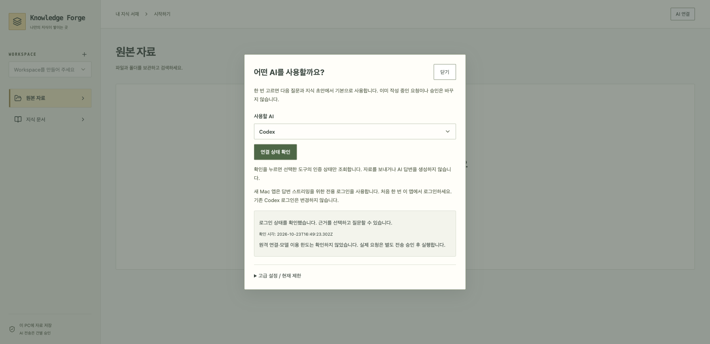

# Codex 로그인과 답변 스트리밍

0.1.7에서 Mac 앱의 전용 로그인을 연결합니다. 빌드·검증·배포 상태는 [검사 기록](release-0.1.7-report.md)을 따릅니다.

## 사용하는 방법



1. **AI 연결 → Codex → 연결 상태 확인**을 누릅니다.
2. 처음에는 로그인 동의를 체크하고 **브라우저에서 로그인**을 누릅니다.
3. 브라우저 로그인이 끝나면 같은 앱에서 지식 초안과 답변을 요청합니다.
4. 답변은 근거를 먼저 보여 주고, 생성 중 글과 검사된 최종 답변을 구분합니다.

터미널에서 폴더를 만들거나 환경 변수를 설정할 필요가 없습니다. 이전 버전에서 Codex를 사용했더라도 이 앱의 전용 로그인은 한 번 필요합니다. 기존 Codex/ChatGPT 로그인은 수정하거나 복사하지 않습니다. 로그인은 자료 전송 동의가 아니며, 외부 AI 요청은 기존처럼 건별로 승인합니다.

## 작동 원리

```text
Mac 실행기 → 앱 자료 폴더의 codex-profile 경로 지정
연결 확인 → 비어 있는 전용 폴더 준비 → CLI 인증 상태 조회
사용자 동의 → CLI 브라우저 로그인 → 같은 폴더 인증 재확인
지식 생성 → 같은 전용 인증으로 Codex exec
답변 생성 → 같은 전용 인증으로 App Server → SSE 중간/최종 출력
```

- `CodexProfile`은 폴더 700/인증 파일 600 이하 권한, 심볼릭 링크·일반 프로필·사용자 설정 차단을 검사합니다. 앱은 인증 파일 내용을 읽거나 API로 반환하지 않습니다.
- CLI가 생성하는 비공개 `log/codex-login.log`만 허용합니다. 로그 내용도 읽거나 반환하지 않습니다. 연결 확인은 느린 첫 실행을 위해 명령당 최대 30초 기다리며 중복 확인을 막습니다.
- 연결·로그인·초안은 동일한 `CODEX_HOME`과 파일 인증 저장 방식을 사용합니다. 다른 사용자 설정을 읽지 않도록 임시 HOME을 사용합니다.
- `CodexAppServer`의 안전 설정 검사·도구 실행 차단·프로세스 제한·중단 처리는 유지합니다. 실패 시 일반 실행으로 자동 재전송하지 않습니다.
- 프로필 설정은 전송 승인 digest의 실행 설정에 포함됩니다. 이전 일반 로그인으로 준비한 요청은 다시 미리보기·승인해야 합니다. SQLite v21은 그대로입니다.
- 개발 실행은 기존 기본 동작을 유지합니다. `forge.ai.codex-stream-home`을 지정하면 앱의 AI 연결 화면에서 해당 프로필 로그인도 할 수 있습니다.

인증 파일은 제공자 CLI가 관리합니다. 앱 자료 폴더 백업에는 `codex-profile/auth.json`이 포함될 수 있으므로 다른 사람·공개 저장소에 올리지 마세요. 비밀번호·인증 파일·토큰을 지원 문의에 첨부하지 않습니다.

## 검사 범위

`CodexProfileTest`는 가상 CLI로 새 폴더 → 로그인 동의 → 인증 재확인 → 초안 → 스트리밍을 연결하고, 기존 인증을 복사하지 않음을 확인합니다. 일반 프로필/설정/링크 거절과 승인 digest 변경도 검사합니다. 기존 `CodexAppServerTest`의 중간 출력·취소·도구/설정 거절 검사는 유지합니다.

공식 계약: [Codex 인증 저장](https://learn.chatgpt.com/docs/auth), [App Server](https://learn.chatgpt.com/docs/app-server). 실제 계정 검증과 가상 CLI 검증은 [배포 기록](release-0.1.7-report.md)에서 구분합니다.
