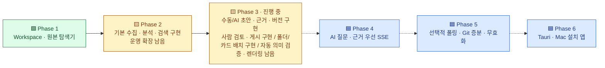
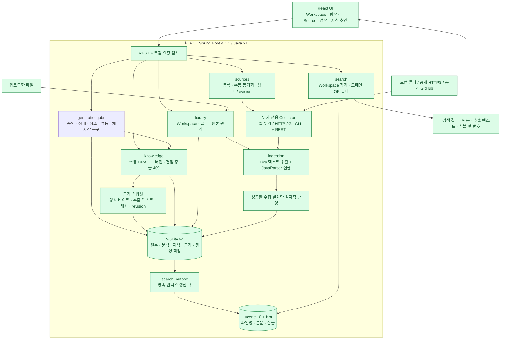
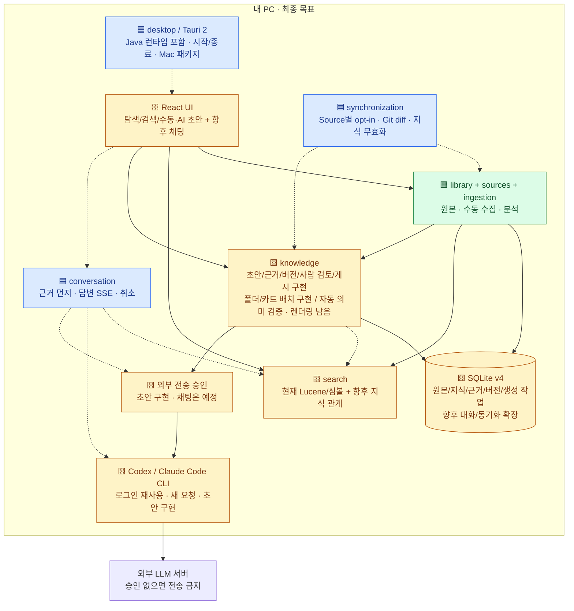
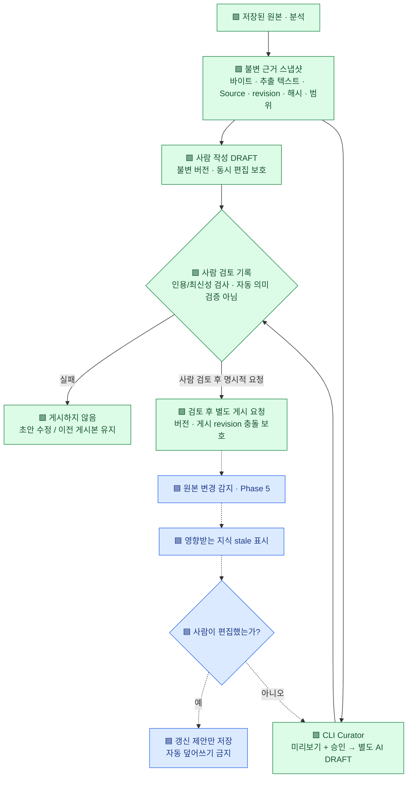
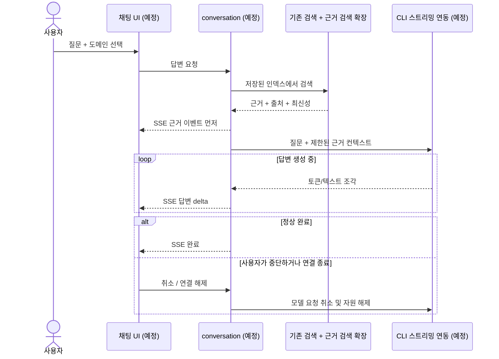
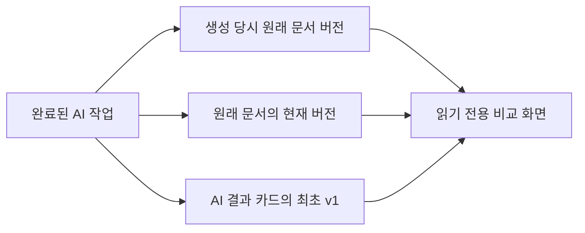
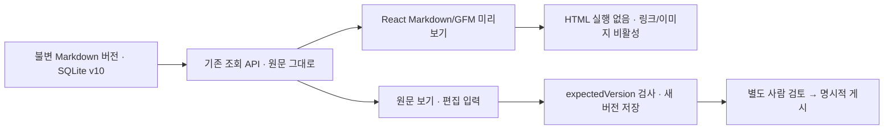

# Knowledge Forge — 한눈에 보는 설계도

> **수집·분석·검색에 이어, 근거를 보존하는 수동 지식 초안·버전이 동작합니다.**
> 이제 로그인된 Codex/Claude Code CLI로 승인 후 별도 AI 초안도 생성합니다. 사람 검토→명시적 게시, 독립 지식 폴더·카드 배치, 안전한 Markdown 표시도 구현했습니다. 자동 의미 검증은 남았습니다.

기준: 2026-10-21 · Phase 3 CLI AI 작업 관리·모델 고정·설치 진단 추가.
최신 범위는 [제안 거절·재검토](proposal-decisions.md), 폴더는 [독립 지식 폴더](knowledge-folders.md), 출처 연결은 [현재 원본 탐색](evidence-navigation.md), 이전 변경은 [사람 검토와 게시](publication.md), [실행 전 CLI 관측 이력](cli-observation.md), 작업 관리는 [생성 작업](generation-jobs.md)을 확인하세요.
실제 JAR 재시작·근거 보존 검증 결과는 [보고서](phase3-foundation-report.md)에 기록합니다.

**범례:** 🟩 구현됨 · 🟨 일부 구현/확장 필요 · 🟦 계획(미구현).
그림의 노드에도 상태를 적었으며, 점선 화살표는 앞으로 추가할 연결입니다.
아래 Mermaid 설계도는 GitHub 문서 화면에서 볼 수 있습니다.

## 1. 전체 진행 상황

| 사용자가 할 수 있는 일 | 지금 | 앞으로 |
|---|---|---|
| 서재 관리 | Workspace 생성·삭제·전환 | 데스크톱 데이터 이전·백업 UX |
| 자료 등록 | 파일 업로드, 로컬 폴더·공개 URL·공개 GitHub | 비공개 저장소, Source 위치 수정 |
| 자료 분석 | Tika 추출, Java 심볼·행 번호 | 청크·정교한 근거 위치, 격리 파서 |
| 검색 | Lucene/Nori, 여러 도메인, 심볼 텍스트 | 지식·코드 관계 검색 |
| 지식 백과사전 | 수동/CLI AI 초안·불변 버전·근거 복사본·사람 검토·게시·충돌 보호 | 자동 의미 검증·안전한 렌더링 |
| AI 운영 | 건별 모델 선택·요청 모델 이력·승인 바인딩·실행 전 CLI 관측 이력 | 인증 상태·실제 실행 모델/바이너리 증명 |
| AI 질문 | 미구현 | CLI Provider, 근거 선표시, SSE, 중단 |
| 최신성 관리 | 수동 동기화·revision·근거 CURRENT/STALE/MISSING 조회 | 자동 폴링·증분·의존 관계 전파·전체 원본 이력 |
| 설치 | 개발용 웹 UI 포함 JAR | Mac `.app`/`.dmg`, Windows는 후속 |

Phase 수는 작업량 비율이 아니므로 전체 완료율을 퍼센트로 표시하지 않습니다.

## 2. 현재 실제로 동작하는 구조

아래는 모두 구현된 경로입니다. 백엔드는 여러 서버가 아니라 **하나의 Spring Boot 프로세스**입니다.

- Source 등록만으로 수집하지 않으며 사용자가 **동기화**를 눌러야 읽습니다.
- 실패하면 기존 원본과 검색 결과를 유지합니다. 변경된 Source는 현재 **전체 스냅샷 교체**입니다.
- 큐는 API 완료 시 및 2초 주기로 소비합니다. 이 작업은 외부 Source 자동 폴링이 아닙니다.
- 앱 시작 시 저장된 분석 결과로 재색인합니다. 검색마다 원본을 다시 수집·분석하지 않습니다.
- 원본 보관 및 분석은 로컬 처리입니다. AI 초안은 건별 승인 후 CLI로 외부 호출합니다.
- 지식 초안은 별도 API/테이블로 관리하며 아직 Lucene 검색에는 포함하지 않습니다.
- 원본 삭제 후에도 지식과 근거 복사본이 남습니다. Workspace 삭제 시에는 함께 삭제됩니다.

## 3. 앞으로 연결할 목표 구조

색상은 각 박스의 **현재 구현 상태**입니다. 파란 박스는 아직 사용할 수 없습니다.

벡터 DB·Elasticsearch·외부 DB 서버·GitHub Actions는 요구하지 않습니다.
모듈 내부는 `adapter → application → domain/port` 방향으로 분리하고,
JDBC/HTTP/LLM 어댑터가 포트를 구현합니다. 검색과 LLM 답변 생성은 별도 유스케이스입니다.

## 4. 지식이 만들어지고 갱신되는 과정 — 현재와 계획

근거 캡처·수동/AI 초안·사람 검토·명시적 게시가 구현되었습니다. **자동 의미 검증·자동 갱신은 아직 계획**입니다.

**구현된 보호 장치:** 현재 Source 변경 시 entry ID가 교체되어도 별도 근거 스냅샷은 유지됩니다.
현재성과 비교할 때는 Source+상대 경로와 원본/텍스트 해시를 사용합니다.
근거 일치 상태는 사실 검증이 아닙니다. 사람 검토 후 게시 정책은 구현했으며 자동 의미 검증은 남아 있습니다.

## 5. AI 질문 시 처리 순서 — 계획

전체 시퀀스는 Phase 4 계획입니다. 검색과 초안 생성 기반은 존재하지만 채팅·SSE는 미구현입니다.

검색 결과 없음·모델 실패·승인 없는 외부 전송에 대한 분기도 구현/테스트해야 합니다.
위 이벤트 이름은 설명용이며 실제 API 계약은 Phase 4에서 확정합니다.

## 6. 개발자가 바로 찾을 코드와 다음 작업

| 영역 | 현재 코드 위치 | 다음 확장 |
|---|---|---|
| 화면 | `frontend/src/App.tsx`, `GenerationPanel.tsx`, `GenerationJobsPanel.tsx`, `GenerationComparison.tsx`, `PublicationPanel.tsx` | 제안 채택·부분 반영, 채팅 |
| 원본/DB | `backend/src/main/java/dev/knowledgeforge/library` | 현재 v10, 향후 데이터/보존 정책 확장 |
| 수집 | `backend/src/main/java/dev/knowledgeforge/sources` | Source 편집, 취소, 비공개 인증 |
| 분석 | `backend/src/main/java/dev/knowledgeforge/ingestion` | 청크/인용 범위, 파서 격리 |
| 검색 | `backend/src/main/java/dev/knowledgeforge/search` | 게시 지식·관계 검색 |
| 지식 | `backend/src/main/java/dev/knowledgeforge/knowledge`, `frontend/src/KnowledgePanel.tsx` | CLI 운영 보강 · 자동 의미 검증 · AI 갱신 제안 |
| 아직 없는 모듈 | `conversation`, `synchronization`, `desktop` | 실제 기능·테스트와 함께 추가 |

**다음 한 작업:** **제안 채택 이력·부분 선택·충돌 재확인 후 반영**. [읽기 전용 비교](generation-comparison.md)와 [폴더 이름 변경/이동](folder-update.md)은 구현·검증했습니다. 개발 도구 보안 갱신은 [검증 완료](toolchain-report.md)했습니다. 안전한 표시와 원문 보존은 [Markdown 가이드](markdown-rendering.md), 독립 폴더/카드 배치는 [폴더 가이드](knowledge-folders.md) 범위로 구현했습니다. 현재 출처 탐색 이동은 [탐색 가이드](evidence-navigation.md) 범위로 구현했습니다. 사람 검토/게시의 경계는 [게시 가이드](publication.md), 실행 모델/바이너리 증명 한계는 [관측 이력](cli-observation.md)에 기록했습니다.
모든 단계의 상세 완료 조건은 [backlog.md](backlog.md), 기술 설명은 [architecture.md](architecture.md),

비교 조회는 기존 문서를 변경하거나 AI를 호출하지 않습니다. 거절·재검토 이력은 별도 구현했고 채택 저장은 앞으로 구현합니다.

실행/PC 이전은 [HANDOFF.md](../HANDOFF.md), 최신 검증은 [거절·재검토 보고서](proposal-decisions.md)를 참고하세요.
쉽게 읽으려면 [작동 원리](how-it-works.md)와 [모델링·코드 대조](modeling.md)를 먼저 보세요.
사용자 체험은 [Mac 설치형](desktop-preview.md) 준비 후 진행합니다. 최신 도구 검증은 [별도 보고서](toolchain-report.md)를 참고하세요.

