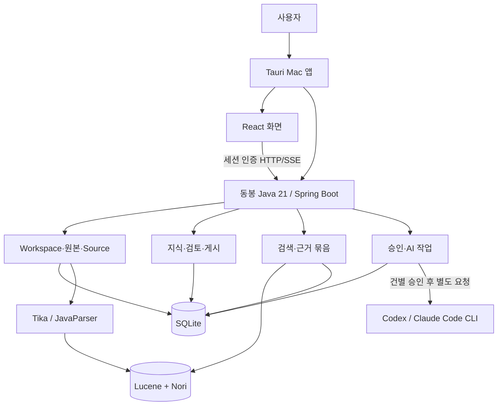
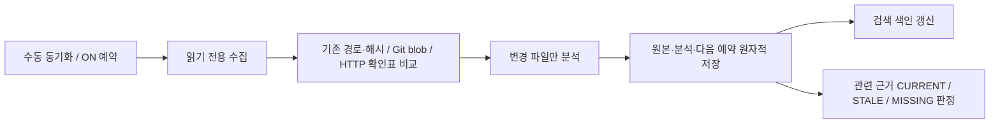
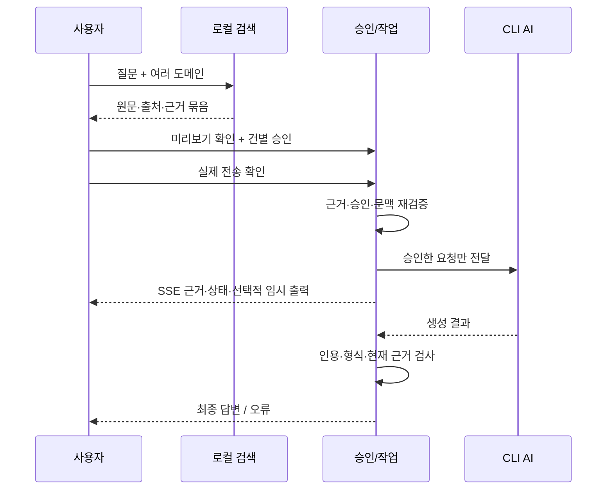

# Knowledge Forge — 한눈에 보는 설계도

## 지금 가능한 흐름

0.1.3: **AI 연결 → Codex/Claude 선택 → 인증 확인 → 필요하면 브라우저 로그인**. 실제 버튼 요청 오류를 수정했고, 시작/메뉴에서 새 버전을 확인하는 서명 업데이트를 추가했습니다. [설치 파일·검증](release-0.1.3-report.md) · [업데이트](automatic-updates.md).
Codex 실행 도구는 새 Mac 빌드에 동봉합니다. Claude 동봉·실제 계정 검증은 아직 별도입니다. [구현과 검증 범위](provider-connection.md).

**자료 넣기 → 분석·검색 → 근거 선택 → AI/수동 초안 → 사람 검토·게시 → 근거 기반 질문**

| 영역 | 현재 구현 | 한계/후속 |
|---|---|---|
| 원본 | 파일·폴더·공개 HTTPS·공개 GitHub, 독립 탐색 | 비공개 저장소·대용량 확장 |
| 분석·검색 | Tika, JavaParser, Lucene/Nori, 여러 도메인 | 의미 검색·함수 호출 그래프 |
| 관계 | 같은 선언 심볼·인용 출처로 연결 탐색 | AI 근거 자동 확장 아님 |
| 지식 | 불변 버전·수동/AI 초안·출처·검토·게시 | 자동 의미 검증 아님 |
| 질문 | 근거 먼저, 건별 승인, SSE·중단·이력·선택 문맥 | 실제 외부 서비스 호환성 별도 검증 |
| 갱신 | Source별 OFF 기본 폴링·Git blob 재사용·HTTP 304 | 앱 종료/잠자기 중 실행 안 함 |
| 설치형 | Tauri·동봉 Java·로컬 토큰·CLI 경로 설정, Intel/ARM 패키지 | Intel 실행·ARM 정적 검사 통과; ARM 실기기 미검증, 공증 제외, Windows 후속 |

현재 개발 소스는 SQLite v21입니다. 공개 릴리스에 포함된 기능은 [설치 안내](macos-install.md)를 확인하세요.

Intel/Apple Silicon은 UI·서버 JAR·DB 모델을 공유합니다. **Tauri 실행 파일·동봉 Java·Codex 실행 도구를 대상 CPU에 맞춰 함께 빌드**합니다.
아키텍처 혼합은 패키징 검사에서 거부합니다. 공증은 이번 범위에서 제외합니다. [ARM 빌드·검증 구분](apple-silicon.md).

## 실행 구조

앱이 현재 코딩 세션을 공유하는 것은 아닙니다. 0.1.2부터 Codex 도구가 동봉됩니다. Claude는 기존 호환 CLI가 필요합니다. 계정 로그인과 실제 자료 전송 승인은 별개입니다.
화면에는 DB/셸 직접 접근 권한을 주지 않으며 외부 AI 전송은 승인 경로를 거칩니다.

## 자료가 바뀌면

실패하면 이전 복사본을 유지합니다. 사람이 편집한 지식을 덮어쓰지 않으며 새 게시에는 다시 검토가 필요합니다.
원본·지식·당시 근거는 독립 수명주기입니다.

## 질문 처리 순서

중단하면 작업을 취소합니다. 재연결·이력 조회는 AI를 재호출하지 않습니다.
검사는 의미적 진실을 자동 증명하지 않습니다.

## 자세히 볼 곳
[쉬운 사용법](how-it-works.md) · [모델·실제 코드 대조](modeling.md) · [API](api.md) ·
[개발 인수인계](../HANDOFF.md) · [검증/남은 작업](backlog.md).
