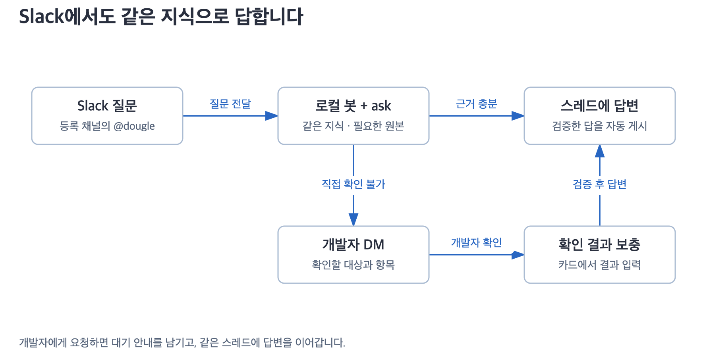

# 더글 개발 설계 참고

호스트 AI와 로컬 Slack 봇은 `~/.dougle/`의 같은 Markdown 지식을 사용합니다. 봇은 여기에 문의 접수·실행 기록 검사·게시·담당자 확인 절차를 더합니다. 제품 개념은 [설계 안내](design.md), 아래는 구현을 확인할 때 필요한 참조입니다.

[지식 구조](#1-지식은-무엇으로-구성되나요) · [봇의 대화 모델](#2-봇은-무엇을-기억하나요) · [질문 처리](#3-질문이-오면-어떻게-흐르나요)

## 1. 지식은 무엇으로 구성되나요?

| 개념 | 역할 |
|---|---|
| 목차 | 업무 용어·동의어·코드 식별자로 토픽 위치 안내 |
| 토픽 | 한 업무의 설명·규칙·관계를 여러 원본 근거와 함께 정리 |
| 주장 | 토픽 안의 설명 단위. 조건·예외·근거를 함께 보존 |
| 소스 | 자료 식별 정보, 원본 위치, 실제 확인 범위·시각 기록 |

토픽과 소스는 여러 대 여러 관계이며 Markdown의 ID·링크로 연결합니다. 별도 그래프 DB는 없습니다. 같은 이름이어도 회사·프로젝트·사이트·페이지 ID 등 실제 출처가 다르면 구분합니다.

질문에는 목차, 관련 토픽의 주장·조건·예외, 소스 기록 순으로 읽습니다. 기본적으로 관련 원본의 변경을 확인하고 충분한 근거가 유지되면 재사용합니다. 변경·부족·충돌이 있으면 필요한 원문을 읽고 해당 지식만 갱신합니다. 구현 질문에는 관련 코드, 현재 상태 질문에는 최신 조회가 필요합니다.

근거: [기록·중복 처리](../skills/dougle-connect/references/records.md) · [탐색](../skills/dougle-ask/references/retrieval.md) · [갱신](../skills/dougle-ask/references/freshness.md) · [저장 구조](skills/architecture.md)

## 2. 봇은 무엇을 기억하나요?

같은 스레드에서 다시 멘션하면 새 문의를 만들고 기존 Claude 세션을 이어 씁니다. 다른 원글의 세션은 합치지 않습니다. 세션을 잃으면 조회 한도 안에서 가져온 스레드 메시지로 새 세션을 시작합니다.

| 기록 | 용도 |
|---|---|
| `inquiries.current_draft_id` | 옛 카드 대신 현재 초안 식별 |
| `drafts.revision` | 직접 수정·조회 결과 반영 후 최신 초안 구분 |
| `drafts.verification_json` | 필요한 근거 종류와 실제 읽기 기록 검사 결과 |
| `deliveries` + 전송 의도 | 부분 전송·통신 단절 뒤 중복 전송 방지 |
| `jobs`, `processed_events` | 작업 큐와 이벤트 중복 처리 |
| `engine_runs`, `audit`, `control` | 실행 비용, 감사 기록, 실행 상태 |

Claude 세션은 SQLite 테이블에 저장하는 대화 자체가 아니라 `threads.engine_session_id`로 참조하는 외부 세션입니다. 엔진 답변 저장과 해당 작업 완료는 같은 트랜잭션으로 기록합니다.

근거: [저장소·트랜잭션](../dougle-bot/src/dougle_bot/store.py) · [세션 재사용](../dougle-bot/src/dougle_bot/worker.py) · [게시 처리](../dougle-bot/src/dougle_bot/actions.py)

## 3. 질문이 오면 어떻게 흐르나요?

봇은 필요한 읽기 도구와 필수 스킬의 실행 기록을 검사합니다. 검증을 통과하면 원래 스레드에 자동으로 답합니다. 공개 본문에는 출처 목록·인용 번호·서명을 붙이지 않고 근거는 로컬 기록과 필요한 내부 DM에 보존합니다.

| 상황 | 처리 |
|---|---|
| 근거가 충분한 답변 | 검증 후 자동 게시 |
| 운영 조회·개발자 도움·내부 오류 | 지정 담당자 DM으로 확인 요청 |
| 담당자 결과 도착 | 해당 문의에만 반영하고 재검증 후 답변 |
| `require_approval=true` | 최신 초안·미리보기를 지정 승인자가 검토한 뒤 게시 |

자동 모드에서 도움 요청 DM 전송에 성공하면 원래 문의 스레드에 짧은 대기 안내를 한 번 시도합니다. 안내 전송이 실패·중단되거나 성공 여부가 불분명해도 자동 재시도하지 않습니다. 안내 실패가 담당자의 결과 처리나 최종 답변을 막지는 않습니다. 검토 모드와 기존 승인 대기 답변은 자동 게시로 전환하지 않습니다.

운영 DB처럼 봇이 직접 조회할 수 없는 자료는 담당자가 대상·범위와 결과를 요약해 입력합니다. 별도 확인 시각 입력란은 없으며 `submitted_at`은 접수 시각이지 조회 시각이나 최신성의 증거가 아닙니다. 과거 기록의 `observed_at`은 보존하고 개발자 조회 결과는 직접 조회한 사실과 구분합니다. 오래된 결과나 부족한 범위라면 필요한 결과를 다시 요청합니다. DM에 SQL을 제시해도 봇이 대신 실행하거나 공개 스레드에 올리지 않습니다.

게시 직전 최신 답변·대상 채널·스레드를 확인합니다. 스레드가 바뀌면 오래된 답변을 게시하지 않고 재생성 또는 내부 확인으로 처리합니다. 전송이 불분명하면 `post_unknown`으로 보류해 기록을 대조하며 메시지를 못 찾았다는 이유만으로 재전송하지 않습니다.

근거: [접수](../dougle-bot/src/dougle_bot/intake.py) · [조사·검증](../dougle-bot/src/dougle_bot/worker.py) · [읽기 기록 검사](../dougle-bot/src/dougle_bot/evidence.py) · [게시](../dougle-bot/src/dougle_bot/actions.py) · [전송 확인](../dougle-bot/src/dougle_bot/recovery.py)

## 4. 어디까지가 현재 기능인가요?

| 경계 | 현재 동작 |
|---|---|
| 업무 지식 | 호스트 AI와 봇이 `~/.dougle/`의 Markdown을 읽고 정리 |
| 봇 운영 기록 | `~/.dougle-bot/`의 SQLite에 저장. 업무 지식과 분리 |
| 원본 접근 | 기존 도구·계정 권한으로 조회. 설치만으로 DB·Confluence 권한이 생기지 않음 |
| 팀 공유 | 선택한 정제 지식을 publish·fetch로 병합. 정정·충돌은 보존하고 봇 운영 기록은 제외 |
| 채널 감지 | 등록 채널 멘션에 반응. 일반 문의 자동 감지는 [별도 설계안](dougle-bot/channel-detection-design.md) |

읽기 기록 검사는 필요한 종류의 조회가 실행됐는지 확인합니다. 질문 분류·근거 해석·실제 회사 운영 품질까지 보장하지는 않습니다. [검증 방식과 한계](dougle-bot/research-verification.md)

[그림 원본](diagrams/README.md) · [스킬 구동 방식](skills/how-it-works.md) · [봇 설정·사용법](../dougle-bot/README.md) · [공유와 병합](skills/sharing.md)
