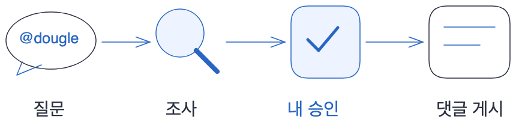

# 더글, 쉽게 이해하기

**더글은 AI가 다시 펼쳐 보는 업무 노트입니다.**

## 1. 지식은 무엇으로 구성되나요?

**토픽에는 업무 설명**, **소스에는 원본 주소와 확인 시각**을 저장합니다. 설명이 부족하거나 오래됐다면 원본을 다시 봅니다. 현재 DB 상태는 새로 조회합니다.

## 2. 봇은 무엇을 기억하나요?

**같은 스레드에서 다시 멘션하면 앞선 질문을 이어서 이해합니다.** 다른 스레드의 대화와는 섞지 않습니다.

## 3. Slack 답변은 어떻게 나가나요?

**지정 승인자가 [게시]를 눌러야 댓글이 나갑니다.** DB를 직접 볼 수 없으면 조회 결과를 받아 답변을 다시 준비합니다.

[개발 설계 자세히](design-reference.md) · [브라우저용 HTML](design.html) · [봇 사용법](../dougle-bot/README.md)
