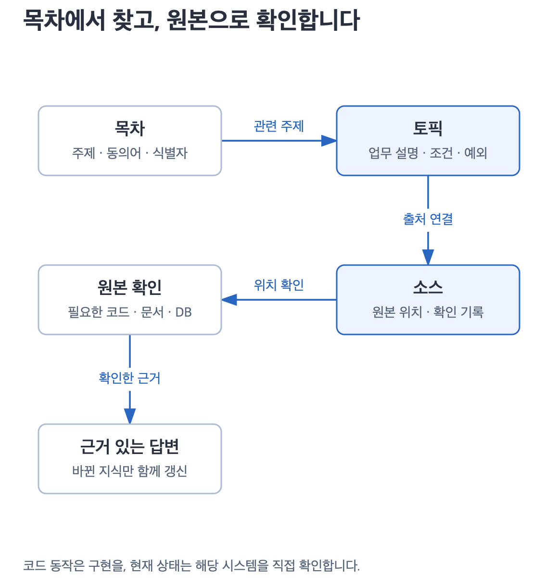

# 더글이 작동하는 방식

**각자 자료를 연결하고, 정리한 지식을 나누고, 같은 지식으로 답합니다.**

<picture>
  <source media="(max-width: 650px)" srcset="diagrams/archify/overview-mobile.png">
  
</picture>

## 자료를 연결하면 내 지식이 됩니다

문서 URL, GitHub 저장소, 코드 폴더나 DB를 알려주세요. 사용 중인 Claude Code·Codex가 실제 자료를 읽고 업무 개념·규칙·관계·출처를 `~/.dougle/`에 정리합니다. 더글에서는 이 과정을 **내재화**라고 부릅니다.

저장된 지식은 세션이 끝나도 남습니다. 같은 OS 사용자라면 AI를 어느 폴더에서 실행해도 같은 목차에서 찾습니다. 여기서 로컬 AI는 PC에서 사용하는 AI 도구를 뜻하며, 모델을 오프라인으로 실행한다는 뜻은 아닙니다.

## publish로 보내고 fetch로 합칩니다

| 작업 | 옮기는 내용 | 도착하는 곳 |
|---|---|---|
| connect | 원본에서 확인한 업무 지식 | 내 PC |
| publish | 선택한 지식과 출처 | 지정한 팀 GitHub 저장소 |
| fetch | 팀에 올라온 지식 | 가져오는 사람의 PC |
| ask | 질문에 필요한 설명과 근거 | AI 대화 또는 Slack 답변 |

누구나 자기 지식을 공유할 수 있습니다. 다른 사람이 보낸 내용을 가져올 때는 내 지식과 합치며, 서로 다른 설명은 근거와 함께 남깁니다. 뒤에 게시한 사람이 앞사람의 지식을 통째로 덮어쓰지 않습니다.

공유는 publish·fetch를 요청할 때 이루어집니다. 원본 코드 전체나 봇의 대화 기록은 공유 대상에 포함하지 않습니다. [공유 절차](skills/sharing.md)

## 질문하면 목차부터 찾습니다

1. **목차**에서 질문의 주제·동의어·코드 이름을 찾습니다.
2. **토픽**에서 관련 설명과 조건·예외를 읽습니다.
3. **소스**에 기록된 원본 위치·버전·확인 범위를 따라 필요한 자료를 확인합니다.
4. 확인한 내용으로 답하고, 바뀐 지식이 있으면 해당 부분만 고칩니다.

토픽은 업무 설명이고 소스는 원본을 다시 찾는 기록입니다. 실제 코드 동작을 물으면 코드를, 현재 운영 상태를 물으면 해당 시스템을 조회합니다. 짧게 답해 달라는 요청도 이 확인을 줄이지 않습니다.

기본적으로 관련 질문마다 원본의 변경을 확인합니다. 사용자가 지정한 확인 주기는 유지하며, 질문과 무관한 자료까지 한꺼번에 갱신하지 않습니다. [갱신 방식](skills/freshness.md)

## Slack 봇도 같은 지식을 읽습니다

봇을 켜 둔 PC에서 Claude CLI와 `dougle-ask`가 답변을 준비합니다. **봇 전용 지식을 따로 만들 필요는 없습니다.** 동료가 공유한 지식도 그 PC에서 fetch하면 질문에 쓸 수 있습니다.

같은 스레드의 후속 질문은 같은 대화로 이어갑니다. 다른 스레드는 별도 대화입니다. 필요한 근거를 확인한 답은 바로 게시하고, 추가 조사가 필요하면 개발자 DM으로 요청합니다. 고객에게는 확인 대기 중임을 한 번 알리고, 보충 결과를 받으면 같은 스레드에 답변을 이어갑니다.

[봇 설치·실행](../dougle-bot/README.md) · [개발 설계](design-reference.md)
