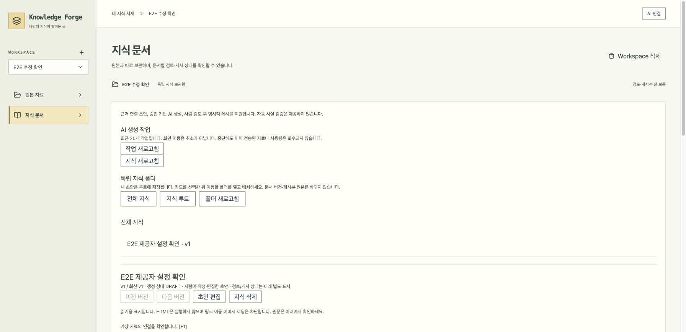

# 전체 사용 흐름 검사 — 2026-10-23

0.1.6은 [자료 이름·분류 편집](source-metadata.md)의 회귀·브라우저 검사를 추가했습니다. 당시 화면 시간 초과와 복구 과정도 [0.1.6 보고서](release-0.1.6-report.md)에 기록합니다. 전체 앱의 모든 브라우저 경로를 새로 검증한 것으로 해석하지 않습니다. `FORGE_BROWSER_JAR=/절대경로/새.jar node scripts/browser-e2e.mjs`로 검사용 JAR를 선택할 수 있으며 지정하지 않으면 기존처럼 Intel 앱의 JAR를 사용합니다.

후속으로 실제 0.1.5 JAR의 [강제 종료 복구 검사](crash-recovery.md)를 추가했습니다. 정상 종료가 아닌 SIGKILL 이후 자료 보존·중단 이력·자동 재전송 방지를 검사합니다. UI 전체 재검사나 실제 전원 차단 시험과 구분합니다.

후속 0.1.5에서는 Git을 앱에 포함하고, 시스템 Git 없는 환경의 실제 공개 저장소 수집을 추가로 검사했습니다. [별도 설치 검증 기록](release-0.1.5-report.md). 아래 전체 UI 점검은 0.1.4 당시 결과입니다.

설치본 0.1.3을 실제로 눌러 보며 검사하고, 발견한 문제를 0.1.4에서 수정했습니다.
검사는 가상 자료와 임시 저장소만 사용합니다. 실제 회사 자료나 사용자의 앱 데이터는 열지 않습니다.

## 찾은 문제

1. **Claude를 골랐는데 Codex 모델 설정이 표시됨.** Codex 전용 모델을 저장하고 AI 연결에서 Claude를 선택한 뒤 지식 화면을 다시 열면 재현됩니다. 처음 화면을 만들 때 선택된 제공자가 아닌 Codex 설정을 읽던 원인을 수정했습니다. Claude 설정이 없는 경우와 별도 설정이 있는 경우 모두 회귀 테스트를 추가했습니다. 수정 전 2개 실패, 수정 후 통과했습니다.
2. **이미 바뀐 사용법을 예전 안내로 표시함.** 지식 생성 화면이 별도 CLI 설치·터미널 로그인을 안내하고, 게시 문서가 있어도 상단은 모두 미검증 초안으로 설명했습니다. 앱의 AI 연결과 문서별 상태를 안내하도록 바로잡았습니다.

수정한 실제 0.1.4 JAR 화면에서 **Claude에 설정 없음 → 앱 기본값**, **Claude 별도 모델 복원**, **Codex로 전환 → Codex 별도 모델 복원**을 다시 확인했습니다. 초기 제공자와 무관한 모델은 복원하지 않습니다.



가상 자료로 촬영한 실제 화면입니다. 실제 AI가 확인한 사실이나 회사 자료가 아닙니다.

## 실제로 확인한 흐름

| 영역 | 확인한 내용 |
|---|---|
| 서재 | 생성·전환·격리, 삭제 취소와 실제 삭제, 재시작 후 마지막 서재 유지 |
| 파일 | 한글 폴더 생성, Markdown 업로드·미리보기, 브라우저 다운로드 바이트 일치 |
| 자료 수집 | 임시 로컬 폴더, 실제 `https://example.org`, 공개 `octocat/Hello-World` 저장소 수집·반영 버전 표시 |
| 검색 | Java 함수 검색, 원본 열기, 두 도메인 동시 선택, 원본·게시 문서 함께 검색 |
| AI 연결 | 전송 동의 전 로그인 버튼 차단, 가상 로그인 상태 변경, 제공자 선택 기억 |
| 답변 | 근거 저장·재검증·요청 미리보기·승인만으로 생성하지 않음, 가상 답변 실행·SSE 완료·중단 |
| 지식 | 수동 초안, 승인한 가상 AI의 별도 초안, 사람 검토 후 게시, 별도 폴더 배치, 사람 편집 v2와 게시 v1 독립 보존 |
| 갱신 | 원본 21→22 변경·재동기화 후 STALE 표시, 사람 편집과 이전 게시본 미덮어쓰기 |
| 복구 | 서버 재시작 뒤 문서·게시·최신성 유지, 실제 v18 설치본 자료를 v21로 올리고 종료 상태 백업 복원 |
| 설치형 | 동봉 Java, 세션 보호, 실제 React 버튼, 중복 실행 거부·종료·같은 DB 재시작 |
| 업데이트 | 임시 가상 앱의 서명 설치, 변조·서명 버전 불일치·구버전·누락 CPU 차단, 실패 시 기존 앱·자료 보존 |
| 화면 | 지식 문서 390px 폭에서 가로 넘침 없음, 확인 구간의 브라우저 미처리 오류 없음 |

브라우저 검사는 실제 배포 JAR·동봉 Java를 웹 모드로 실행합니다. Mac 설치 복사본 WebKit 검사는 별도입니다.
가상 답변 성공은 실제 Codex/Claude 계정의 원격 생성 성공을 뜻하지 않습니다.

## 실패도 구분해 기록합니다

- 모델 설정 회귀 2개는 실제 앱 버그이며 수정했습니다.
- 네이티브 UI가 간헐적으로 완료 표식 없이 시간 초과했습니다. 진단으로 **AI 선택창 높이 0px**을 포착했습니다. DOM에 선택창이 생긴 시점과 React effect가 실제 창을 연 시점 사이에 크기를 검사하던 테스트 순서 오류였습니다. `[open]`과 표시된 레이아웃을 기다린 뒤 기존 40px·디자인 검사를 그대로 수행하도록 수정했습니다. 실패 단계 이름의 `/`도 Workspace 이름 검증에 걸려 진단 표식을 못 남기던 문제를 고쳤습니다. 시간 제한·세션 보호를 완화하거나 실패 검사를 제외하지 않았습니다.
- 최초 업그레이드 검사에 이전 JAR 인자를 빠뜨린 것은 실행 절차 오류입니다. 보관된 v18 DMG를 읽기 전용으로 열어 올바른 JAR로 다시 실행했고 자료 보존·복원 검사를 통과했습니다.
- 새 브라우저 검사 도구를 일시 정지하면 활성 작업이 없어 Node가 종료되는 도구 오류도 발견했습니다. 대기 타이머를 유지하도록 수정하고 정지 중 프로세스 유지·재시작 후 같은 Workspace 보존을 확인했습니다. 설치 앱의 오류는 아닙니다.
- 화면 자동화 중 잘못된 버튼 이름·중복 선택자·비동기 완료 전 조회도 바로잡았습니다. 이를 앱 오류로 집계하지 않습니다.

창 열림 대기를 고친 뒤 같은 0.1.4 DMG 설치 복사본 검사를 **3회 연속 통과**했습니다. 설치 앱 코드는 바꾸지 않고 검사 코드만 추가 수정한 것이므로, 검증한 설치 파일은 그대로 유지합니다.

## 재현하기

```bash
FORGE_SMOKE_DESKTOP_RESOURCES="$PWD/desktop/src-tauri/target/release/bundle/macos/Knowledge Forge.app/Contents/Resources/resources" node scripts/smoke.mjs
node scripts/cli-settings-smoke.mjs
node scripts/polling-smoke.mjs
node scripts/relations-smoke.mjs
node scripts/provider-connection-smoke.mjs
node scripts/upgrade-smoke.mjs /읽기전용/v18/knowledge-forge.jar
node scripts/updater-smoke.mjs
bash scripts/verify-macos-package.sh release/Knowledge.Forge_0.1.4_x86_64.dmg
node scripts/native-host-smoke.mjs
node scripts/browser-e2e.mjs
```

마지막 명령은 격리된 화면 검사 서버를 띄웁니다. 출력된 주소와 임시 Source 폴더만 사용하세요.
가상 AI 초안의 모델은 `synthetic-smoke-model`, 답변은 `preview-only-model`입니다. 실제 제공자에 연결하지 않습니다.
출력된 프로세스 ID에 `SIGUSR1`은 같은 자료로 서버 재시작, `SIGUSR2`는 일시 정지, `SIGINT`는 종료와 임시 자료 정리입니다. 실행 중인 앱/JAR를 덮어쓰지 마세요.

## 아직 별도로 필요한 확인

- 실제 AI 계정의 로그인·원격 답변·이용 한도와 스트림 호환성: 외부 전송 동의 후 확인합니다.
- Apple Silicon 실물 Mac 실행, Claude 도구 동봉 조건 확인. 신규 Mac의 Git 설치 의존은 0.1.5에서 제거했습니다.
- 사용자의 실제 설치 위치에서 다음 공개 버전으로 업데이트하는 체험. 가상 앱 설치 검증과 다릅니다.

최종 빌드·설치 파일·체크섬은 [0.1.4 검증 기록](release-0.1.4-report.md)에 정리합니다.
