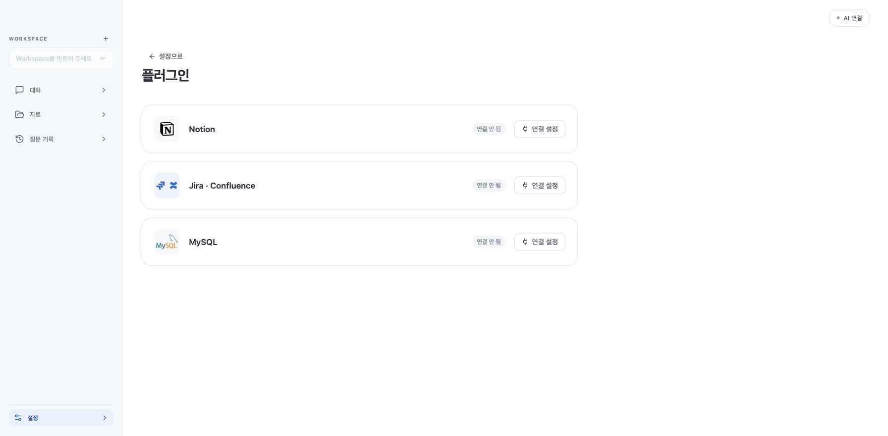

# Slack·Datadog 제거

2026-10-27 사용자 요청으로 두 연결 기능을 제품 범위에서 제외했다.

- Slack 플러그인·수신함·사이드바 알림·소켓 연결·재연결 스케줄러·HTTP API·답장 관련 코드를 삭제했다.
- Datadog 설정·조회 화면·연결 저장 API·로그 HTTP 클라이언트·조사 실행기를 삭제했다.
- 계획 모델의 출력 스키마·프롬프트·파서에서 Datadog 제안을 제거했다. 기존 완료 계획의 제안/범위 API와 캡처도 거부한다.
- 기존 대화·질문 첨부·자료·DB 마이그레이션은 유지한다. 저장된 이전 Datadog 계획은 실행하거나 검색 근거로 표시하지 않는다. 과거 데이터 형식용 열거형은 네트워크 실행기 없이 남긴다.
- 원본 자료·외부 시스템 읽기 전용 정책과 Notion·Jira/Confluence·MySQL 연결은 유지한다. 기존 암호화 보관함을 읽거나 인증정보를 다른 곳에 복사하지 않았다.

## 인수 범위 변경

기존 실행 기록 `acceptance-remaining-20261027.json`은 삭제 전 관측 자료다. T0901–T0925는 사용자 결정에 따른 제외(EXCLUDED)이며, 20개의 부분 통과와 5개의 실패를 수정 완료로 전환하지 않는다. 보고서 생성기는 제외 상태와 이전 관측을 함께 보존한다.

현재 유효 집계: PASS0 / PARTIAL921 / FAIL29 / NOT_RUN25 / EXCLUDED25. 남은 실패는 검색19·대용량5·연속 대화5이며, 새 Mac25개도 미검증이다.

## 검증

`RemovedIntegrationsTest`는 실제 Spring 컨텍스트에서 삭제된 경로의 GET/POST/DELETE가 404이고 Slack·Datadog bean/전송 클래스가 없음을 검사한다. 파서·모델 출력 스키마, 과거 Datadog 범위/캡처 거부, 기존 MySQL 동작과 UI 비노출 회귀 검사를 함께 수행한다.

최종 전체 Java1045실행/1022통과/opt-in23건너뜀/실패0, UI759/759(수집 경계·동기화·업데이트 opt-in 포함), Node172/172, 별도 관련 Java170/170 통과. 중복 실행을 고유 케이스 수로 합산하지 않는다.

첫 전체 Java에서는 변경 전 기대값이 남은 테스트1건과 Codex callback timeout 타이밍1건이 실패했다. 기대값을 새 MySQL 계약으로 수정했고 후자는 제품 코드 변경 없이 대상 및 전체 재실행에서 통과했다. 첫 UI 실행은 MySQL busy 콜백 타이밍1건 실패 후 대상183개와 최종 전체759개에서 통과했다. 첫 무제한 병렬 UI 실행은 자원 경합 때문에 중단하고 worker 수를 제한했다. 모든 실패/중단을 최초부터 통과한 것으로 보고하지 않는다. 로그: /tmp/dougle-remove-java-final.log, /tmp/dougle-remove-java-rerun.log, /tmp/dougle-remove-final-build.log, /tmp/dougle-remove-ui-final.log, /tmp/dougle-remove-ui-complete.log, /tmp/dougle-remove-node.log.

## 로컬 설치

[Intel0.1.29 설치 기록](local-install-0.1.29-20261027.json). 기존 Intel Java/Codex/Git/검색 모델을 재사용하고 CPU·Git 의존성을 검증했다. 새 JAR·네이티브 버전·앱/업데이트 서명·DMG를 만들고, DMG 읽기 전용 마운트로 설치 JAR와 일치함을 확인했다. 기존 앱/정지된 SQLite 백업, DB29·HTTP200·비인증403 확인. 공개 릴리스/업데이트 피드, ARM 실기기 검증은 수행하지 않았다.

빈 임시 HOME의 실제 패키지 JAR를 브라우저로 확인한 화면이다. 실제 업무 계정이나 자료는 사용하지 않았다. 네이티브 격리 HOME 시작25988ms·중복 인스턴스 거부·종료·재시작 검사는 docs/native-host-report.json에 기록했다. 삭제된 외부 전송 클래스가 최종 JAR에 없는 것도 확인했다. 실제 AI 추가 호출은0회다. 이 검증은 남은 검색/대용량/연속 대화 실패29건이나 새Mac25건을 해결했다는 뜻이 아니다.
