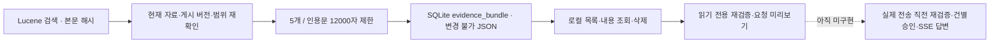

# 답변용 근거 묶음 — AI에게 보내기 전 자료 확인

후속 구현: [읽기 전용 재검증·요청 미리보기](bundle-validation.md). 아래 검증 수치는 묶음 저장 기능 도입 당시 기록입니다.

## 무엇을 하나요?

검색 결과에서 쓸 수 있는 원문과 게시 지식의 근거를 **로컬에 복사해 보관**합니다.
아직 AI에 보내거나 답변을 생성하지 않습니다. 자료 속 명령문도 실행하지 않습니다.

1. 자료 검색창에 질문/검색어를 입력하고 도메인과 게시 지식 포함 여부를 고릅니다.
2. **근거 묶음 → 이 조건으로 묶음 저장**을 누릅니다.
3. `[R1]` 원문, `[R2]` 게시본과 `[R2/E1]` 출처를 읽고 제외 이유를 확인합니다.
4. 저장된 목록에서 다시 열 수 있습니다. 불필요하면 **이 묶음 삭제**를 누릅니다.

묶음을 여는 것만으로 저장하지 않습니다. **저장은 외부 전송 승인이 아닙니다.**
검색어가 없어도 창을 열어 이전 묶음을 조회·삭제할 수 있습니다.

## 어떤 자료가 들어가나요?

- 이름·심볼만 일치한 결과는 제외합니다. 본문에 검색 단어가 있어야 합니다.
- 검색 색인의 본문 해시와 현재 본문이 다르면 제외합니다. 도메인 범위도 다시 확인합니다.
- 게시 지식은 현재 게시 버전이며 모든 출처가 CURRENT일 때만 넣습니다. 수정 중인 초안은 넣지 않습니다.
- 원문 미리보기와 함께 게시본의 출처 인용문 **전체**를 보존합니다. 출처가 너무 길면 그 게시 후보를 제외하며 임의로 자르지 않습니다.
- 최대 5개 결과, 모든 인용문 합계 12,000 UTF-16 코드 단위입니다. 질문·제목·메타데이터는 이 합계에 포함되지 않습니다. 토큰 예산은 아닙니다.
- 검색 후보는 최대 30개이며 점수순으로 검토합니다. 제외 뒤 더 뒤의 후보를 새로 검색하지는 않습니다.

`READY`는 자료가 있다는 뜻이지 답변하기 충분하거나 사실 검증을 통과했다는 뜻이 아닙니다.
`NO_EVIDENCE`는 사용할 자료가 없다는 뜻입니다. 후속 채팅에서는 답변을 유보해야 합니다.
원문의 줄 번호는 추출 텍스트, 게시본은 Markdown 기준이며 미리보기는 행 일부일 수 있습니다.

## 보관과 삭제

묶음은 생성 당시 복사본입니다. 원본·지식이 수정/삭제되어도 묶음의 인용문은 바뀌지 않습니다.
따라서 **실제 AI 전송 전에는 다시 검증해야 합니다.** 로컬 재검증·요청 미리보기는 구현했지만 실제 전송/승인 경로는 아직 미구현입니다.
CURRENT 검사도 앱의 수집본 기준이며 원격 사이트 최신성은 보장하지 않습니다.

Workspace당 최대 100개입니다. 한도가 차면 자동 삭제하지 않고 새 저장을 거절합니다.
묶음 삭제는 원본/지식을 삭제하지 않습니다. Workspace 삭제는 해당 묶음도 함께 삭제합니다.
닫기/연결 취소는 화면의 대기를 중단하지만 이미 요청된 서버 저장까지 취소한다고 보장하지 않습니다.
파일 전체/원본 바이너리 복사본이 아니라 인용문과 해시·출처 식별 정보를 저장합니다. 암호화 저장은 아닙니다.

## 실제 모델과 코드 대조

- `EvidenceBundleService`: 검색을 먼저 끝낸 다음 저장 유스케이스를 호출합니다. 검색 잠금과 DB 트랜잭션을 역순으로 겹치지 않습니다.
- `EvidenceBundleWriter`: 한 DB 트랜잭션에서 현재 자료 확인, 길이/보관 한도 검사, 저장을 수행합니다.
- `JdbcEvidenceBundleStore`: 질문·범위·인용문·제외 이유를 JSON과 SHA-256으로 저장하고 조회 시 해시를 확인합니다. 해시는 식별/손상 검사이지 전송 승인·인증·서명이 아닙니다.
- v14 `evidence_bundle`: Workspace FK만 연결합니다. 원본/카드 삭제에 연쇄 삭제되지 않습니다. 내용 수정 API는 없습니다.
- `EvidenceBundlePanel`: 저장/조회/삭제 모달이며 원문을 텍스트로 표시합니다. HTML·링크·이미지는 실행/로딩하지 않습니다.

## API

접두사: `/api/workspaces/{workspaceId}/evidence-bundles`

| 요청 | 동작 |
|---|---|
| POST 접두사 | `{question, domains?: [], includeKnowledge?: true}` → 201 묶음 |
| GET 접두사 | 최근 순 요약 목록, 최대 100개 |
| GET `/{id}` | 생성 당시 내용과 digest 조회 |
| DELETE `/{id}` | 해당 묶음만 삭제, 204 |

질문은 1~256자, 도메인은 최대 20개/각 80자입니다. 변경 요청에는 기존 로컬 변경 헤더가 필요합니다.
다른 Workspace의 묶음은 404, 한도 초과는 409입니다. 무결과도 `NO_EVIDENCE` 묶음으로 저장합니다.
기존 검색 Hit에는 색인 본문의 `textHash`가 추가되었습니다. 검색 시 전체 파일을 재추출하지 않습니다.

## 남은 작업

실제 전송 경로의 재검증 연결, 실제 모델의 토큰 예산, 건별 승인, 대화 기록, CLI 스트림/SSE·취소,
질문 의미에 맞는 청크 선택과 심볼/지식 관계 검색은 남았습니다. P4 전체 완료가 아닙니다.
Mac 설치 패키지도 후속 단계입니다. v14로 업데이트하기 전 앱을 종료하고 데이터를 백업하세요.

## 검증

원문 변경·게시 교체·도메인 변경, 오래된/삭제된 출처, Workspace 격리, 길이/개수/보관 한도,
독립 삭제, 손상 해시, 외부 전송 없는 저장, UI 삭제 취소와 요청 취소를 자동 테스트합니다.

| 검증 | 실제 결과 |
|---|---|
| `bash scripts/maven.sh clean verify` | 백엔드 191개 통과, 실제 CLI opt-in 1개 skip |
| `npm --prefix frontend test -- --maxWorkers=2` | 프런트엔드 100개 통과 |
| `npm --prefix frontend run build` | TypeScript/Vite 빌드 성공 |
| `bash scripts/maven.sh -DskipTests package` | 최종 UI 번들 포함 실행 JAR 재패키징 성공 |
| `node scripts/smoke.mjs` | 원본/게시 근거 묶음의 인용·해시가 재시작·Source 삭제 후 동일, 새 묶음은 변경/삭제 근거 제외, 개별 삭제 통과 |
| 실제 브라우저 | 질문 입력 → 근거 모달 열기 → 명시적 저장 → 원본/게시본·출처 인용 확인 → 닫고 목록에서 다시 열기 통과, 화면 배치 확인 |

`EvidenceBundleIntegrationTest` 9개와 v13→v14를 포함한 `MigrationTest` 14개가 통과했습니다.
실제 회사 자료는 사용하지 않았으며, 외부 AI도 호출하지 않았습니다. 기존 AI 회귀 smoke는 fake CLI입니다.

2026-10-21 macOS Intel/Java 21: 시작 5,402ms, 재시작 5,942ms,
가상 원본 파일 100개 검색 30회 p95 13.25ms. [원시 측정](performance-phase3-foundation.json).
소규모 순차 원본 검색 측정이며 대용량 묶음 생성/동시 요청 성능 보장은 아닙니다.
출처 원본 해시 검사 비용과 토큰 예산 최적화는 남았습니다.
