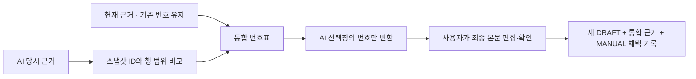

# 근거 번호 통합 — 서로 다른 E1을 섞지 않기

**현재 문서의 번호는 그대로 두고, AI 근거를 뒤에 연결합니다.**
예: 현재 [E1]은 새 자료이고 AI [E1]은 예전 자료라면, AI 문장의 번호만 [E2]로 바꿔 보여줍니다.

## 사용법

1. **부분 반영 편집 → 근거 번호 통합 미리보기**를 누릅니다.
2. “AI [E1] → 통합 [E2]” 같은 변환표와 근거 내용을 확인합니다.
3. 번호가 바뀐 AI 선택창에서 필요한 문장을 추가합니다.
4. 최종 본문과 통합 번호표를 대조하고 두 확인 항목에 체크해 저장합니다.

현재 본문과 이미 붙여넣은 내용은 자동 변환하지 않습니다.
통합 전에 붙여넣은 AI 문장이나 재조회 전 작성 내용은 **직접 번호를 확인**해야 합니다.
편집·재조회·오류는 확인 체크를 해제합니다. 재조회 후에는 통합 미리보기도 다시 선택합니다.

## 정확히 무엇을 합치나?

- 현재 문서의 근거 목록과 순서는 유지합니다. 중복 번호도 임의로 줄이지 않습니다.
- AI 근거의 **같은 스냅샷 ID + 같은 시작/끝 행**이 있으면 그 번호를 재사용합니다.
- 다른 스냅샷이나 다른 행 범위는 별도 근거로 뒤에 붙입니다. 문구가 같다는 이유로 합치지 않습니다.
- AI 원문의 [E숫자] 표기만 한 번에 바꿉니다. 번호 맞교환 시 두 번 치환하지 않습니다.
- 새 초안에는 통합된 당시 근거 연결을 저장합니다. 원본 파일을 다시 수집하거나 AI를 호출하지 않습니다.

모든 근거가 마지막 로컬 수집본 기준 CURRENT여야 하며 합계는 10개 이하입니다.
변경·삭제된 근거를 새 자료로 추측해 연결하지 않습니다. 해당 경우는 여전히 차단합니다.
최초 AI 결과가 편집됐거나 문서 버전/처리 상태가 바뀌어도 차단합니다.

번호 변환은 코드 블록 등 Markdown 문맥을 해석하지 않고 [E숫자] 표기 전체에 적용합니다.
자동 사실 검증이나 주장-근거의 의미적 연결은 아닙니다. 최종 초안은 사람이 대조하고 별도로 검토·게시해야 합니다.

## 모델과 실제 구현

`MergeEvidencePlanner`는 번호표와 변환된 AI 본문을 계산합니다.
`ProposalAcceptanceService`는 미리보기 때와 저장할 때 다시 계산하며 기대 버전·최신성·인용 범위를 검사합니다.
`KnowledgeService.reviseWithEvidence`는 서버에서 조회한 근거만 연결합니다. 클라이언트가 임의 스냅샷 ID를 전달하지 않습니다.
새 버전/근거 연결/채택 이력은 한 트랜잭션이며 실패 시 모두 롤백합니다.
이전 문서·AI 결과·게시본은 유지합니다.

DB는 **v12 그대로**입니다. 기존 `knowledge_evidence`에 통합 순서를 저장하고
`proposal_acceptance.mode=MANUAL`을 사용합니다. 별도 통합 여부 열은 없으며 최종 근거 목록은 반영 버전에서 확인합니다.

## API

읽기 전용 미리보기:
`GET /api/workspaces/{workspaceId}/generation-jobs/{jobId}/acceptance/merge-preview`

응답: `{sourceVersion,resultVersion,plan:{evidence,mapping,generatedMarkdown}}`.
mapping의 첫 값이 2라면 AI E1이 통합 E2가 됩니다. 미리보기는 저장하지 않습니다.

기존 `POST .../acceptance/merge`에 `"combineEvidence": true`를 추가하면 통합 근거로 저장합니다.
생략/null/false이면 기존 동일 근거 병합을 유지합니다. 저장할 본문의 인용은 통합 번호 기준입니다.
미리보기는 필수 토큰을 발급하는 절차가 아니며, 직접 API를 사용할 때도 변환표를 확인할 책임이 있습니다.
400: 잘못된 AI/최종 인용 번호. 404: 다른 Workspace·없는 작업/카드.
409: 문서 버전·처리 상태·근거 최신성 충돌, 편집된 결과, 통합 근거 10개 초과.

## 한계와 다음 작업

오래되거나 삭제된 근거를 새 원본으로 교체하는 기능은 아직 없습니다.
줄 단위 diff/충돌 표시, 임시 편집 복구 저장, 채팅/SSE, 선택적 폴링·Git 증분 갱신, Mac 설치형도 남아 있습니다.

## 검증 (2026-10-21, macOS Intel)

| 명령 | 실제 결과 |
|---|---|
| `npm --prefix frontend test -- --maxWorkers=2` | 90개 통과 |
| `npm --prefix frontend run build` | TypeScript/Vite 빌드 성공 |
| `bash scripts/maven.sh clean verify` | 167개 통과, 실제 CLI opt-in 1개 skip, JAR 빌드 성공 |
| `node scripts/smoke.mjs` | 현재 E1 보존·AI E1→E2 변환·통합 스냅샷/이전 버전/게시본의 재시작 보존 통과 |

백엔드 신규 9개: 번호 통합·중복/순서 유지·번호 맞교환·스냅샷/행 구별,
잘못된 인용·변경/누락 근거·10개 초과·Workspace/버전 격리·롤백·HTTP 계약.
UI 신규 3개: 명시적 미리보기·추가 확인·통합 저장, 버전 변경 시 편집 보존, 편집/재조회 시 동의 해제.

첫 백엔드 실행은 기존 merge 요청이 새 boolean 필드를 생략했을 때 HTTP 400이 발생해 1개 실패했습니다.
선택 필드를 nullable Boolean으로 받아 true일 때만 통합하도록 수정했고 기존 요청 포함 전체 회귀 테스트가 통과했습니다.
실제 AI 호출·이번 기능의 브라우저 시각 QA·Mac 설치형 검증은 하지 않았습니다. Smoke는 가상 CLI입니다.

100개 가상 파일 기준 시작 4,931ms, 재시작 5,183ms, 목록 p95 3.61ms, 검색 p95 10.90ms입니다.
단일 실행·소규모 자료이며 성능 보장은 아닙니다. [원시 기록](performance-phase3-foundation.json).
