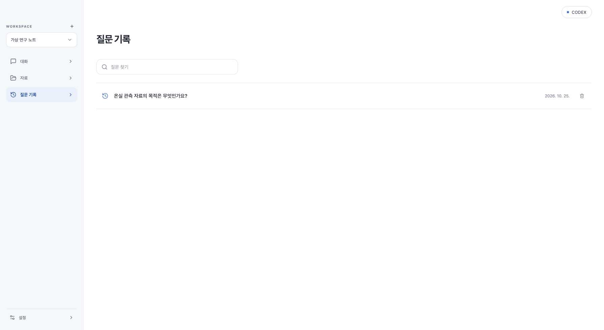

# 폴더 연결과 설정

자료를 넣는 버튼은 **자료 추가** 하나입니다. 파일·폴더·웹 링크·GitHub 중 고릅니다. 새 가상 폴더 만들기와 별도의 파일 추가 버튼은 없앴지만 기존 자료와 폴더는 보존합니다.

**질문 기록**은 제목·날짜·삭제 버튼의 세로 리스트입니다. 행을 누르면 메인 대화에서 해당 질문과 저장된 답변을 엽니다. 목록 조회만으로 AI를 실행하지 않습니다. 기존 고급 보관함 API/자료는 삭제하지 않았습니다.

## 사용법

1. **자료 → 자료 추가 → 폴더 → 폴더 선택**을 누릅니다.
2. Finder에서 폴더를 고르면 자동 등록·동기화합니다. 파일은 선택할 수 없습니다.
3. 이후 **동기화** 아이콘으로 변경 내용을 가져옵니다. 원래 폴더는 변경하지 않습니다.
4. 주기적으로 반영하려면 **설정 → Workspace 관리**에서 자동 갱신 토글과 주기를 설정합니다. 앱이 실행 중일 때만 갱신합니다.

PDF 같은 개별 파일은 **자료 → 자료 추가 → 파일**로 올리세요. 질문에만 쓸 파일은 대화 입력창의 **+**를 이용하세요.

Workspace 삭제는 **설정 → Workspace 관리**에 있습니다. 대상 이름을 확인한 뒤 삭제하며, PC의 원래 폴더는 지우지 않습니다.

### 이미 잘못 등록한 경우

이전 버전에서 PDF 경로를 ‘로컬 폴더’에 넣으면 동기화가 실패했습니다. 새 버전은 등록 단계부터 파일·없는 폴더·심볼릭 링크를 거부합니다. 기존 항목은 임의로 삭제하거나 위치를 바꾸지 않습니다. 올바른 폴더를 새로 연결한 뒤, 필요 없어진 항목은 확인 후 직접 삭제하세요.

폴더에 용량 제한을 넘는 파일이나 심볼릭 링크가 있어도 수집이 실패할 수 있습니다. 오류 메시지를 확인하고 필요한 파일만 모은 폴더를 선택하세요. 기존 크기·개수 제한과 실패 시 이전 자료 보존 정책은 유지합니다.

## 구조와 코드 대조

| 역할 | 실제 구현 |
|---|---|
| 설치 앱의 폴더 선택 | `folderPicker.ts` → Tauri `select_source_folder` → `blocking_pick_folder` |
| 권한 범위 | 현재 앱의 정확한 loopback origin·main 창만 허용. 파일/저장/임의 명령 권한은 제공하지 않음 |
| 선택 결과 | 폴더 경로만 화면에 반환. 선택 취소는 등록·수집하지 않음 |
| 등록·동기화 검증 | `LocalFolderCollector.validate`에서 실제 디렉터리 검사. 동기화 시 재검사 |
| 자동 갱신 | `SourceSettings` → 기존 polling API, 사용자 저장 시에만 변경 |
| Workspace 삭제 | `App` 설정 탭 → 기존 확인 창 → 기존 삭제 API |

브라우저 개발 화면에서는 폴더 선택 버튼이 비활성화됩니다. 브라우저의 파일 업로드를 폴더 동기화로 속이거나 경로 직접 입력으로 우회하지 않습니다. DB v22·승인·인증·Source 수명주기는 그대로입니다.

검증 결과와 설치본은 [0.1.12 기록](release-0.1.12-report.md)에 정리합니다.
