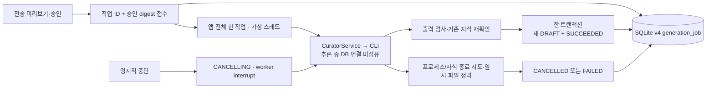

# AI 생성 작업 — 상태·취소·중복 방지·재시작 복구

후속 [건별 모델 선택](model-selection.md)에서 v5 요청 모델 이력을 추가했습니다.
아래 v4 설명은 최초 구현 기준이며 상태·취소·멱등 규칙은 계속 유지합니다.

2026-10-21. P3-2 운영 기능의 두 번째 구현 단위입니다. 지식 검증·게시 및 Phase 4 채팅/SSE는 아직 아닙니다.
Ollama 대신 로그인된 CLI를 사용하고, 전송 승인·제한된 근거·수동 문서 보호 원칙을 유지합니다.

## 사용 방법

1. 기존 지식에서 Provider 선택 → 전송 미리보기 → 동의 → 별도 AI 초안 생성.
2. 요청이 접수되면 화면을 계속 사용할 수 있습니다. 지식 화면 상단 **AI 생성 작업**에서 최근 20개를 봅니다.
3. 실행 중인 작업의 **생성 중단**을 누르면 중단 처리 중 → 취소됨으로 바뀝니다.
4. 완료된 작업은 **생성된 초안 열기**로 이동합니다. 결과는 여전히 미검증 DRAFT입니다.
5. 화면 이동/새로고침은 작업 취소가 아닙니다. 다시 지식 화면을 열면 DB의 작업 상태를 조회합니다.
6. 접수 응답을 잃으면 작업 새로고침 또는 **같은 요청 ID로 재전송**을 사용합니다.
   **새 승인 준비**는 기존 작업을 취소하지 않습니다. 새 ID로 생성하면 별도 작업이므로 중복 초안이 생길 수 있습니다.

이미 전송한 자료나 사용량은 취소로 회수되지 않습니다. 로컬 CLI 종료가 제공자 서버의 과금 취소를 보장하지 않습니다.
이 기능은 Source 폴링이나 자동 재시도가 아닙니다. 진행률 퍼센트는 알 수 없어 상태만 표시합니다.

## 구현 구조



- 도메인 `GenerationJob`, 포트 `GenerationJobStore`, 유스케이스 `GenerationJobService`, JDBC/HTTP 어댑터.
- 작업 ID는 클라이언트가 만든 16~64자 영문·숫자·하이픈·밑줄이며 Workspace 안에서 유일합니다. UI는 UUID 사용.
- 같은 ID + 같은 sourceCard/provider/version/digest는 기존 작업을 반환하고 모델을 다시 호출하지 않습니다.
  다른 내용으로 같은 ID를 재사용하면 409. 취소·실패·재시작 중단도 동일 ID로 재실행되지 않습니다.
- 최초 접수 때와 실제 실행 직전에 승인 내용을 검사합니다. 대기 중 원본/버전이 바뀌면 전송하지 않습니다.
- 결과 저장과 SUCCEEDED 전환은 동일 트랜잭션입니다. 상태 저장 실패 시 새 카드도 롤백합니다.
- 취소와 결과 커밋은 같은 애플리케이션 잠금으로 직렬화합니다. 취소가 먼저면 늦게 도착한 출력도 저장하지 않습니다.
  커밋이 먼저면 취소 요청은 SUCCEEDED를 반환하며 완료된 결과를 삭제하거나 취소됐다고 표시하지 않습니다.
- CANCELLING 동안 새 작업은 409. CLI 정리와 worker 종료가 끝나야 실행 슬롯을 반환합니다.
- Workspace 삭제는 작업 이력을 cascade 삭제합니다. 1초 주기의 로컬 확인 작업이 실행 중 worker를 중단시킵니다.
  이 확인 작업은 외부 통신을 하지 않습니다. 삭제 직전에 이미 전송된 데이터는 회수할 수 없습니다.
- 일반 종료는 worker에 interrupt를 보내고 최대 5초 기다립니다.
- 재시작 시 QUEUED/RUNNING/CANCELLING은 INTERRUPTED가 됩니다. 자동 재실행/외부 재전송하지 않습니다.
  SUCCEEDED/FAILED/CANCELLED와 기존 requestId/digest/resultCardId는 유지합니다.

## 저장 및 보안

스키마 v3→v4는 `generation_job`과 최근 작업 인덱스만 추가합니다. 기존 원본·지식·근거·버전은 유지합니다.
저장 필드는 ID/Workspace/기반 카드/Provider/기대 버전/승인 digest/상태/결과 카드/안전한 오류/시각입니다.
작업 테이블에는 프롬프트·원문·인증 파일·CLI stderr를 저장하지 않습니다. 기반 카드 삭제 후에도 작업 이력은 남습니다.
결과 카드를 따로 삭제하면 기존 작업의 결과 링크는 404일 수 있으며 재전송으로 부활시키지 않습니다.

`CliCuratorModel`은 관찰한 자식 PID를 기억하고 interrupt/실패/timeout 시 종료시킵니다.
최대 2초 정리를 기다리고 스트림·읽기 작업을 닫습니다. 테스트용 실제 부모/자식 프로세스 종료를 검증합니다.
단, 악의적인 daemon 탈출이나 OS가 종료를 거부하는 경우의 완전한 격리 보장은 아닙니다.
JVM 강제 종료/전원 손실 시 고아 CLI·임시 파일이 남을 수 있습니다. 재시작 시 작업 상태 복구는
이전 OS 프로세스의 종료 증명이 아닙니다. OS 프로세스 그룹/sidecar 감독과 잔여 파일 정리는 후속입니다.
DB 하나를 여러 앱 인스턴스가 동시에 여는 구성은 지원하지 않습니다.

## 남은 작업

- P3-2: CLI 설치/인증 상태와 모델 선택 UI, 실제 모델 ID·CLI 버전·생성 설정 영속 이력.
- 작업 이력 보존 기한/삭제/페이지네이션, 강제 종료 시 OS 프로세스 감독, 여러 앱 인스턴스 방지.
- 기존 동기 `/generation` API는 호환용이며 작업 추적/멱등/취소가 없습니다. 새 UI는 `/generation/jobs`만 사용합니다.
- P3-3 사람 검토·문장/근거 검증·게시와 이전 게시본 보존. P4 근거 우선 SSE·질문·중단은 별도 작업입니다.
- Claude 실제 생성은 이전 인증 오류로 여전히 미검증입니다. 이번 테스트는 외부 LLM 호출 없이 진행합니다.

## 검증 방법

```bash
npm --prefix frontend test
npm --prefix frontend run build
bash scripts/maven.sh clean verify
node scripts/smoke.mjs
```

자동 테스트는 mock 모델 및 테스트 전용 실행 파일로 실행됩니다. smoke는 임시 서버에만
`scripts/fixtures/fake-codex.sh`를 지정하여 실제 HTTP/작업/SQLite/자식 프로세스를 검사합니다.
**이 가짜 응답은 실제 AI 추론 검증이 아니며 기본 앱 설정이나 배포 JAR에 포함되지 않습니다.**
실제 Codex 검증의 이전 기록은 [CLI AI](cli-ai.md)에 있습니다.

집중 검사에서 interrupt된 테스트 모델의 checked exception이 terminal 상태로 반영되지 않는 문제를 발견했습니다.
worker 예외 처리와 중복 interrupt 방지를 수정했으며, 취소 후 늦은 응답과 DB 결과 저장 실패도 함께 검사합니다.

### 실제 회귀 실행 결과

- `npm --prefix frontend test`: **23개 통과**. 작업 복원·취소·중단/실패 표시·멱등 재전송·화면 종료 시 조회 중단 검사.
- `npm --prefix frontend run build`: TypeScript/Vite 성공.
- `bash scripts/maven.sh clean verify`: **78개 통과, 실패/오류 0, 실제 CLI opt-in 테스트 1개 skip**, 실행 JAR 성공.
- 추가 백엔드 검사: 작업 유스케이스 10개, v3 마이그레이션/재시작 복구 2개, 실제 부모/자식 프로세스 interrupt 종료 1개.
- 실제 AI 서버는 이번 회귀에서 호출하지 않았습니다. Claude 인증 오류는 해결했다고 보고하지 않습니다.
- `node scripts/smoke.mjs` 성공: 실제 JAR/HTTP에서 가짜 CLI 초안 생성·취소·중복 요청·재시작 후 이력/결과 보존 확인.
  최초 실행은 테스트 fixture의 `/var`와 `/private/var` 경로 별칭 비교 때문에 실패했고, 물리 경로 비교로 수정 후 통과했습니다.
- [최신 측정](performance-phase3-foundation.json): 시작 17,272 ms, 재시작 18,244 ms,
  100개 가상 파일 검색 p95 25.30 ms, 목록 p95 9.98 ms. 실제 LLM 지연이나 대규모 SLA 수치가 아닙니다.
- 이번 작업의 브라우저 수동 QA는 미실행입니다. UI는 자동 테스트와 번들 빌드로 검증했습니다.
