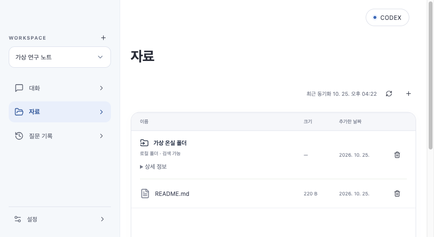
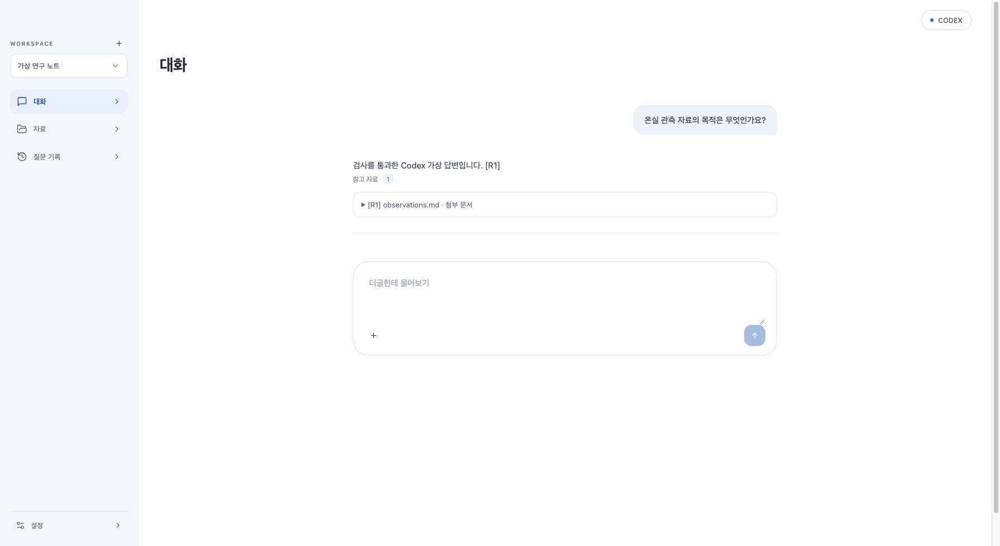
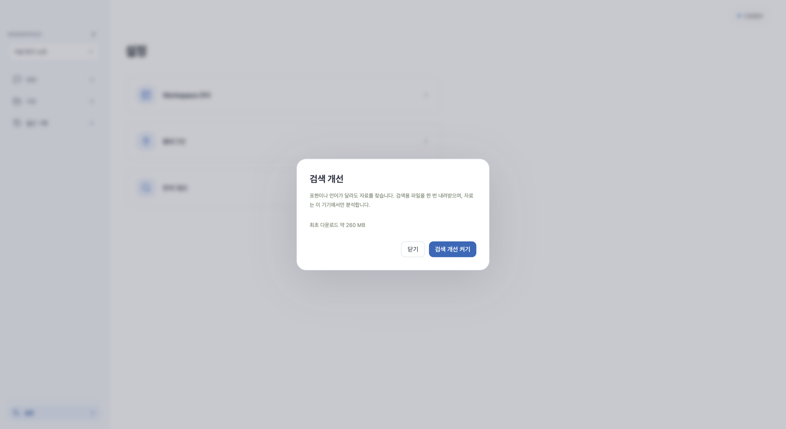

# 수집·검색 개선 작업

Dougle 0.1.20 · DB v25의 수집·검색 개선 기록입니다. 구현·가상 검사와 실제 외부 계정 검증을 구분합니다.

## 최신 후속 검증

검색 엔진 기본 포함·자동 준비, Notion 본문/제목 해제·조각 검색/답변 문맥 보완, 이력 체크박스 삭제, 대용량 분할의 반복 탐색 수정을 반영했습니다. 실제 문서의 40개 질문을 두 차례 검사해 최종 40/40을 확인했습니다. [정확도 범위·실제 AI 호출·회귀 결과](notion-search-verification.md).

UI 397개 통과, Java 468개 중 462개 통과/opt-in 6개 제외(기존 이름 제한 fixture 두 클래스는 실행 대상에서 제외). 실제 모델 검사는 별도로 통과했습니다. Intel 설치/재실행 완료, 백업 `2026-10-25T09-13-04.191Z-before-dougle`. JAR·네이티브·아이콘·검색 모델 해시·codesign·UI 200/인증 없는 API 403을 확인했습니다. 설치 로그는 `/tmp/dougle-notion-install.log`입니다.

Intel/ARM DMG·서명 업데이트 아카이브의 CPU·버전·현재 JAR·서명·설치 복사본·검색 모델 해시를 검증했고 `SHA256SUMS` 6개 모두 일치합니다. 최종 패키지 로그는 `/tmp/dougle-notion-packages.log`입니다. 공개 릴리스/피드는 변경하지 않았으며 ARM 실기기와 Apple 공증은 포함하지 않습니다. 아래 패키지/화면 수치는 이전 설치본의 이력입니다.

## 일곱 항목

1. Notion: OAuth form UTF-8 수정은 이전 설치본에 포함했습니다. 실제 계정 승인과 페이지 읽기 확인은 사용자 승인이 필요합니다.
2. 대용량: 폴더와 Git blob을 디스크 스냅샷으로 복사하고, 파일별 스트림 분석을 수행합니다. 업로드는 multipart 임시 파일을 사용합니다. SQLite 원본 저장 경계에서는 아직 파일 한 개의 byte 배열을 사용하며, 무제한 스트리밍 저장이라고 설명하지 않습니다.
3. 진행 상태: 읽은 바이트, 처리 파일, PDF 페이지, 추출, 문단 분할 단계를 실제 작업에서 보고합니다. 전체량을 모르면 indeterminate 표시입니다. 원본 발행 전 중단과 분석 체크포인트 재사용을 구현하고 재개 테스트를 통과했습니다.
4. 부분 실패: 읽기/분석 실패 파일은 이전 자료를 보존하고 다른 파일은 발행합니다. 변경되지 않은 분석 실패는 같은 분석을 반복하지 않습니다. 네트워크 시간 초과/일부 일시적 HTTP 실패만 최대 두 번 재시도합니다.
5. 링크: 원본 HTML은 보존하고 본문 추출 시 main/article을 우선하며 메뉴·스크립트를 제외합니다. Git class/IDE 산출물을 제외합니다. 검색 가능·일부 처리·연결 필요를 구별합니다.
6. 의미 검색: 다국어 로컬 임베딩과 Lucene 키워드를 결합하고 cross-encoder로 재순위화합니다. 특정 도메인 번역 사전은 넣지 않습니다. 최신 작업본은 검색 모델을 설치 파일에 기본 포함하고 자동 준비하며, 준비 중에는 새 질문을 잠급니다. 한국어 전략 패턴 질문→영문 코드, 설명 문장 없는 코드, 수기 건수의 바꿔 쓴 질문, 무관한 질문 제외와 Workspace 격리 검사를 유지합니다. 모든 도메인/표현에 대한 정확도 보증은 아닙니다.
7. 출처: 완료 답변에서 실제 `[R번호]`로 인용한 항목만 출력하며, 코드 블록 안의 번호와 미인용 후보는 제외합니다. 출력 애니메이션 완료 후 표시하는 기존 동작을 유지합니다.

## 처리 경계

- 원본 파일: 256 MiB, 자료 하나: 20,000개 파일·8 GiB 안전 한도입니다.
- 웹 HTTP 응답의 별도 10 MiB 보안 한도는 유지합니다. 큰 다운로드 링크를 임의로 무제한 가져오지 않습니다.
- 본문 추출: 최대 32,000,000자. 초과 시 앞부분과 PARTIAL 상태를 보존합니다. Java 2,000,000자 초과는 AST 대신 본문 검색을 제공합니다.
- PDF OCR·암호 해제·파일 형식 변환을 자동으로 수행한다고 표시하지 않습니다.
- Java/JDBC 원본 보관 메모리와 아주 큰 텍스트의 저장 비용이 남아 있습니다. 최종 성능 검증 전 모든 상한 크기에서 동작이 검증되었다고 보고하지 않습니다.
- 경로 탈출, 심볼릭 링크, 비공개 HTTP 목적지 차단은 유지합니다.

## 로컬 검색 모델

- 모델: [intfloat/multilingual-e5-small](https://huggingface.co/intfloat/multilingual-e5-small), MIT.
- 고정 revision: `614241f622f53c4eeff9890bdc4f31cfecc418b3`.
- 임베딩 ONNX int8와 tokenizer: 135,429,554바이트.
- 재순위화: [cross-encoder/mmarco-mMiniLMv2-L12-H384-v1](https://huggingface.co/cross-encoder/mmarco-mMiniLMv2-L12-H384-v1), Apache-2.0. 고정 revision `1427fd652930e4ba29e8149678df786c240d8825`, CPU별 양자화 ONNX와 tokenizer.
- 합계 Intel 271,132,230바이트(약 259 MiB), ARM은 1바이트 더 큽니다. 네 파일의 크기·SHA-256을 확인한 뒤 원자적으로 설치합니다.
- 패키지 제작 시 고정 revision·크기·해시를 검사하고 CPU별 모델과 라이선스를 동봉합니다. 설치 앱은 모델 다운로드를 요구하지 않습니다.
- 추론은 ONNX Runtime 1.20.0과 DJL tokenizer 0.29.0입니다. 두 JAR의 macOS Intel/ARM 네이티브 포함 여부를 확인했습니다. ARM 실제 실행은 별도 검증입니다.
- DJL 0.33.0에는 Intel macOS tokenizer가 없어 사용하지 않습니다.
- 앱 시작 후 모델과 색인을 비동기로 준비합니다. 별도 검색 설정은 표시하지 않습니다. 준비 실패는 대화 입력창에 안내하며 새 질문은 잠금 상태를 유지합니다. 앱을 재시작하면 준비를 다시 수행합니다.
- 개발/개별 테스트용 기존 다운로드 경로는 유지하지만 Mac 설치본의 기본 동작은 아닙니다.
- 검색 절차는 Java 코드가 실행합니다. 답변 AI에 검색용 sh 작성/실행이나 수집 권한을 넘기지 않습니다. 모델은 고정된 로컬 관련도 함수이며 권한·필터·한도·재시도는 프로그램 규칙입니다.

## 저장·복구

- DB v25: `source_analysis_checkpoint`, `source_file_failure` 추가.
- 체크포인트는 source/path/content hash에 묶입니다. 변경된 내용에는 오래된 분석을 재사용하지 않습니다.
- 재시작 시 실행 중 상태는 중단으로 바꾸고, 다음 동기화에서 완료된 분석을 재사용합니다. 수집 원본 전체를 영구 staging하는 방식은 아니므로 원본 읽기는 다시 수행합니다.
- 발행은 기존 트랜잭션과 revision/root CAS를 유지합니다. 실패한 경로와 그 부모/하위 경로의 이전 자료를 삭제로 오인하지 않습니다.
- Lucene 형식 버전이 같으면 재시작마다 전체 임베딩을 다시 만들지 않습니다. DB outbox로 변경을 이어서 반영합니다.
- 재구축 중에는 별도 building 표식을 기록하여 중간 색인을 완성본으로 오인하지 않습니다. 분석 체크포인트와 달리 중단된 색인 재구축은 처음부터 수행하며 큰 색인의 재구축 시간/시작 시간은 추가 성능 검증 대상입니다.

## 이전 설치본 회귀 검증

- `StreamingCollectionTest`: 10 MiB를 넘는 가상 텍스트의 마지막 문장까지 추출, 원본 불변, 임시 파일 정리, 큰 파일과 정상 형제 분리.
- `TextChunksTest`: Unicode 경계, 원문 오프셋·행 번호, 긴 한 줄·빈 본문 종료.
- UI 최종 전체 49파일·391개 통과, TypeScript/Vite 빌드 통과(기존 500kB 청크 경고).
- Java 전체 첫 실행: 460개 중 문서 스키마 계약 1개 실패와 기존 긴 Workspace 테스트 fixture 10개 오류. 스키마 문서 누락은 수정했습니다. 이번 변경과 무관한 `QuestionAttachmentIntegrationTest`, `AnswerPartialIntegrationTest`의 20자 초과 fixture는 변경하지 않았습니다.
- 해당 두 클래스를 제외한 최종 재실행은 55클래스·455개 중 453개 통과, 명시 opt-in 2개 제외입니다. 실패/오류는 0개입니다. 별도 실행 수는 중복 합산하지 않습니다. 실제 로컬 검색 모델 테스트는 포함했습니다.
- 실제 모델 테스트는 `FORGE_VERIFY_SEARCH_MODEL_DIR` opt-in입니다. 가상 문서만 로컬 추론하고 외부 AI 호출은 하지 않습니다.
- 13.2 MiB 가상 파일은 multipart 업로드·원본 저장·마지막 문장 색인까지 검사했습니다. 추출 PARTIAL 경고, Git blob 하나의 읽기 실패 시 형제 파일 보존, EUC-KR HTML, 색인 재구축 중단 표식도 포함했습니다.
- 최종 회귀와 UI 캡처를 완료했습니다. 로그: `/tmp/dougle-final-backend-regression.log`, `/tmp/dougle-final-ui-regression.log`, `/tmp/dougle-final-ui-build2.log`.
- 패키지 smoke 첫 실행은 30초 시작 제한을 넘겼고, 재실행에서 예전 CLUE 제목 단언을 발견해 Dougle로 수정했습니다. 후속 실행은 업로드·수집·검색 등 앞선 검사를 지나 `synthetic streaming smoke` Workspace의 기존 20자 제한 위반에서 중단되었습니다. 전체 smoke 통과로 보고하지 않으며 무관한 fixture는 변경하지 않았습니다. 로그: `/tmp/dougle-final-package-smoke-brand.log`.

## 이전 설치본 패키지

- Intel/ARM DMG와 서명된 업데이트 아카이브, CPU·버전·현재 JAR·설치 복사본 정적 검증 완료. SHA256SUMS 6개 모두 일치합니다.
- `/tmp/dougle-upgrade-final-packages.log`: `DOUGLE_PACKAGES_VERIFIED`, `/tmp/dougle-final-checksums.log`: 6개 OK.
- 로컬 manifest만 갱신했으며 커밋·푸시·GitHub 릴리스·공개 업데이트 피드는 변경하지 않았습니다.
- ARM 실기기 실행과 Apple 공증은 포함하지 않습니다.
- Intel 설치/재실행 완료. 백업 `2026-10-25T07-43-59.154Z-before-dougle`, 기존 인증 미변경·닫힌 DB 백업 후 교체했습니다. 설치 JAR/서명된 네이티브/아이콘 일치, codesign, UI 200·인증 없는 session/plugins API 403을 확인했습니다. 설치 로그: `/tmp/dougle-ingestion-final-install.log`.

## 이전 설치본 화면 확인

가상 Workspace와 문서만 사용하는 독립 브라우저에서 파일 업로드·질문 첨부·가상 답변·인용 출처·이력·설정을 확인했습니다. 가상 CLI 호출 1회이며 실제 답변 AI 호출은 없습니다. 폴더는 가상 경로로 등록하고 화면의 동기화 버튼을 눌러 검색 가능 상태를 확인했습니다. 실행 중 캡처는 브라우저 시간 초과로 확보하지 못했으며 진행/화면 잠금 분기는 자동 테스트와 구분합니다.

