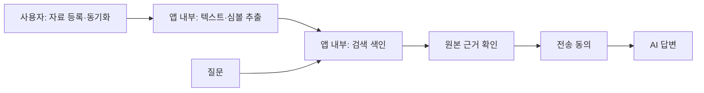
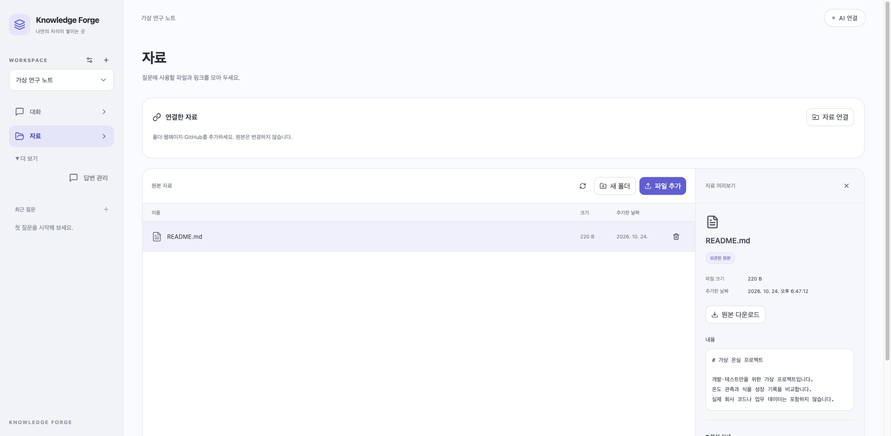

# 자료는 사용자가, 검색 준비는 앱이

사용자는 **자료를 넣고 질문**합니다. 검색을 위해 지식 문서를 직접 만들거나 편집할 필요가 없습니다.

앱은 등록된 자료에서 텍스트와 코드 심볼을 추출하고 검색 색인을 관리합니다. 질문하면 이 내부 자료에서 근거를 찾아 먼저 보여 줍니다. 전송에 동의한 뒤에만 AI가 답변합니다.

## 바뀐 점

- 지식 문서 메뉴와 원본 화면의 문서 생성·편집 진입점을 없앴습니다.
- 새 대화 질문은 원본 기반 검색만 사용합니다. 예전 편집형 지식 문서는 새 질문의 근거에 포함하지 않습니다.
- 예전 문서·답변은 삭제하지 않습니다. 지식 문서를 포함한 미완료 질문은 그대로 전송하지 않고 **원본으로 다시 질문**합니다. 완료한 답변은 그대로 읽을 수 있습니다.
- 원본을 갱신하면 기존 수집·분석·색인 경로로 검색 정보가 갱신됩니다. 질문할 때 모든 자료를 처음부터 분석하지 않습니다.

## 구현 범위

현재 자동 관리하는 내부 지식은 **추출문·심볼·Lucene 색인**입니다. AI가 의미를 판단해 요약 문서를 자동 생성·검증하는 새 기능을 추가한 것은 아닙니다. 향후 내부 요약을 추가하더라도 출처 연결·변경 무효화·게시 전 검증·외부 전송 동의를 지켜야 합니다.

기존 문서 DB와 호환 API는 보존합니다. 화면에서 편집 진입점을 제거한 것이지 로컬 API를 폐지하거나 새 보안 권한 체계를 추가한 것은 아닙니다. 명시적으로 `includeKnowledge=true`를 사용하는 예전 API 호출은 유지됩니다. 과거 답변을 사용자가 직접 문맥으로 고르는 고급 경로는 새 질문의 기본 검색과 별개입니다.

| 규칙 | 코드·검사 |
|---|---|
| 메뉴·문서 생성 진입점 제거 | `App.tsx`, `AnalysisPanel.tsx`, `App.test.tsx` |
| 원본만 근거로 선택 | `ChatPanel.tsx`: `includeKnowledge=false`, `ChatPanel.test.tsx` |
| 편집형 문서 검색 제외·문서 보존 | `EvidenceBundleIntegrationTest.originalOnlyQuestionsIgnoreEditableKnowledgeButPreserveTheDocuments` |
| 이전 미완료 질문 재검색 | `ChatPanel.tsx`, `ChatPanel.test.tsx` |

DB v21·원본 파일·검색 엔진·AI 전송 승인 계약은 유지합니다.
