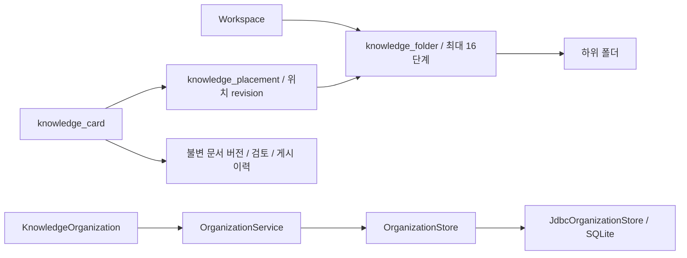

# 독립 지식 폴더와 카드 배치

## 사용 방법

1. 지식 문서에서 **지식 루트**를 누르고 새 지식 폴더 이름을 입력해 생성합니다.
2. 폴더를 열면 하위 폴더와 직접 배치된 카드만 표시합니다. 경로 버튼으로 상위 폴더로 이동합니다.
3. **전체 지식**에서 카드를 선택한 뒤 목적지 폴더를 열고 **선택한 카드를 현재 폴더로 이동**을 누릅니다.
4. 루트로 꺼내려면 **지식 루트**에서 같은 이동 버튼을 사용합니다.
5. 현재 폴더 삭제는 별도 확인을 요구하며 카드 또는 하위 폴더가 있으면 거부합니다.

필터를 바꿔도 선택한 문서는 계속 열려 있습니다. 배치 대상 카드 이름을 확인하세요.
본문 편집 중에는 폴더 탐색/이동을 막습니다. 이동 충돌은 폴더 새로고침 후 다시 확인합니다.
기존 카드와 새 수동/AI 초안은 루트에서 시작합니다. AI 생성 결과를 임의로 기존 폴더에 넣지 않습니다.
원본 폴더와 지식 폴더는 서로 독립이며 같은 이름을 사용할 수 있습니다.

## 저장 모델과 경계

SQLite v8에 `knowledge_folder`, `knowledge_placement`를 추가합니다. 기존 카드/버전 테이블에
열을 추가하지 않으므로 버전 내용, 생성 승인 digest, 검토 기록과 게시본이 이동으로 바뀌지 않습니다.

- 배치 기록이 없으면 루트·위치 revision 0입니다. 루트 재이동도 기록을 지우지 않고 revision을 증가시킵니다.
  따라서 이동→루트 복귀 후 과거 revision 0 요청이 다시 유효해지는 문제를 막습니다.
- PUT 이동은 기대 위치 revision과 현재 값을 비교합니다. 단일 연결 트랜잭션과 SQL 조건으로 동시 이동 중 한 건만 성공합니다.
- 폴더 생성은 같은 Workspace 부모만 허용하며 부모를 변경하는 API는 없습니다. 깊이는 16단계까지입니다.
- 이름은 trim 후 1~120자, 경로 구분자·제어문자·`.`·`..` 금지. 같은 부모의 같은 이름은 409입니다.
  현재 이름 비교는 대소문자를 구별하며 Unicode 정규화는 하지 않습니다.
- 빈 폴더 삭제 조건은 같은 트랜잭션의 DELETE에서 검사합니다. 폴더 삭제로 카드를 연쇄 삭제하지 않습니다.
- 카드 삭제는 해당 배치만 함께 삭제합니다. Workspace 삭제는 모든 폴더/배치를 정리합니다.
- 기존 `/knowledge` 목록은 전체 카드 목록 계약을 유지합니다. UI는 별도 폴더/배치 catalog로 목록을 필터링합니다.
- 외부 AI 호출·수집·검색 재분석은 하지 않습니다. UI 폴더 선택은 세션 상태이며 DB에는 구조/배치만 보존합니다.

## API

공통 경로 `/api/workspaces/{workspaceId}/knowledge-organization`.
변경 요청에 `X-Forge-Client: 1`이 필요합니다.

| 메서드/경로 | 요청/응답 |
|---|---|
| GET | 200 `{folders:[{id,parentId,name}],placements:[{cardId,folderId,revision}]}` |
| POST `/folders` | `{parentId:null 또는 지식 폴더 ID,name}` → 201 Folder |
| DELETE `/folders/{id}` | 빈 폴더만 204; 하위 폴더/카드가 있으면 409 |
| PUT `/cards/{id}` | `{folderId:null 또는 지식 폴더 ID,expectedRevision:정수}` → 200 최신 Catalog |

루트는 null입니다. expectedRevision은 필수이며 문서 버전 번호와 다릅니다.
이름/깊이/누락 revision은 400, 없는 Workspace/카드/폴더와 다른 Workspace의 ID는 404,
이름 중복/위치 충돌/비어 있지 않은 폴더는 409입니다. 원본 entry ID를 지식 폴더 ID로 사용할 수 없습니다.

## 업그레이드와 남은 범위

앱을 종료하고 데이터 디렉터리를 백업한 뒤 새 버전을 실행하세요. v1~v7에서 v8로 업그레이드하며
기존 데이터는 루트에 남깁니다. 구버전 앱으로 되돌리는 마이그레이션은 없습니다.

P3-4 전체가 완료된 것은 아닙니다. 폴더 이름 변경/이동, 드래그 배치, 일괄 이동,
안전한 Markdown 렌더링, AI 갱신 제안 UX, 대규모 catalog 페이지네이션/가상화는 남았습니다.
새 카드 생성 시 목적 폴더 지정과 마지막 탐색 위치 저장도 후속 범위입니다.

## 검증

가상 자료만 사용합니다. 실제 AI/수동 브라우저 QA는 이번 작업에서 실행하지 않았습니다.
신규 백엔드 8개: 이름/중복/깊이, 이동 시 버전·검토·게시 보존, 빈 폴더만 삭제,
Workspace/원본 폴더 격리, 카드/Workspace 삭제, 비어 있지 않은 Workspace cascade,
동시 이동 CAS, REST 헤더/필수 revision. 추가 v7→v8 마이그레이션 1개.
신규 UI 6개: 계층 필터링, 생성 실패 입력 보존, 위치 revision 전송, 삭제 확인/취소,
편집 중 차단·조회 중단, 실제 KnowledgePanel의 카드 선택→폴더 이동→목록/본문 유지.
JAR smoke에는 중첩 폴더/배치 재시작 보존·비어 있지 않은 폴더 삭제 거부·루트 복귀를 추가했습니다.

2026-10-21 검증 중 전체 UI 기본 병렬 실행에서 기존 App 폴더 탐색 테스트가 한 번
요소 대기 시간 초과로 실패했습니다. 해당 파일 단독 실행은 6개 통과했고,
`npm --prefix frontend test -- --maxWorkers=2` 전체 재실행은 48개 통과했습니다.
이 실패를 숨기지 않으며 자원 제약 환경에서는 worker 2개 실행을 사용하세요.
`npm --prefix frontend run build`의 TypeScript/Vite 빌드도 성공했습니다.

| 최종 검증 | 결과 |
|---|---|
| `bash scripts/maven.sh clean verify` | 125개 통과, 실제 CLI opt-in 1개 skip, 실행 JAR 성공 |
| `npm --prefix frontend test -- --maxWorkers=2` | 48개 통과 |
| `npm --prefix frontend run build` | TypeScript/Vite 성공 |
| `node scripts/smoke.mjs` | 실제 JAR HTTP·재시작 폴더/배치 보존·빈 폴더 삭제·기존 버전 보존 통과 |

기존 deprecated API/Mockito 동적 agent/Lucene vector/native access 경고는 남아 있습니다.
smoke의 AI 경로는 fake CLI fixture이며 실제 모델 성능 검증이 아닙니다.
측정 시각 2026-10-21T12:08:28Z, macOS Intel/Java 21: 시작 14,456ms, 재시작 16,628ms,
목록 p95 9.08ms, 검색 p95 26.36ms. 원시 값은 `performance-phase3-foundation.json`에 있습니다.
작은 가상 자료의 순차 요청 결과이며 대규모 폴더/동시 수집/LLM 성능을 대표하지 않습니다.
