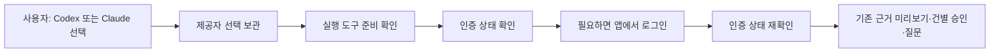

# 모델링 재점검 — 구현과 약속의 차이

0.1.3 재대조: `LocalRequestFilter`의 same-origin/UTF-8 계약을 실제 React/WebKit 변경 요청으로 검사하고, 네이티브 업데이트의 키·버전·종료/교체 경계를 `updates.rs`와 설치 smoke로 대조했습니다. DB v21과 기존 승인 모델은 변경하지 않았습니다. [이번 변경·실제 검사](release-0.1.3-report.md). 아래는 최초 감사 기록이며 파일 목록은 현재 소스에서 재생성합니다.

기준: 2026-10-22, DB v21. 간편 연결 개선 **전** 소스 기준은 `ce0277f`입니다.

## 어떻게 조사했나

`scripts/model-audit.mjs`는 Git의 추적/미추적(ignored 제외) 목록에서 backend, frontend, desktop, scripts의 코드·빌드 설정 파일을 모두 열어
경로·SHA-256·줄 수·테스트의 이름 참조를 [파일 목록](model-audit-inventory.json)에 기록합니다.
초기 목록은 273개(테스트/fixture 79개)입니다. 목록은 변경 후 재생성하므로 현재 수치는 JSON을 따릅니다.
Java 도메인 전체 의존성·application→adapter 역참조·모든 CREATE TABLE의 모델 문서 등재를 `ArchitectureContractTest`로 검사합니다.

**전 파일 목록/구조 검사는 전수 조사지만, 모든 줄의 수동 의미 검토나 모든 실행 경로 검증을 뜻하지 않습니다.**
이름 참조는 코드 커버리지가 아닙니다. 주요 상태 변경·보안 경로는 구현과 아래 회귀 테스트를 별도로 대조했습니다.

## 핵심 규칙 대조

| 모델의 약속 | 실제 코드 | 회귀 검사 | 판정 |
|---|---|---|---|
| Workspace 격리·원본 독립 | LibraryService/SqliteLibraryStore | LibraryIntegrationTest | 구현 |
| 실패 시 이전 수집본 유지 | SourceService/JdbcSourceStore.publish | SourceIntegrationTest | 구현 |
| 변경 파일만 분석 | SnapshotPlanner/SourceService | SnapshotPlannerTest, SourceIntegrationTest | 구현 |
| Source별 opt-in 예약 | SourcePolling/SourceStore | PollingIntegrationTest, SourcePollingTest | 구현 |
| 질문 시 재수집/LLM 호출 없음 | SearchService/SearchIndex | SourceIntegrationTest, PublishedSearchIntegrationTest | 구현 |
| 같은 선언·출처 관계 | RelationSearch/JdbcRelationCatalog | RelationSearchIntegrationTest | 구현, 의미/호출 그래프 아님 |
| 불변 초안·사람 편집 보호 | KnowledgeService/ProposalAcceptanceService | KnowledgeIntegrationTest, GenerationComparisonIntegrationTest | 구현 |
| 사람 검토 후 게시 | PublicationService | PublicationIntegrationTest | 구현, 자동 사실 검증 아님 |
| 승인과 실행 분리·일회 소비 | AnswerApprovalService/AnswerJobService | AnswerApprovalIntegrationTest, AnswerJobIntegrationTest | 구현 |
| 근거 먼저 SSE·중단 | AnswerJobEventsController/AnswerJobService | AnswerJobEventsIntegrationTest, AnswerPartialIntegrationTest | 가상 CLI 계약 검증 |
| 선택 문맥만 전송 | ConversationRequestService/StoredAnswerContext | ConversationIntegrationTest | 구현, 자동 전체 대화 전송 아님 |
| 설치 API 보호·종료 정리 | DesktopSession/Bootstrap, Rust supervisor | desktop 테스트, Rust 단위/설치 smoke | Intel 실행·ARM 정적 구분 |
| CLI 경로 설정과 실제 실행 일치 | CliLaunchConfiguration/CuratorSettings | CliLaunchIntegrationTest | 재시작 적용, 바이너리 내용 증명 아님 |

## 발견한 차이와 조치

1. **사용성 미완료:** CLI를 사용자가 설치·로그인하고 절대 경로를 입력해야 합니다. 앱에서 제공자만 골라 쓰는 목표와 다릅니다.
2. **연결 확인 없음:** `CliDiagnosticsAdapter`는 `--version`만 확인합니다. 인증은 UNKNOWN, 원격은 NOT_CHECKED입니다. “연결 완료”라고 표시하면 잘못입니다.
3. **실행 도구 미동봉:** DMG에는 Java/JAR만 있고 Codex/Claude 실행 파일은 없습니다. 앱만 설치하면 AI 준비도 끝난다는 안내는 하지 않습니다.
4. **문서 누적 불일치:** architecture/AGENTS 일부에 다중 대화가 미구현이라고 남아 있습니다. 선택 문맥 고정 경로는 이미 구현했으므로 바로잡습니다.
5. **Hexagonal의 범위:** domain은 순수 Java이고 포트→어댑터 방향을 지킵니다. application에는 Spring 서비스/트랜잭션 의존이 있습니다. 완전한 framework-free application이라고 주장하지 않습니다.
6. **외부 검증 경계:** 실제 ARM 실행·최신 제공자 인증/스트림 전체 호환성은 로컬 가상 테스트가 보증하지 않습니다.

첫 구조 테스트 작성 중 메서드 선언 오타로 컴파일이 실패했고 수정했습니다. 제품 오류를 숨기기 위해 테스트를 비활성화하지 않습니다.
전체 빌드·회귀 결과는 인수인계에 최신 수치로 기록합니다.
재실행 결과: `bash scripts/build.sh` 성공. 백엔드 **353 통과 + 실제 AI 1 제외**, UI **195 통과**, 구조 계약 **3개 통과**(백엔드 수치에 포함).

## 개선 모델 — 구현된 것과 예정 구분

감사 후 개발 소스에는 제공자 선택 기억·인증 조회·브라우저 로그인/중단과 Codex 동봉 빌드를 추가했습니다. [실제 개선 범위](provider-connection.md).
개선 후 목록은 코드·설정 305개, 테스트/fixture 분류 84개입니다. [실행 검사 결과](connection-verification.md).
이후 2D 테마의 SVG 컴포넌트/CSS를 더한 현재 목록은 307개이며, API/DB 모델은 변경하지 않았습니다. [디자인](retro-design.md).
기존 공개 0.1.1에는 없으며 Claude 동봉·실제 계정 인증·ARM 실행까지 완료됐다고 간주하지 않습니다.
상태는 도구 없음 / 인증 미확인 / 로그인 필요 / 인증 확인으로 구분하고,
원격 모델 이용 가능 여부는 별도입니다. 연결 확인만으로 문서 전송·추론을 실행하지 않습니다.
토큰·계정 이메일·CLI 오류 원문을 API/로그/감사 문서에 노출하지 않습니다.

제공자 정책 확인: [Codex app-server 인증](https://learn.chatgpt.com/docs/app-server),
[Claude 명령 규격](https://code.claude.com/docs/en/cli-reference),
[Claude 제품 포함 조건](https://code.claude.com/docs/en/legal-and-compliance).
배포·인증 조건과 실제 기기 확인을 거치지 않은 자동 설치/로그인 버튼은 가짜 완료 화면으로 만들지 않습니다.
