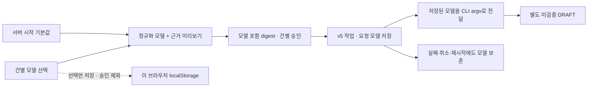

# 건별 모델 선택·요청 모델 이력 (SQLite v5)

0.1.4 E2E에서 제공자 선택 후 화면을 다시 열 때 Codex 설정을 잘못 복원하는 문제를 찾아 수정했습니다. `GenerationPanel`은 선택된 제공자의 설정만 읽고, 그 제공자에 저장한 값이 없으면 앱 설정을 사용합니다. 승인·기존 작업은 바꾸지 않으며 DB는 v21입니다. [재현과 회귀 검사](e2e-report.md).

후속 [실행 전 CLI 관측 이력](cli-observation.md)에서 SQLite v6을 추가했습니다. 아래는 v5 구현 당시 기록입니다.

2026-10-21. P3-2 운영 기능의 후속 구현입니다. 이전 시작 설정·설치 진단은
[CLI 설정](cli-settings.md), 생성 수명주기는 [작업 설계](generation-jobs.md)를 참고하세요.

## 사용 흐름

1. 지식 카드에서 제공자를 선택합니다.
2. **서버 설정 사용 / CLI 기본 선택 / 모델 ID 직접 지정** 중 하나를 고릅니다.
3. 전송 미리보기의 요청 모델·근거를 확인한 후 이번 전송을 승인합니다.
4. 생성 작업 목록에서 성공·실패·취소 작업에 기록된 요청 모델을 확인합니다.

직접 지정은 사용자가 계정에서 이용 가능한 모델 ID를 알고 입력하는 방식입니다.
모델 목록 조회나 계정별 사용 가능성 확인을 제공하지 않습니다.
모델 또는 제공자를 변경하면 이전 미리보기·승인을 즉시 폐기합니다.
접수 응답이 유실되면 모델 선택을 잠그고 기존 ID/승인 digest/모델로만 재전송합니다.

**이 브라우저에 모델 선택 저장**은 제공자별 선택 방식과 ID만 localStorage에 저장합니다.
문서·인증 정보·미리보기·전송 승인은 저장하지 않으며 화면 재진입 시 자동 전송도 없습니다.
선택은 이 브라우저/출처에만 적용됩니다. 다른 PC·브라우저 또는 DB 백업에 포함되지 않습니다.
저장이 차단되면 오류를 표시하되 현재 화면의 선택으로 계속 사용할 수 있습니다.

## 서버 계약

미리보기, 동기 생성 호환 API, 비동기 작업 접수에 `requestedModel`을 추가했습니다.

| 요청 값 | 의미 |
|---|---|
| 생략 또는 null | 해당 제공자의 서버 시작 설정을 사용 |
| 빈 문자열 | 서버 설정과 무관하게 CLI에 `--model`을 전달하지 않음 |
| 식별자 문자열 | 서버 설정을 덮어쓰는 이번 요청의 모델 |

모델 식별자는 양끝 공백 제거 후 128자 이하, 영문/숫자로 시작하고 `._:/-`와 영문/숫자만 허용합니다.
잘못된 값은 CLI 호출 전 400입니다. 유효한 모델 ID라도 계정 지원 여부는 실행 시 실패할 수 있습니다.
미리보기는 정규화·해석된 `requestedModel`을 반환합니다. UI는 작업 접수 시 이 값을 명시적으로 보냅니다.
Provider·Workspace·카드·버전·근거 지시문·요청 모델이 같은 digest에 바인딩됩니다.
다른 모델에 이전 digest를 사용하면 409이며 외부 AI 호출은 없습니다.

`CuratorModel.generate(provider,prompt,requestedModel)` 포트는 해석된 모델을 명시적으로 받습니다.
CLI 어댑터는 건별 모델을 임의로 서버 기본값으로 바꾸지 않습니다.
`GenerationJobService`는 승인 검증과 모델 기록을 같은 짧은 DB 트랜잭션에서 처리하고,
worker는 저장된 모델로 다시 검증한 후 실행합니다. CLI I/O 동안 DB 연결은 점유하지 않습니다.

같은 requestId의 Provider/기반 카드·버전/digest가 달라지면 기존처럼 409입니다.
명시된 모델이 저장된 모델과 달라도 409입니다. 모델을 생략한 구형 클라이언트의 재전송은
같은 digest일 때 이전 결과를 반환하며 현재 서버 기본값으로 재실행하지 않습니다.

## 영속성과 마이그레이션

SQLite v4→v5에서 `generation_job.requested_model TEXT`만 추가합니다.
새 작업은 승인 당시 모델을 저장합니다. 빈 문자열은 명시적인 CLI 기본 선택입니다.
기존 작업은 null을 유지하고 UI에 **기록 없음 (이전 작업)**으로 표시합니다.
과거 요청 모델을 현재 서버 설정으로 채워 넣거나 실제 실행 모델로 추정하지 않습니다.
기존 작업 ID/digest/상태/결과 카드와 지식·원본 데이터는 그대로 보존합니다.

재시작 시 진행 중 작업은 기존 정책대로 INTERRUPTED이며 모델도 보존합니다.
완료·실패·취소 작업은 서버 기본 모델이 변경되어도 당시 요청 모델을 유지합니다.
v5 DB를 구버전 앱으로 열면 거부합니다. 업그레이드 전에 앱을 종료하고 데이터 디렉터리를 백업하세요.

## 범위와 남은 작업

요청 모델은 실제 실행 모델과 다릅니다. 별칭·CLI 기본 선택은 제공자 측에서 달라질 수 있습니다.
실제 실행 모델 ID, 생성 당시 CLI 버전, 토큰 사용량의 구조화된 저장은 아직 없습니다.
`--version` 진단은 현재 설치 확인일 뿐 로그인·원격 연결·과거 실행 버전의 증거가 아닙니다.
인증 상태 진단, 강제 종료 프로세스 감독, 의미적 검증·게시, 채팅·폴링·Tauri는 남아 있습니다.

테스트는 가상 자료/가상 CLI를 사용합니다. 실제 외부 AI 생성과 브라우저 수동 QA는 이번 검증에 포함하지 않습니다.

## 자동 검증 기록

환경: macOS Intel / Java 21.0.10 / Node 24.2.0.

- `npm --prefix frontend test`: 30개 통과. 모델 변경 시 재승인, 제공자별 선택 저장/복원,
  승인 비저장, 빈 모델 처리, 같은 ID 재전송, 이전 작업의 미기록 표시를 검증했습니다.
- `npm --prefix frontend run build`: TypeScript/Vite 성공.
- `bash scripts/maven.sh clean verify`: 백엔드 91개 통과, 실제 AI opt-in 1개 skip.
  v1/v2/v3/v4→v5 보존·재열기, 요청 모델 승인·CLI 인자 전달, 작업 성공/취소/실패 모델 기록을 검증했습니다.
- 초기 핵심 테스트 실행에서 blocking Mockito 응답을 `when`으로 재설정해 기존 응답이 실행되는
  fixture timeout 1건이 있었습니다. `doThrow`로 수정 후 작업 테스트 12개 및 전체 테스트가 통과했습니다.
- `git diff --check`, `node --check scripts/smoke.mjs`: 통과.
- 최종 UI를 포함해 `bash scripts/maven.sh clean verify && node scripts/smoke.mjs`도 통과했습니다.
  실제 JAR에서 서버 기본값과 다른 모델을 지정해 가상 CLI에 전달하고, 성공/취소 이력을 저장한 뒤
  서버 기본 모델을 변경해 재시작해도 기존 요청 모델·digest·멱등 응답이 유지됨을 확인했습니다.
  fake CLI는 실제 LLM이 아니며 이번 실행에서 외부 AI를 호출하지 않았습니다.
- 성능 기록: `performance-phase3-foundation.json`, 2026-10-21T11:30:23Z.
  시작 11,944ms, 재시작 11,921ms, 목록 p95 6.59ms, 검색 p95 21.68ms.
  작은 가상 파일 100개 순차 측정이며 대규모 동시 처리·실제 AI 성능을 의미하지 않습니다.
