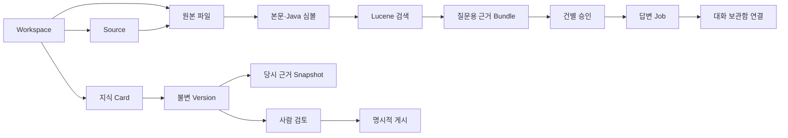

# 모델링 — 무엇을 어떻게 보관하나?

## Slack 답변 영수증 (DB v28 작업본)

`slack_reply`는 사용자가 확인한 본문과 수신 항목·Workspace·채널·스레드 범위를 고정하고 미리보기/실행 요청 ID를 각각 중복 없이 보관한다. 전송 횟수는 0 또는 1이며 실행 전에 SENDING으로 기록한다. 시작 시 남아 있는 SENDING은 UNCERTAIN으로 바꾸고 자동 전송하지 않는다. Slack 자체의 정확히 한 번 전달을 보증하는 상태가 아니다. SENDING이 있는 Workspace의 삭제는 원자적으로 거부한다. 이 테이블에는 인증 토큰을 저장하지 않는다. v28 서비스/UI는 통합 작업 중이며 실제 Slack 전송 검증은 별도다.

## 수집 복구 (DB v25)

`source_analysis_checkpoint`는 source/path/content hash별 완료 분석을 보관합니다. 중단 뒤 같은 파일의 분석을 재사용하며 변경된 파일에는 적용하지 않습니다. `source_file_failure`는 경로별 제외 원인을 저장합니다. 실패 경로의 이전 원본을 보존하고 정상 파일만 발행합니다. 두 테이블은 Source 삭제 시 함께 삭제됩니다. [수집·검색 변경](ingestion-retrieval-upgrade.md).

## 플러그인 연결 (0.1.20 후속)
Notion/MySQL 연결 정보는 DB 테이블 대신 앱 데이터의 암호화된 PluginVault에 앱 전체 연결로 보관합니다. Notion은 기존 URL Source, MySQL은 MYSQL Source의 비밀 없는 host:port/database 위치로 식별합니다. 수집 결과는 기존 Source 원본/분석/검색 모델을 따릅니다. MySQL 연결 대상 변경 후 다른 DB의 기존 Source를 임의의 새 DB로 대체하지 않으며 연결 필요 오류를 표시합니다. [보호 범위·API](plugins.md).

## 질문 첨부 (0.1.11 후속, DB v22)

`question_attachment`는 **질문에만 쓰는 파일**입니다. Workspace 1:N 첨부, 질문(`evidence_bundle`) 1:N 첨부이며 질문 전에는 bundle_id가 비어 있습니다. ID·파일명·MIME·바이트·SHA-256·추출문·잘림 여부를 저장합니다. 질문 생성과 연결은 하나의 트랜잭션이며 연결 뒤 수정하지 않습니다. 질문/서재를 지우면 함께 삭제합니다. 자료 탐색기·검색 색인과 독립적입니다. [제한·승인·코드·API](question-attachments.md).

아래 “새 테이블 없음/v21 유지”는 첨부 기능을 넣기 전의 단계 기록입니다. 현재 개발 스키마는 v22입니다.

최신 결정: 사용자는 원본 자료만 관리하고 검색용 추출문·심볼·색인은 앱이 관리합니다. 편집형 지식 문서는 보존하되 화면에서 편집하거나 새 대화 검색에 사용하지 않습니다. 새 모델·DB 마이그레이션 없이 검색 범위를 분리했습니다. [쉬운 원리·실제 구현 범위](internal-search.md).

0.1.11은 대화 화면과 최근 질문 목록을 기존 `EvidenceBundle`·`AnswerJob`에 연결합니다. 새 테이블 없이 저장된 질문·근거·답변을 다시 읽고, 새 질문의 선택 모델만 미리보기와 승인에 고정합니다. 연결 전 질문 잠금은 UX 장치이며 서버의 전송 승인·재검증을 대체하지 않습니다. [화면·코드·검사 대조](chat-first.md).

0.1.10은 기능 모델을 삭제하지 않고 기본 화면의 단계를 줄였습니다. `QuickAnswerPanel`이 명시적 동의 후 기존 `AnswerApproval`의 조건부 저장과 `AnswerJob` 접수를 순서대로 호출합니다. 요청 ID를 고정해 응답 유실 시 중복 생성을 막으며 DB v21·근거 보존·게시 조건은 그대로입니다. [흐름과 테스트 대조](simple-workflow.md).

0.1.7 전용 Codex 로그인은 제공자 CLI가 관리하는 별도 파일이며 DB 테이블이 아닙니다. 앱은 토큰을 조회·복사·반환하지 않습니다. 실행 프로필을 승인 digest에 결합하고 기존 v21 모델을 유지합니다. [실제 코드 대조](codex-managed-login.md).

0.1.6: 자료 이름·분류는 기존 Source의 설정입니다. `pollingRevision`으로 폴링 설정과 함께 충돌을 막고, Source·원본 루트 폴더·검색 큐를 한 번에 바꿉니다. 원본 반영 버전·지식 내용·과거 근거는 유지합니다. [모델과 실제 코드 대조](source-metadata.md).

0.1.5: Git은 앱 안에 포함된 실행 도구입니다. 자료 모델을 추가하지 않고 기존 Source revision·변경 blob·지식 최신성 모델을 사용합니다. `supervisor → GitRunner → GithubCollector`의 연결과 경로 격리를 [코드·검사에 대조](bundled-git.md)했습니다.

0.1.4: 브라우저의 모델 선택은 제공자별로 분리합니다. 선택된 제공자와 초기 모델 설정이 일치하는지 실제 UI와 회귀 테스트로 대조해 수정했습니다. DB v21과 승인 모델은 변경하지 않습니다. [전체 E2E](e2e-report.md).

**재점검 결과:** [전체 파일 조사 범위·규칙별 코드/테스트 대조·차이](model-audit.md).
현재 CLI 경로 설정과 목표인 제공자 선택형 연결은 다릅니다. 설치 확인을 인증/연결 완료로 간주하지 않습니다.
0.1.2부터 [제공자 선택·인증 확인·로그인](provider-connection.md)이 포함됩니다. 최신 [0.1.3 설치 파일과 검증](release-0.1.3-report.md)은 실제 버튼 요청 오류도 수정합니다.

현재 개발 소스의 DB는 **SQLite v21**입니다. 원본, 지식, AI 요청을 따로 보관합니다.
Intel/Apple Silicon 패키지에서 같은 모델을 사용합니다. CPU 지원 추가로 스키마를 변경하지 않습니다.
원본 파일을 CPU별로 변환하지 않으며, 로컬 Source·CLI의 절대 경로는 다른 PC에서 다시 확인해야 합니다.

## 핵심 용어와 실제 테이블

| 쉽게 말하면 | 모델/테이블 | 역할 |
|---|---|---|
| 프로젝트 서랍 | `workspace`, `app_state` | 자료 격리, 마지막 선택 |
| 연결한 자료 위치 | `source`, `source_http_cache` | 폴더/URL/GitHub, revision·오류·예약·HTTP 확인표; 이름·분류 편집은 pollingRevision으로 충돌 검사 |
| Workspace 자동 갱신 | `workspace_source_polling` | v23. Workspace별 활성 여부와 CAS revision. 토글은 기존 자료에 원자적으로 적용하고 새 자료가 상속하며, 기존 개별 설정은 사용자가 변경하기 전까지 보존합니다. |
| 원본 복사본 | `entry` | 폴더·파일 바이트, Source 경로·해시 |
| 검색 준비 결과 | `extracted_document`, `symbol`, `search_outbox` | 본문·Java 선언·색인 갱신 큐 |
| 지식 문서 | `knowledge_card`, `knowledge_version` | 문서 식별자와 불변 Markdown 버전 |
| 지식 폴더 | `knowledge_folder`, `knowledge_placement` | 원본 폴더와 독립된 문서 배치 |
| 당시 근거 | `evidence_snapshot`, `knowledge_evidence` | 원본 바이트·글·위치·해시·인용 행 |
| 검토·게시 | `knowledge_review`, `knowledge_publication` | 사람이 확인한 버전과 실제 게시 이력 |
| AI 초안·제안 | `generation_job`, `proposal_decision`, `proposal_acceptance` | 생성·취소·거절·채택 이력 |
| 질문과 답변 | `evidence_bundle`, `answer_approval`, `answer_job` | 불변 근거·건별 승인·답변 작업 |
| 대화 보관함 | `conversation`, `conversation_turn`, `conversation_request` | 완료 답변 연결과 명시적으로 고정한 문맥 |
| 실행 경로 설정 | `cli_launch_settings` | 앱 전체 CLI 경로, 설정 충돌 방지 revision |

## 관계를 그림으로

그림은 개념 관계입니다. 원본 삭제가 근거 Snapshot 삭제로 이어지지 않습니다.
지식의 DRAFT 버전을 덮어써 상태를 바꾸는 대신 별도 검토/게시 이력을 추가합니다.

## 실제 코드와 크로스체크

| 규칙 | 실제 구현 | 검증/상세 |
|---|---|---|
| 같은 파일 ID 유지, 변경 파일만 분석 | `SourceService → SnapshotPlanner → JdbcSourceStore` | [증분 반영](incremental-snapshots.md) |
| Source별 기본 OFF·동시 작업 제한·백오프 | `SourcePolling`, `JdbcSourceStore.beginPoll` | [자동 갱신](source-polling.md) |
| Git/URL 변경 없으면 재사용 | `GithubCollector`, `UrlCollector`, `PublicHttpReader` | [Git](git-incremental.md), [URL](url-conditional.md) |
| 수동 편집/이전 버전 보존, 검토 후 게시 | `KnowledgeService`, `PublicationService` | [게시](publication.md), [제안 병합](proposal-merge.md) |
| 검색과 AI 실행 분리 | `SearchService` vs `AnswerJobService`/`CliAnswerModel` | [답변](answer-jobs.md) |
| 같은 출처/선언 심볼 연결만 표시 | `RelationSearch → JdbcRelationCatalog` | [관계 탐색](relations.md) |
| 선택한 이전 문맥만 불변 저장 | `ConversationRequestService`, `StoredAnswerContext` | [문맥](context-requests.md) |
| 경로 설정은 재시작 적용, 새 승인 필요 | `CliLaunchConfiguration`, `CuratorSettings.executionBinding` | [CLI 설정](cli-launch-settings.md) |
| 설치형 API 보호·부모 종료 시 Java 정리 | `DesktopBootstrap`, `DesktopSession`, Rust `supervisor` | [설치형 보안](desktop-backend.md) |
| 앱만 서명 확인 후 교체, 자료 폴더 보존 | Rust `updates.rs`, `Lifecycle`, Tauri Updater | [업데이트](automatic-updates.md), 가상 앱 설치·변조/버전 불일치 차단 검사 |

마이그레이션의 실제 테이블과 대조한 파일:
`backend/src/main/java/dev/knowledgeforge/library/adapter/persistence/DatabaseConfiguration.java`.

## 추가 검색 계획·팀 설정 가져오기 (DB v26)

- `investigation_plan`: 별도 검색 계획 미리보기의 불변 요청문·범위 해시·제공자·모델·만료와 일회 승인 소비, 작업 상태·검색어·로컬 결과를 저장합니다. 기존 답변 승인과 구별하며 새 근거로 다시 답변할 때는 새 답변 승인이 필요합니다. Workspace/근거 삭제 시 함께 삭제합니다. 재시작 시 미완료 계획은 실패 처리하고 재실행하지 않습니다.
- `team_settings_import_receipt`: 가져오기 요청 ID·계획 ID·해시·적용 결과를 저장합니다. 요청 재전송은 같은 결과를 반환하고, 계획 ID의 유일 제약으로 다른 요청 ID를 이용한 재적용을 막습니다. 생성된 Workspace 삭제 뒤에도 재생성되지 않도록 영수증을 보존합니다. 인증정보·자료 본문은 포함하지 않습니다.
- 두 테이블은 v25 → v26 트랜잭션 마이그레이션으로 생성하며 기존 자료·대화·승인 테이블을 재작성하지 않습니다. 이전 버전 앱으로 새 DB를 열 수 없으므로 다운그레이드로 복구하지 않습니다.

## 반드시 구분할 것
- 업데이트 정보(`updates/preview.json`)와 공개 키는 앱 배포 모델입니다. SQLite 테이블이나 지식 버전이 아니며 개인 서명 키는 빌드 PC에만 둡니다. 다운로드·설치 확인과 AI 전송 승인은 별개입니다.
- `ProviderLogin.Status`는 메모리 작업(PENDING → AUTHENTICATED/FAILED/CANCELLED/TIMED_OUT)입니다. 토큰/로그인 이력을 SQLite에 추가하지 않으며 DB v21은 유지합니다.
- 기본 제공자 선택은 UI 로컬 저장소에만 보관합니다. 이미 승인한 요청이나 진행 작업의 제공자를 바꾸지 않습니다.
- CURRENT는 현재 **로컬 복사본과 일치**한다는 뜻이지 사실·원격 최신성 검증이 아닙니다.
- 심볼 이름 일치는 함수 호출 관계가 아닙니다. 관계 탐색 결과를 자동으로 AI 근거에 넣지 않습니다.
- CLI 경로 식별자는 바이너리 내용/서명 검증이 아닙니다.
- 임시 AI 스트림은 메모리에만 두며 최종 검사 전에는 확정 답변으로 저장하지 않습니다.
- 영속 Git 캐시, 자동 의미 검증, 비공개 저장소·키체인, 대규모 ArtifactStore는 [후속 로드맵](backlog.md)입니다.

## Workspace 관리 화면 (0.1.11)

대화·자료 화면과 Workspace 관리를 분리했습니다. 왼쪽 Workspace 관리 아이콘 → 전체 목록 → 삭제 대상 이름 확인 → 명시적 삭제 순서입니다. 삭제 요청은 화면의 현재 선택이 아니라 확인한 Workspace ID에 묶입니다. 비활성 Workspace를 삭제해도 현재 대화 선택은 바뀌지 않습니다. 기존 Workspace 모델과 API·DB v21은 그대로입니다. `App.tsx`와 `App.test.tsx`에서 활성/비활성 삭제·취소 경로를 대조합니다.
# DB v27 브라우저 조사

`browser_investigation`은 Workspace·불변 근거·정확한 HTTPS 페이지/GET 경로 범위를 일회 승인에 묶고 요청 ID, 진행 상태, 제한된 캡처 결과를 보관한다. Workspace/근거 삭제는 해당 조사 기록도 삭제한다. 재시작 중 미완료 실행은 실패 처리하며 자동 재실행하지 않는다. 브라우저 인증 정보·사용자 프로필은 저장하지 않는다.

`workspace_archive_import_receipt`는 자료·대화 ZIP 가져오기의 요청 ID와 미리보기 ID를 각각 한 번만 적용하고 결과를 보관한다. 가져온 Workspace를 삭제하거나 앱을 다시 시작해도 같은 요청을 다시 적용하지 않는다. 인증/실행 승인은 이전하지 않는다.

`slack_inbox_route`는 채널별 Workspace 배치, `slack_inbox_item`은 수신 메시지·명시적 대화 저장 결과, `slack_inbox_seen`은 이벤트 중복 방지 시각, `slack_inbox_thread`는 Slack 스레드와 대화의 연결을 보관한다. Workspace 연결 행은 해당 Workspace 삭제와 함께 지워지며 수신 자체로 AI 호출이나 답변 게시를 하지 않는다. 인증 토큰은 이 테이블에 저장하지 않는다.
