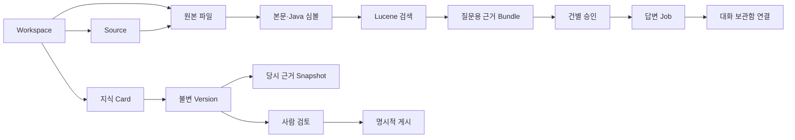

# 모델링 — 무엇을 어떻게 보관하나?

**재점검 결과:** [전체 파일 조사 범위·규칙별 코드/테스트 대조·차이](model-audit.md).
현재 CLI 경로 설정과 목표인 제공자 선택형 연결은 다릅니다. 설치 확인을 인증/연결 완료로 간주하지 않습니다.
0.1.2에는 [제공자 선택·인증 확인·로그인](provider-connection.md)이 포함됩니다. [설치 파일과 검증](release-0.1.2-report.md). 0.1.1에는 이 기능이 없습니다.

현재 개발 소스의 DB는 **SQLite v21**입니다. 원본, 지식, AI 요청을 따로 보관합니다.
Intel/Apple Silicon 패키지에서 같은 모델을 사용합니다. CPU 지원 추가로 스키마를 변경하지 않습니다.
원본 파일을 CPU별로 변환하지 않으며, 로컬 Source·CLI의 절대 경로는 다른 PC에서 다시 확인해야 합니다.

## 핵심 용어와 실제 테이블

| 쉽게 말하면 | 모델/테이블 | 역할 |
|---|---|---|
| 프로젝트 서랍 | `workspace`, `app_state` | 자료 격리, 마지막 선택 |
| 연결한 자료 위치 | `source`, `source_http_cache` | 폴더/URL/GitHub, revision·오류·예약·HTTP 확인표 |
| 원본 복사본 | `entry` | 폴더·파일 바이트, Source 경로·해시 |
| 검색 준비 결과 | `extracted_document`, `symbol`, `search_outbox` | 본문·Java 선언·색인 갱신 큐 |
| 지식 문서 | `knowledge_card`, `knowledge_version` | 문서 식별자와 불변 Markdown 버전 |
| 지식 폴더 | `knowledge_folder`, `knowledge_placement` | 원본 폴더와 독립된 문서 배치 |
| 당시 근거 | `evidence_snapshot`, `knowledge_evidence` | 원본 바이트·글·위치·해시·인용 행 |
| 검토·게시 | `knowledge_review`, `knowledge_publication` | 사람이 확인한 버전과 실제 게시 이력 |
| AI 초안·제안 | `generation_job`, `proposal_decision`, `proposal_acceptance` | 생성·취소·거절·채택 이력 |
| 질문과 답변 | `evidence_bundle`, `answer_approval`, `answer_job` | 불변 근거·건별 승인·답변 작업 |
| 대화 보관함 | `conversation`, `conversation_turn`, `conversation_request` | 완료 답변 연결과 명시적으로 고정한 문맥 |
| 실행 경로 설정 | `cli_launch_settings` | 앱 전체 CLI 경로, 설정 충돌 방지 revision |

## 관계를 그림으로

그림은 개념 관계입니다. 원본 삭제가 근거 Snapshot 삭제로 이어지지 않습니다.
지식의 DRAFT 버전을 덮어써 상태를 바꾸는 대신 별도 검토/게시 이력을 추가합니다.

## 실제 코드와 크로스체크

| 규칙 | 실제 구현 | 검증/상세 |
|---|---|---|
| 같은 파일 ID 유지, 변경 파일만 분석 | `SourceService → SnapshotPlanner → JdbcSourceStore` | [증분 반영](incremental-snapshots.md) |
| Source별 기본 OFF·동시 작업 제한·백오프 | `SourcePolling`, `JdbcSourceStore.beginPoll` | [자동 갱신](source-polling.md) |
| Git/URL 변경 없으면 재사용 | `GithubCollector`, `UrlCollector`, `PublicHttpReader` | [Git](git-incremental.md), [URL](url-conditional.md) |
| 수동 편집/이전 버전 보존, 검토 후 게시 | `KnowledgeService`, `PublicationService` | [게시](publication.md), [제안 병합](proposal-merge.md) |
| 검색과 AI 실행 분리 | `SearchService` vs `AnswerJobService`/`CliAnswerModel` | [답변](answer-jobs.md) |
| 같은 출처/선언 심볼 연결만 표시 | `RelationSearch → JdbcRelationCatalog` | [관계 탐색](relations.md) |
| 선택한 이전 문맥만 불변 저장 | `ConversationRequestService`, `StoredAnswerContext` | [문맥](context-requests.md) |
| 경로 설정은 재시작 적용, 새 승인 필요 | `CliLaunchConfiguration`, `CuratorSettings.executionBinding` | [CLI 설정](cli-launch-settings.md) |
| 설치형 API 보호·부모 종료 시 Java 정리 | `DesktopBootstrap`, `DesktopSession`, Rust `supervisor` | [설치형 보안](desktop-backend.md) |

마이그레이션의 실제 테이블과 대조한 파일:
`backend/src/main/java/dev/knowledgeforge/library/adapter/persistence/DatabaseConfiguration.java`.

## 반드시 구분할 것
- `ProviderLogin.Status`는 메모리 작업(PENDING → AUTHENTICATED/FAILED/CANCELLED/TIMED_OUT)입니다. 토큰/로그인 이력을 SQLite에 추가하지 않으며 DB v21은 유지합니다.
- 기본 제공자 선택은 UI 로컬 저장소에만 보관합니다. 이미 승인한 요청이나 진행 작업의 제공자를 바꾸지 않습니다.
- CURRENT는 현재 **로컬 복사본과 일치**한다는 뜻이지 사실·원격 최신성 검증이 아닙니다.
- 심볼 이름 일치는 함수 호출 관계가 아닙니다. 관계 탐색 결과를 자동으로 AI 근거에 넣지 않습니다.
- CLI 경로 식별자는 바이너리 내용/서명 검증이 아닙니다.
- 임시 AI 스트림은 메모리에만 두며 최종 검사 전에는 확정 답변으로 저장하지 않습니다.
- 영속 Git 캐시, 자동 의미 검증, 비공개 저장소·키체인, 대규모 ArtifactStore는 [후속 로드맵](backlog.md)입니다.
