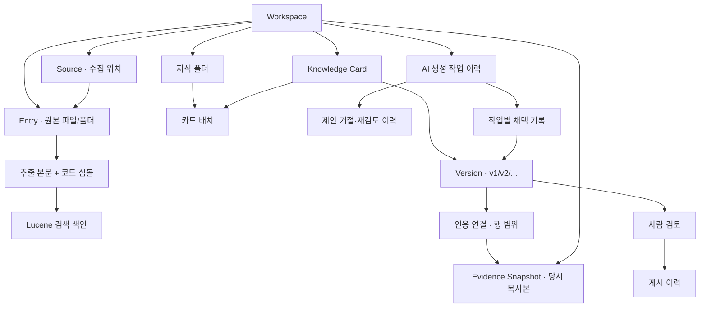

# 모델링 — 무엇을 어떻게 보관하나?

Claude 임시 출력은 **실행 중 메모리 문자열**이며 테이블/지식/답변 이력으로 저장하지 않습니다.
`AnswerJobService.partial → SSE partial → 미검증 임시 영역`으로 보내고 최종/실패/중단 때 지웁니다. [코드 대조](partial-answer.md).

SSE 화면은 새 데이터를 저장하지 않습니다. `AnswerJobsPanel → observeAnswerJob`이 기존 작업을 읽고 상태를 교체합니다.
Workspace·묶음 전환 때 화면/관측만 초기화하며 서버 작업은 명시적으로 중단해야 합니다. [UI 코드 대조](answer-events-ui.md).

2026-10-22 대조: 작업 관측 SSE는 저장 테이블 없이 기존 묶음/작업을 읽습니다.
`AnswerJobEventsController → EvidenceBundleService/AnswerJobService.get` 경로이며 생성/취소 권한을 갖지 않습니다. [그림·코드 대조](answer-events.md).

새 `AnswerJob`은 묶음에 속하는 답변 작업입니다. 승인 ID는 UNIQUE라 작업 하나에만 쓰입니다.
답변/오류/상태/요청 모델을 보관하며 재시작 시 진행 중 작업은 INTERRUPTED입니다. 지식 버전과는 독립입니다. [코드 대조·그림](answer-jobs.md).

**한 줄 요약: 원본 자료와 지식 문서를 따로 보관하고, 지식에는 당시 근거를 붙입니다.**
2026-10-21 코드 대조 기준, SQLite v16. 아래 그림은 현재 구현입니다.

`EvidenceBundle → AnswerApproval`은 묶음당 현재 승인 하나입니다. 제공자·모델·요청 해시와 승인/만료/철회 시각을 저장합니다.
조회 시 근거 변경과 만료를 다시 계산합니다. 전송 이력·답변 작업은 아닙니다. [현재 코드 대조와 설계도](answer-approval.md).

`EvidenceBundle → BundleValidation → Preview`도 구현했습니다. 뒤 두 객체는 읽기 전용 응답이며 저장/승인 모델이 아닙니다.
검사 시각·항목별 상태와 제공자/모델/요청 해시를 반환합니다. [코드 대조·흐름도](bundle-validation.md).

새 `Evidence Bundle`은 답변용 인용문 묶음입니다. Workspace에 속하며 원본/지식 삭제 후에도 보존합니다.
본문·출처·해시를 생성 당시 값으로 보관하며 전송 승인을 포함하지 않습니다. [모델·코드 대조](evidence-bundles.md).

게시 검색 모델: `최신 Publication → 해당 Version → Lucene → 근거 상태 확인 → 읽기 전용 게시본`.
v13은 검색 큐 트리거만 추가하며 초안/게시본을 합치지 않습니다. [실제 코드 대조](published-search.md).

검색 결과의 `startLine/endLine/bodyMatch`는 Lucene 본문의 저장 위치에서 계산합니다.
별도 DB 엔터티나 확정 인용이 아니라 미리보기 정보입니다. [코드 대조·한계](search-evidence.md).

## 1. 용어를 쉽게

| 용어 | 쉬운 뜻 | 예시 |
|---|---|---|
| Workspace | 서로 섞이지 않는 작업 공간 | 개인 연구 |
| Source | 다시 가져올 자료의 위치 | 로컬 폴더, URL, 공개 GitHub |
| Entry | 앱 안에 복사한 파일 또는 폴더 | 관측 기록.txt |
| Analysis | 파일에서 뽑은 글과 코드 이름 | 본문, 메서드 이름·행 번호 |
| Knowledge Card | 하나의 지식 문서 묶음 | 관측 방법 정리 |
| Version | 문서를 저장할 때마다 생기는 판본 | v1, v2 |
| Evidence Snapshot | 근거로 쓴 당시 원본의 복사본 | 작성 당시 기록과 인용 행 |
| Review / Publication | 사람이 확인한 기록 / 게시한 기록 | v2 검토 후 게시 |

단일 파일 업로드에는 Source가 없습니다. Source는 폴더·URL·GitHub처럼 다시 수집할 대상을 말합니다.

## 2. 데이터 관계

선은 “소유하거나 연결한다”는 뜻입니다. 세부 열을 모두 나열한 물리 ERD는 아닙니다.

- 원본 폴더와 지식 폴더는 별도입니다. 지식 폴더 이동으로 원본이 이동하지 않습니다.
- 지식 폴더는 이름·부모 변경마다 자체 revision이 증가합니다. 오래된 편집은 거절하고 하위 카드·문서·게시 이력은 유지합니다. [코드 대조·검증](folder-update.md).
- 한 카드에는 여러 버전이 있습니다. 편집은 이전 버전을 바꾸지 않고 새 버전을 추가합니다.
- 한 버전은 여러 근거를 인용할 수 있고, 같은 근거 복사본을 여러 버전이 공유할 수 있습니다.
- 검토와 게시는 별도 기록입니다. **최신 초안과 현재 게시본이 다를 수 있습니다.**
- AI 작업의 원본/결과 카드 ID는 추적용입니다. 카드 삭제로 작업 이력을 함께 지우는 DB 외래 키는 없습니다.

## 3. 실제 저장소

| 저장 내용 | 실제 테이블/저장소 |
|---|---|
| 작업 공간·선택 | `workspace`, `app_state` |
| 자료·수집 위치 | `entry`, `source` |
| 분석·검색 갱신 대기 | `extracted_document`, `symbol`, `search_outbox` |
| 지식·버전·근거 | `knowledge_card`, `knowledge_version`, `knowledge_evidence`, `evidence_snapshot` |
| 검토·게시 | `knowledge_review`, `knowledge_publication` |
| 지식 폴더·배치 | `knowledge_folder`, `knowledge_placement` |
| AI 작업 | `generation_job` |
| 제안 거절·재검토 | `proposal_decision` · 작업별 revision/상태/판단 시 문서 버전/이유/시각 |
| 제안 전체 채택 | `proposal_acceptance` · 기준/결과/반영 버전·처리 revision·이유·시각 |
| 반영 방식 | `proposal_acceptance.mode` · FULL=전체 채택, MANUAL=수동 부분 반영. 기존 기록은 FULL로 이관 |
| 검색 색인 | SQLite와 별도인 로컬 Lucene 파일 |

원본 바이트와 근거 복사본은 현재 SQLite BLOB에 저장합니다. Markdown도 DB의 문자열이며,
디스크에 `.md` 파일을 자동 생성·내보내는 기능은 아직 없습니다. 카드 제목은 최신 버전에서 가져옵니다.

## 4. 코드와 대조한 결과

| 확인한 설명 | 실제 구현 | 근거 코드 |
|---|---|---|
| 원본 삭제 후에도 지식 근거 보존 | 구현됨. 근거의 원본 ID에 삭제 연쇄 FK 없음 | [DB 정의](../backend/src/main/java/dev/knowledgeforge/library/adapter/persistence/DatabaseConfiguration.java), [지식 저장](../backend/src/main/java/dev/knowledgeforge/knowledge/adapter/JdbcKnowledgeStore.java) |
| 편집 충돌 방지·이전 버전 유지 | 구현됨. 기대 버전이 다르면 409 | [KnowledgeService](../backend/src/main/java/dev/knowledgeforge/knowledge/application/KnowledgeService.java) |
| 새 지식 검증 후 게시 | 일부 구현. 사람 검토·인용 번호·최신성 검사, 자동 사실 판정은 없음 | [PublicationService](../backend/src/main/java/dev/knowledgeforge/knowledge/application/PublicationService.java) |
| AI가 사람이 쓴 글을 갱신 | 별도 AI 카드 생성 후 전체 채택 또는 동일 근거의 수동 부분 반영으로 다음 DRAFT 저장. CURRENT 근거 번호 통합도 구현. 오래된 근거의 새 원본 교체는 예정 | [ProposalAcceptanceService](../backend/src/main/java/dev/knowledgeforge/knowledge/application/ProposalAcceptanceService.java) |
| Source 자동 폴링 | 미구현. 설정 열은 있지만 기본 OFF이며 수동 동기화만 제공 | [SourceService](../backend/src/main/java/dev/knowledgeforge/sources/application/SourceService.java) |
| 질문/검색 때 재분석 | 검색은 기존 색인 조회. 채팅 질문 기능은 아직 없음 | [SearchService](../backend/src/main/java/dev/knowledgeforge/search/application/SearchService.java) |
| Git 변경 파일만 반영 | 미구현. revision이 같으면 생략, 다르면 전체 수집 스냅샷 교체 | [SourceService](../backend/src/main/java/dev/knowledgeforge/sources/application/SourceService.java), [JdbcSourceStore](../backend/src/main/java/dev/knowledgeforge/sources/adapter/JdbcSourceStore.java) |
| AI 작업 재시작 | 미완료 작업은 INTERRUPTED. 자동 재전송하지 않음 | [DB 복구](../backend/src/main/java/dev/knowledgeforge/library/adapter/persistence/DatabaseConfiguration.java), [작업 서비스](../backend/src/main/java/dev/knowledgeforge/knowledge/application/GenerationJobService.java) |

**주의:** DB 버전 상태 열은 VERIFIED/PUBLISHED도 허용하지만, 현재 본문 버전은 DRAFT로 보존합니다.
검토/게시 여부는 별도 테이블을 읽어야 합니다. “DRAFT니까 게시되지 않았다”는 해석은 틀립니다.
검색의 2초 주기 작업도 외부 Source 폴링이 아니라 **로컬 색인 갱신**입니다.

위 보호 규칙은 `KnowledgeIntegrationTest`, `PublicationIntegrationTest`, `SourceIntegrationTest`,
`GenerationJobIntegrationTest`, `OrganizationIntegrationTest`, `GenerationComparisonIntegrationTest`와 대조했습니다.
실제 실행 결과는 [최신 검증](evidence-merge.md), 후속 설계는 [전체 설계도](design-map.md)를 참고하세요.

## 5. 앞으로 더할 모델 — 아직 미구현

현재는 작업의 원래 카드/기준 버전/결과 카드 연결로 [읽기 전용 비교](generation-comparison.md)를 제공합니다.
거절·재검토는 별도 추가 전용 이력으로 구현했습니다. [모델·코드 대조](proposal-decisions.md).
충돌 없는 전체 채택은 구현했습니다. [새 초안·채택 이력의 원자적 저장](proposal-acceptance.md). 동일 근거의 [수동 부분 반영](proposal-merge.md)도 구현했습니다. CURRENT 근거의 [번호 통합](evidence-merge.md)도 구현했습니다. 오래된 근거의 새 원본 교체는 아직 없습니다.

| 계획 | 목적 |
|---|---|
| 대화 → 질문/답변 → 인용 근거 | 답변마다 무엇을 보고 말했는지 보존 |
| Source → 동기화 작업 → 변경 파일 | 선택한 Source만 주기적으로 확인하고 변경분 반영 |
| 원본 변경 → 영향 받는 지식 → 갱신 제안 | 오래된 지식을 표시하되 사람 편집은 덮어쓰지 않기 |

이 표는 방향이며 아직 테이블·API 계약이 아닙니다. 기능 구현 시 확정하고 테스트합니다.
