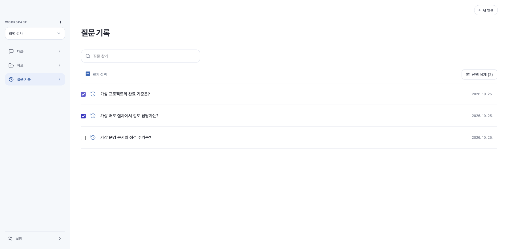

# 실제 Notion 문서 검색·답변 검증

2026-10-25 · Dougle 0.1.20 작업본. 사용자가 지정한 페이지의 실제 본문을 읽고, 명시적으로 승인받은 AI 호출로 검사했습니다. 문서·인증 정보·원문 포함 평가 결과는 저장소에 넣지 않았습니다.

## 방법과 결과

- 공식 Notion 읽기 도구로 받은 실제 응답을 `BrowserPluginReader.documentSnapshot`에 통과시켰습니다. 이 스냅샷을 독립 Workspace의 정상 폴더 수집 API로 가져와 분석·색인·근거 고정·답변 작업 API를 실행했습니다. 사용자의 실제 Workspace DB는 시험용으로 변경하지 않았습니다.
- 질문 40개: 문서에 답이 있는 사실/바꿔 쓴 표현 32개, 문서에 없는 회사 수치·개인 정보·측정값 등 8개. 동일 질문으로 개선 전후 두 라운드를 실행했습니다.
- 첫 답변 라운드의 수동 검토: **36/40**. 답변 가능한 질문 중 28/32, 문서 밖 질문 8/8. 이름만 포함하고 정작 답을 거부한 응답은 오답으로 분류했습니다.
- 최종 라운드의 수동 검토: **40/40**. 답변 가능한 질문 32/32는 원문 근거와 `[R1]` 인용으로 답했고, 문서 밖 질문 8/8은 추측하지 않았습니다. 최종 자동 문자열 검사도 40/40이지만 정확도 판정은 실제 답변을 읽고 대조한 결과입니다.
- 최종 라운드에서 실제 외부 AI는 39회 호출했습니다. 한 질문은 검색 근거가 없어 AI를 실행하지 않았습니다. 초기 확인 1회·첫 라운드 32회를 합쳐 이번 검증의 실제 호출은 72회입니다. 기존 전용 Codex 로그인과 기본 모델 설정을 사용했으며 인증 파일의 내용을 읽거나 복사하지 않았습니다.
- `폭포수모델은 누가처음 만든거냐`, `워터폴 방식의 시초로 소개된 사람은 누구야?`, 카이젠 설명, 스크럼 용어의 유래가 최종 검증에 포함됩니다. 문서가 설명한 내용과 역사적 최초 창안자라는 더 강한 단정은 구분합니다.
- GitHub 실제 예제 저장소도 별도로 가져와 한국어 전략 패턴 질문 세 가지가 `strategy` 코드로 연결되는 것을 확인했습니다. 이 검사는 검색만 실행하며 외부 AI 답변 검증과 구분합니다.

이 결과는 **이 문서와 40개 평가 질문에 대한 회귀 결과**입니다. 모든 문서·표현에서 100% 정확하다는 의미가 아니며 독립적인 대규모 평가도 아닙니다. 관련성이 낮은 후보가 검색되더라도 실제 답이 없으면 답변을 거부해야 합니다.

## 고친 원인

1. Notion 응답의 JSON 포장을 해제해 실제 줄바꿈·본문·제목을 저장합니다. 출처가 `connected-document.txt`로만 보이는 문제도 수정했습니다.
2. 의미 검색용 조각을 768자로 줄이고 같은 문서의 여러 조각을 평가한 **뒤에** 중복을 제거합니다. 긴 입력의 뒷부분이 잘리거나 첫 조각만 남는 문제를 줄였습니다.
3. 재순위화 점수가 낮다는 이유만으로 의미 유사도가 높은 후보를 모두 버리지 않도록 제한적인 보존 경로를 추가했습니다. 특정 질문이나 분야의 답을 코드에 넣지 않았습니다.
4. 짧은 원문은 최대 6,000자, 큰 문서는 검색 조각의 앞뒤 문맥을 최대 2,400자로 확보합니다. 전체 근거 12,000자·5개 자료·원문 해시·Workspace 제한은 유지합니다.
5. 검색 엔진을 CPU별 설치본에 포함하고 자동 준비합니다. 준비/오류 중에는 새 질문을 UI와 API에서 잠급니다. 다시 시작한 의미 색인의 형식을 다음 변경에서도 보존합니다.
6. 큰 파일 분할 시 매 조각마다 원문 처음부터 문단 경계를 재탐색하던 처리를 현재 조각 범위로 제한했습니다. 16 MiB 줄바꿈 없는 입력과 10 MiB 초과 업로드의 끝부분 검색을 검사했습니다.

검색·필터·문맥 구성은 Java 코드가 수행합니다. 답변 AI에 검색용 셸 스크립트 작성이나 자료 수집을 맡기지 않습니다.

## 회귀·화면

- UI: 50파일 **397개 통과**, TypeScript/Vite 빌드 통과. 병렬 검사의 시간 초과를 확인한 뒤 단일 worker와 20초 테스트 제한으로 전체를 다시 검사했습니다. 제품의 타임아웃을 늘린 것은 아닙니다.
- Java: 기존 이름 제한을 위반한 fixture 두 클래스(`QuestionAttachmentIntegrationTest`, `AnswerPartialIntegrationTest`)를 제외하고 58클래스·468개 중 **462개 통과, opt-in 6개 제외**, 실패/오류 0개. 실제 모델·실제 문서 검사는 별도 opt-in 실행에서 통과했으며 중복 합산하지 않습니다.
- 실제 모델의 문맥 확보: 답변 가능한 질문 **32/32**. 실제 저장소의 한국어 질문, Workspace 격리, 무관한 질문, 모델 누락/준비 잠금 검사도 포함합니다.
- 중간 전체 실행의 색인 재시작 회귀 실패는 이미 컴파일된 구버전 클래스를 검사한 결과였습니다. 수정본 재컴파일 후 해당 검사와 전체 회귀 모두 통과했습니다.
- 가상 자료의 실제 브라우저에서 질문 두 개를 선택·확인·삭제하고, 한 개만 남는 것을 확인했습니다. 행별 삭제 버튼은 없으며 검색어를 바꾸면 선택이 초기화됩니다. 실패한 삭제만 재시도합니다.
- 검색 엔진이 별도 다운로드/활성화 없이 `사용 중`으로 표시되는 것을 확인했습니다. 브라우저 검사 중 실제 AI 호출은 0회입니다.

[검증 당시 검색 엔진 상태 화면](screenshots/dougle-bundled-search.png). 이후 별도 옵션처럼 보이는 설정 항목과 모달을 제거했습니다. 현재는 설치본의 검색 엔진을 자동 준비하며 대화 입력창에 준비/오류 상태만 표시합니다.

## 재현과 경계

- 로컬 실제 문서 평가 입력/답변: `/tmp/dougle-notion-evaluation-20261025/`. 사용자 원문을 포함하므로 공개하지 않습니다.
- 검색 평가: `DocumentRetrievalEvaluationTest`와 `FORGE_DOCUMENT_EVALUATION`, `FORGE_VERIFY_SEARCH_MODEL_DIR` 환경 변수.
- 실제 답변 평가: `scripts/document-answer-eval.mjs`. `FORGE_EVALUATION_LIVE=approved`와 승인된 문서 경로·기존 전용 프로필 경로가 있어야 실행됩니다. 자동 로그인이나 인증 복사는 하지 않습니다. 결과의 자동 통과 플래그만으로 정확도를 선언하지 않습니다.
- 최종 실제 답변 로그: `/tmp/dougle-answers-final.log`. UI/Java 최종 로그: `/tmp/dougle-notion-ui-final.log`, `/tmp/dougle-notion-backend-final.log`.
- 설치본과 같은 JAR 옆 모델 디렉터리를 자동 탐지하는 경로로 최종 평가했습니다. 명시적 검색 모델 경로 없이 준비·수집·답변까지 실행했습니다.
- 앱 자체의 Notion OAuth 브라우저 승인 과정을 이번 검사에서 새로 수행한 것은 아닙니다. 실제 페이지 읽기·응답 해석·수집·검색·답변 검사와 OAuth 승인 UI 검증을 혼동하지 않습니다.
- 기존 Notion 자료는 한 번 다시 동기화해야 본문 정리와 제목이 반영됩니다. 이미 저장된 질문의 불변 근거/답변은 변경하지 않습니다.
- 설치 패키지·로컬 설치 상태는 [수집·검색 작업 보고서](ingestion-retrieval-upgrade.md)를 따릅니다. ARM 실기기와 Apple 공증은 별도 검증 대상입니다.
