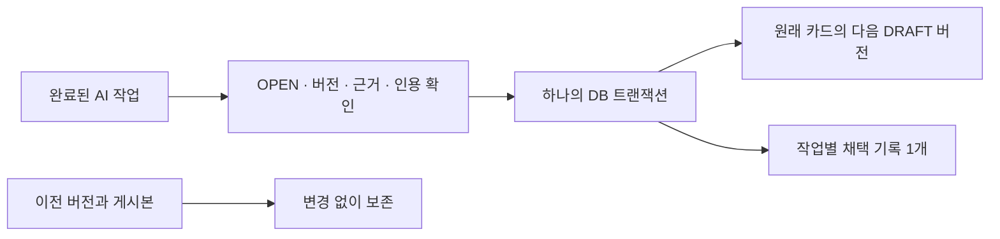

# 제안 전체 채택 — 새 초안으로만 반영

**AI 결과를 원래 문서의 다음 버전으로 저장합니다. 이전 버전과 게시본은 그대로 남습니다.**
자동 게시·AI 재실행·외부 전송은 없습니다.

## 사용법

1. 완료된 AI 작업에서 **원래 문서와 비교**를 누릅니다.
2. 세 문서와 근거를 읽고 **전체 채택 검토**를 누릅니다.
3. 채택 이유를 적고 전체 내용을 확인했다는 항목에 체크합니다.
4. **전체 결과를 새 초안으로 채택**을 누릅니다.
5. 비교가 새로고침되면 반영 버전을 확인합니다. **현재 문서 열기**로 이동해 검토 후 별도로 게시합니다.

제목과 본문 **전체**를 반영합니다. 이 전체 채택 화면은 일부 문장만 선택하거나 기존 편집과 자동 병합하지 않습니다. 후속 [부분 반영 편집](proposal-merge.md)에서는 동일 근거를 유지한 수동 편집을 지원합니다.
사람이 확인해 채택해도 AI 본문 자체는 미검증 DRAFT이며 `manuallyEdited=false`입니다.

## 언제 차단되나?

| 상황 | 동작 |
|---|---|
| 생성 후 원래 문서 또는 결과 카드를 편집함 | 전체 채택 차단. 현재 문서에서 직접 병합 |
| 근거 변경·삭제 또는 인용 번호 오류 | 채택 차단 |
| 제안이 거절 상태 | 먼저 재검토로 전환 |
| 비교한 버전/처리 순번과 현재 값이 다름 | 저장 거절, 다시 확인 |
| 이미 채택함 | 중복 저장 차단, 기존 채택 기록 표시 |

원래 문서가 생성 당시 v3이었다면 v4로 반영합니다. **반영할 결과는 항상 AI 최초 v1**입니다.
결과 카드가 편집됐다면 최신 버전을 알더라도 전체 채택하지 않습니다.
근거 CURRENT는 마지막 로컬 수집본과 같다는 뜻이지 원격 최신성이나 사실성 보장이 아닙니다.
통신이 끊겼다면 **채택 기록 새로고침**으로 먼저 확인하세요. 자동 재시도하지 않습니다.

## 모델과 실제 코드



- SQLite **v11**: `proposal_acceptance` 추가. 키는 `workspace_id + job_id`.
- 기록: 기준 문서 버전, 결과 v1, 반영 버전, 판단한 처리 revision, 이유, 시각.
- `ProposalAcceptanceService`가 조건 검사 → `KnowledgeService.acceptGenerated`로 새 버전 추가 → 저장 포트로 채택 이력을 저장합니다.
- 두 저장은 원자적입니다. 이력 저장이 실패하면 새 문서 버전도 롤백합니다.
- 거절·재검토 이력은 유지합니다. 채택 이후에는 재거절/재검토 전환을 막습니다.
- 카드 삭제 후에도 채택 기록은 남고 Workspace 삭제 시 함께 삭제됩니다. 카드 삭제 후 조회는 API만 지원합니다.
- 기존 게시본은 바뀌지 않으며 새 버전에 사람 검토 기록을 자동 복사하지 않습니다.

검증은 버전·근거 연결·인용 번호에 대한 구조 검사입니다. 자동 사실 검증이 아닙니다.
처리자 인증·감사 서명은 없으며 채택 취소 API도 없습니다. 되돌릴 내용은 새 버전으로 직접 편집합니다.

## API

`/api/workspaces/{workspaceId}/generation-jobs/{jobId}/acceptance`

GET 응답: `{status, decisionRevision, acceptance}`.
status는 OPEN/REJECTED/ACCEPTED. 미채택 시 acceptance는 null입니다.
decisions API는 거절/재검토 배열이며 최종 채택 상태는 이 API로 확인합니다.

POST는 `X-Forge-Client: 1` 헤더와 다음 본문을 받으며 같은 State를 반환합니다.

```json
{
  "expectedRevision": 0,
  "expectedSourceVersion": 1,
  "expectedResultVersion": 1,
  "note": "전체 내용을 다음 초안으로 사용",
  "confirmed": true
}
```

acceptance 항목은 `sourceVersion,resultVersion,appliedVersion,decisionRevision,note,acceptedAt,mode`입니다. v12에서 FULL/MANUAL 구분을 추가했습니다.
400: 확인/이유 누락, 잘못된 인용. 404: 작업·Workspace 불일치, 저장 시 카드 없음.
409: 미완료/거절/기채택 작업, 버전·처리 순번·근거 충돌.
이유는 공백만 입력할 수 없고 전체 4,000자 이내입니다.

## 검증 범위와 남은 작업

가상 자료로 새 DRAFT·이전 버전·게시본·근거 보존, 중복 반영 거절, 사람 편집 보호,
인용 오류·근거 삭제 차단, 명시적 확인, 거절→재검토→채택, 트랜잭션 롤백,
Workspace 격리·삭제, HTTP 헤더와 v10→v11 이관·재시작을 검사합니다.
UI는 확인/이유 필수, 버전 바인딩, 오류 시 입력 보존, 상태별 차단, 중복 클릭·종료 취소를 검사합니다.

동일 근거의 부분 선택·수동 편집·재대조 저장은 [후속 구현](proposal-merge.md)했습니다. CURRENT 근거 번호 통합도 [후속 구현](evidence-merge.md)했습니다. 오래된 근거 교체·줄 단위 충돌 표시는 남았습니다. 자동 폴링/Git 변경 기반 제안도 아직 없습니다.
실제 AI 호출·브라우저 시각 QA·Mac 설치형 검증은 이번 범위가 아닙니다.
업데이트 전 앱을 종료하고 데이터 디렉터리 전체를 백업하세요. 현재 DB는 v12이며 구버전 앱 역이동은 지원하지 않습니다.

## 실행 결과 (2026-10-21, macOS Intel)

| 명령 | 실제 결과 |
|---|---|
| `npm --prefix frontend test -- --maxWorkers=2` | 81개 통과 |
| `npm --prefix frontend run build` | TypeScript/Vite 빌드 성공 |
| `bash scripts/maven.sh clean verify` | 151개 통과, 실제 CLI opt-in 1개 skip, JAR 빌드 성공 |
| `node scripts/smoke.mjs` | 새 초안·이전 버전·게시본·채택 이력의 재시작 보존 통과 |

추가 테스트는 백엔드 9개(마이그레이션 1개 포함), UI 7개입니다.
이력 INSERT를 강제로 실패시키는 테스트에서 새 버전도 롤백됨을 확인했습니다.
Smoke는 가상 CLI로 새 결과를 생성하고 채택한 뒤 재시작합니다. 실제 AI 성공을 뜻하지 않습니다.
100개 가상 파일 기준 시작 7,461ms, 재시작 9,734ms, 목록 p95 4.67ms, 검색 p95 13.20ms입니다.
단일 실행·소규모 자료이며 시간 변동 원인을 분리 측정하지 않았습니다. [원시 기록](performance-phase3-foundation.json).
