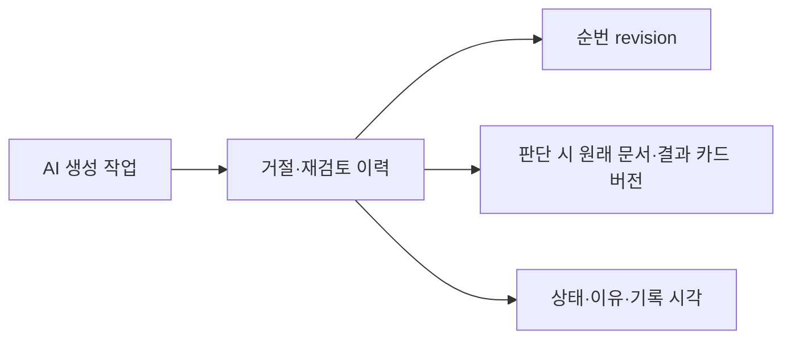

# 제안 거절·재검토 — 문서는 그대로 두기

**AI 결과를 쓰지 않기로 한 이유를 기록하고, 나중에 다시 검토할 수 있습니다.**
후속 [전체 채택](proposal-acceptance.md)은 구현했습니다. [수동 부분 반영](proposal-merge.md)도 구현했습니다. 자동 병합은 아직 없습니다.

## 사용법

1. 완료된 AI 작업에서 **원래 문서와 비교 → 제안 처리 기록 열기**를 누릅니다.
2. 이유를 적고 **제안 거절 기록**을 누릅니다.
3. 다시 살펴보려면 이유를 적고 **재검토로 돌리기**를 누릅니다.

문서·AI 결과·게시본을 삭제하거나 수정하지 않습니다. 재검토는 AI 재실행이 아니며 외부 전송도 없습니다.
근거가 삭제돼도 거절할 수 있지만 사실 검증이나 게시 승인은 아닙니다.
문서 충돌이면 **비교 새로고침**, 처리 상태 충돌이면 **처리 기록 새로고침** 후 다시 판단하세요.
통신이 끊겨도 서버에는 저장됐을 수 있으니 기록부터 확인하세요. 자동 재시도하지 않습니다.

## 모델과 코드 대조



- SQLite **v10**, 새 테이블 `proposal_decision`.
- 초기 상태는 기록 없는 OPEN, revision 0. OPEN → REJECTED → OPEN 순서로 기록을 추가합니다.
- 이전 기록은 수정하지 않습니다. 생성 작업의 SUCCEEDED 상태와는 별개입니다.
- 카드 삭제 후에도 작업과 처리 기록은 남지만, 새 판단은 저장할 수 없습니다.
- Workspace 삭제 시 작업과 처리 기록도 삭제됩니다.
- 원래/결과 카드의 최신 버전과 처리 revision을 검사합니다. 비교 본문은 여전히 결과 v1입니다.

실제 경로: `ProposalDecisionController → ProposalDecisionService → ProposalDecisionStore → JdbcProposalDecisionStore`.
한 트랜잭션에서 Workspace·완료 작업·버전·상태 전이를 검사하고,
예상 revision이 맞을 때만 INSERT합니다. 문서 저장·게시·LLM 포트를 호출하지 않습니다.

## API

`/api/workspaces/{workspaceId}/generation-jobs/{jobId}/decisions`

- GET: 최신 순 이력 배열, 초기에는 `[]`.
- POST: 아래 요청으로 이력 추가 후 최신 순 배열 반환. `X-Forge-Client: 1` 필요.

```json
{
  "expectedRevision": 0,
  "expectedSourceVersion": 1,
  "expectedResultVersion": 1,
  "status": "REJECTED",
  "note": "이번 문서에는 필요하지 않은 내용"
}
```

재검토는 `status: "OPEN"`. 이유는 공백만 입력할 수 없으며 전체 길이 4,000자 이내입니다.
응답 항목: `revision,status,sourceVersion,resultVersion,note,createdAt`.
400: 잘못된 상태/이유. 404: 작업·Workspace 불일치 또는 저장 시 카드 없음.
409: 미완료 작업, 같은 상태 반복, 오래된 문서/처리 revision.
카드 삭제 후에도 API로 이력을 조회할 수 있습니다. UI는 비교 화면을 거치므로 삭제 후 진입은 아직 불가능합니다.

## 검증과 한계

가상 자료로 거절→재검토, 문서/게시본 불변, 오래된 revision·문서 충돌, Workspace 격리,
입력 오류, 미완료 작업, 카드 삭제/Workspace 연쇄 삭제, 누락 근거, HTTP 쓰기 헤더를 검사합니다.
v1~v9 업그레이드와 v10 재시작 보존도 검사합니다.
UI는 명시적 진입, 이유 필수, 버전 바인딩, 오류 시 입력 보존, 중복 클릭 차단·종료 시 취소를 검사합니다.

처리자를 별도 인증하지 않습니다. 로컬 메모이지 감사 서명이나 사실 검증이 아닙니다.
삭제 카드 이력 UI, 목록 상태 배지·필터, 이력 페이지 나누기는 후속입니다.
전체 채택 후에는 거절·재검토로 바꾸지 못합니다. 동일 근거의 수동 부분 반영은 구현했고 CURRENT 근거 번호 통합도 구현했습니다. 오래된 근거 교체·줄 단위 충돌 표시는 남았습니다.
실제 AI 호출·브라우저 시각 QA·Mac 설치형은 이번 검증 범위가 아닙니다.

업데이트 전 앱을 종료하고 데이터 디렉터리 전체를 백업하세요. 현재 DB는 반영 방식이 추가된 v12이며 구버전 앱으로 열 수 없습니다.

## 실행 결과 (2026-10-21, macOS Intel)

| 명령 | 실제 결과 |
|---|---|
| `npm --prefix frontend test -- --maxWorkers=2` | 74개 통과 |
| `npm --prefix frontend run build` | TypeScript/Vite 빌드 성공 |
| `bash scripts/maven.sh clean verify` | 142개 통과, 실제 CLI opt-in 1개 skip, JAR 빌드 성공 |
| `node scripts/smoke.mjs` | 실제 JAR 재시작 후 거절 이력 보존·재검토 추가·문서/게시본 보존 통과 |

이번 추가 검증은 백엔드 7개(마이그레이션 1개 포함), UI 5개입니다.
Smoke의 AI는 가상 CLI이며 실제 모델 성공을 뜻하지 않습니다.
100개 가상 파일 기준 시작 5,265ms, 재시작 5,660ms, 목록 p95 3.58ms, 검색 p95 10.40ms입니다.
단일 실행·소규모 자료이며 동시 사용자나 실제 AI 성능 측정은 아닙니다. [원시 측정](performance-phase3-foundation.json).
