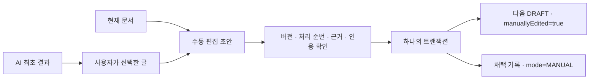

# 부분 반영 — 사람 편집을 남기고 필요한 문장만

**현재 문서를 먼저 불러온 뒤, 필요한 AI 문장만 추가하거나 직접 고쳐 새 초안으로 저장합니다.**
자동 병합·자동 게시·AI 재실행은 하지 않습니다.

## 사용법

1. 완료된 AI 작업에서 **원래 문서와 비교 → 부분 반영 편집**을 누릅니다.
2. 생성 당시·현재·AI 최초 결과를 비교합니다. 편집칸은 **현재** 제목과 본문으로 시작합니다.
3. AI 원문에서 필요한 문장을 드래그한 뒤 **선택한 AI 문장 추가**를 누릅니다.
4. 추가된 문장을 직접 다듬고, 기존 사람 편집과 [E1] 같은 인용 번호를 확인합니다.
5. 이유를 적고 확인 항목에 체크한 뒤 **편집한 내용을 새 초안으로 반영**을 누릅니다.

선택한 글은 본문 맨 뒤에 붙습니다. 의미를 판단해 자동 배치하거나 나머지 글을 삭제하지 않습니다.
제목도 직접 바꿀 수 있습니다. 저장 후 새 버전은 미검증 DRAFT이며 게시하려면 별도 사람 검토가 필요합니다.

## 편집 충돌과 미저장 내용 보호

- 편집창이 열리면 다른 화면 조작을 막는 모달로 표시합니다.
- 미저장 내용이 있을 때 닫기/Escape는 폐기 여부를 묻고, 페이지 종료는 브라우저 경고를 요청합니다.
- 저장 중에는 닫기·재조회·중복 저장을 막습니다.
- 다른 창에서 문서나 처리 상태가 바뀌면 서버가 저장을 거절합니다.
- **최신 비교 다시 불러오기**는 최신 자료만 갱신합니다. 작성 중인 제목·본문·이유를 덮어쓰지 않습니다.
- 재조회 후 현재 문서와 **직접** 대조하고 확인 체크를 다시 해야 저장할 수 있습니다.
- 다른 창이 이미 채택한 경우에도 작성 중인 본문은 복사할 수 있게 남깁니다.

작성 중인 내용은 메모리에만 있습니다. 강제 종료·충돌로 앱이 죽으면 복구되지 않습니다.
통신 오류가 나면 서버에는 저장됐을 수 있으므로 재조회로 채택 기록부터 확인하세요.

## 안전하게 지원하는 범위

생성 후 **원래 문서의 글만 바뀐 경우**도 수동 병합할 수 있습니다. 다만 아래 조건을 지켜야 합니다.

- AI 결과 카드는 최초 v1 그대로여야 합니다.
- 기본 모드는 현재 문서와 AI 결과의 근거 목록·순서·인용 행이 같아야 합니다. 다른 경우 명시적 [번호 통합](evidence-merge.md)을 선택할 수 있습니다.
- 모든 근거가 마지막 로컬 수집본 기준 CURRENT여야 합니다.
- 최종 본문에는 유효한 [E1] 형식 인용이 있어야 합니다.
- 제안 상태는 OPEN이며 작업당 한 번만 채택할 수 있습니다.

기본 모드는 근거나 순서가 다른 문서를 차단합니다. 후속 번호 통합에서는 현재 번호를 유지하고 AI 번호를 변환해 서로 다른 E1이 섞이지 않게 합니다.
CURRENT 근거의 인용 번호 변환 미리보기는 구현했습니다. 오래된 근거를 새 원본으로 교체하는 재연결은 아직 없습니다.
글의 사실성을 자동 검증하지 않으며, 사용자가 직접 편집하면서 지운 문장을 자동 복구하지도 않습니다.

## 모델과 실제 코드



SQLite **v12**는 기존 `proposal_acceptance`에 `mode`를 추가합니다.
기존 전체 채택 이력은 FULL로 이관하며 MANUAL 기록을 만들어내지 않습니다.
반영 당시 기준/결과/반영 버전과 이유·시각은 그대로 보존합니다.

실제 구현: `ProposalAcceptanceController.merge → ProposalAcceptanceService.merge → KnowledgeService.revise`.
전체 채택과 동일한 작업/상태/근거 검사를 공유하며, 수동 병합에서는 생성 당시 버전과 같아야 한다는 조건만 완화합니다.
저장 시 기대 버전은 **화면에서 마지막으로 조회한 현재 버전**입니다.
새 버전과 MANUAL 채택 기록은 원자적으로 저장하며 이력 저장 실패 시 새 버전도 롤백합니다.
이전 버전·게시본·AI 결과 카드는 바꾸지 않습니다.

## API

`POST /api/workspaces/{workspaceId}/generation-jobs/{jobId}/acceptance/merge`

```json
{
  "expectedRevision": 0,
  "expectedSourceVersion": 2,
  "expectedResultVersion": 1,
  "note": "기존 설명을 남기고 한 문장만 보충",
  "confirmed": true,
  "title": "현재 제목",
  "markdown": "기존 설명 [E1]\n\n선택한 문장 [E1]"
}
```

`X-Forge-Client: 1` 헤더가 필요합니다. 응답은 기존 Acceptance State이며
`acceptance.mode`가 MANUAL, `appliedVersion`이 기대 버전+1입니다.
기록 조회는 기존 GET acceptance를 사용합니다. 전체 채택은 기존 POST acceptance 그대로입니다.

400: 확인·이유·제목·본문 오류, 현재 문서와 같은 내용, 잘못된 인용.
404: 다른 Workspace 또는 작업/카드 없음.
409: 오래된 버전/처리 순번, 거절·기채택 상태, 결과 카드 편집, 근거 불일치·변경·삭제.
제목 120자, 본문 100,000자, 이유 4,000자 제한입니다.

## 남은 작업

CURRENT 근거 번호 통합은 후속 구현했습니다. 오래된 근거의 새 원본 교체, 줄 단위 diff/충돌 표시, 임시 편집 복구 저장은 남았습니다.
채팅/SSE, Source별 폴링·Git 증분 반영, Mac 설치형도 아직 남았습니다.
업데이트 전 앱을 종료하고 데이터 디렉터리 전체를 백업하세요. v12 DB의 구버전 앱 역이동은 지원하지 않습니다.

## 자동 검증 (2026-10-21, macOS Intel)

| 명령 | 실제 결과 |
|---|---|
| `npm --prefix frontend test -- --maxWorkers=2` | 87개 통과 |
| `npm --prefix frontend run build` | TypeScript/Vite 빌드 성공 |
| `bash scripts/maven.sh clean verify` | 158개 통과, 실제 CLI opt-in 1개 skip, JAR 빌드 성공 |
| `node scripts/smoke.mjs` | FULL/MANUAL 이력·사람 편집 버전·게시본의 재시작 보존 통과 |

추가 테스트는 백엔드 7개(마이그레이션 포함), UI 6개입니다.
수동 병합의 버전·근거 불일치 차단, 본문/인용 검증, 이력 저장 실패 롤백,
선택 추가·미저장 폐기 확인·재조회 시 편집 보존·다른 창의 채택·저장 중 차단을 검사했습니다.
Smoke는 가상 CLI만 호출합니다. 실제 AI 및 Mac 설치형 검증은 아닙니다.
CSS 배치 수정 후 `npm --prefix frontend run build`, `bash scripts/maven.sh package -DskipTests`,
`node scripts/smoke.mjs`도 다시 실행해 통과했습니다. 마지막 패키징에서 테스트는 재실행하지 않았으며 위 전체 테스트 결과는 같은 로직 기준입니다.
최종 100개 가상 파일 기준 시작 5,547ms, 재시작 6,103ms, 목록 p95 5.09ms, 검색 p95 46.29ms입니다.
단일 실행·소규모 자료 결과이며 성능 보장은 아닙니다. [원시 기록](performance-phase3-foundation.json).

### 실제 브라우저 확인

Ego Chromium과 별도 임시 DB·가상 CLI로 모달 열기, 현재 v2 본문 보존, AI 문장 선택 추가,
닫기 시 폐기 확인에서 취소, 확인 후 MANUAL v3 저장을 확인했습니다.
스크린샷에서 모달이 왼쪽 위에 붙는 것을 발견해 중앙 배치 CSS를 수정하고 재빌드했습니다.
브라우저에서는 동일한 스타일을 적용해 배치를 확인했습니다. 모든 화면·해상도를 검사한 것은 아닙니다.

첫 브라우저 준비 스크립트는 가상 CLI가 요구하는 테스트 모델명을 생략해 실패했으며 명시 후 성공했습니다.
브라우저 QA용 JAR을 실행한 채 같은 경로에 재패키징한 뒤 종료할 때 Logback 클래스 로딩 오류가 발생했습니다.
실행 중 JAR 교체가 원인으로 의심되므로 앱 종료 후 빌드/교체해야 합니다. 제품 기능 테스트 실패로 숨기지 않고 환경 사건으로 기록합니다.
최종 JAR로 새 임시 DB를 다시 시작해 가상 생성까지 수행한 뒤, 재빌드 없이 종료했을 때는 이 오류가 재현되지 않았습니다.
