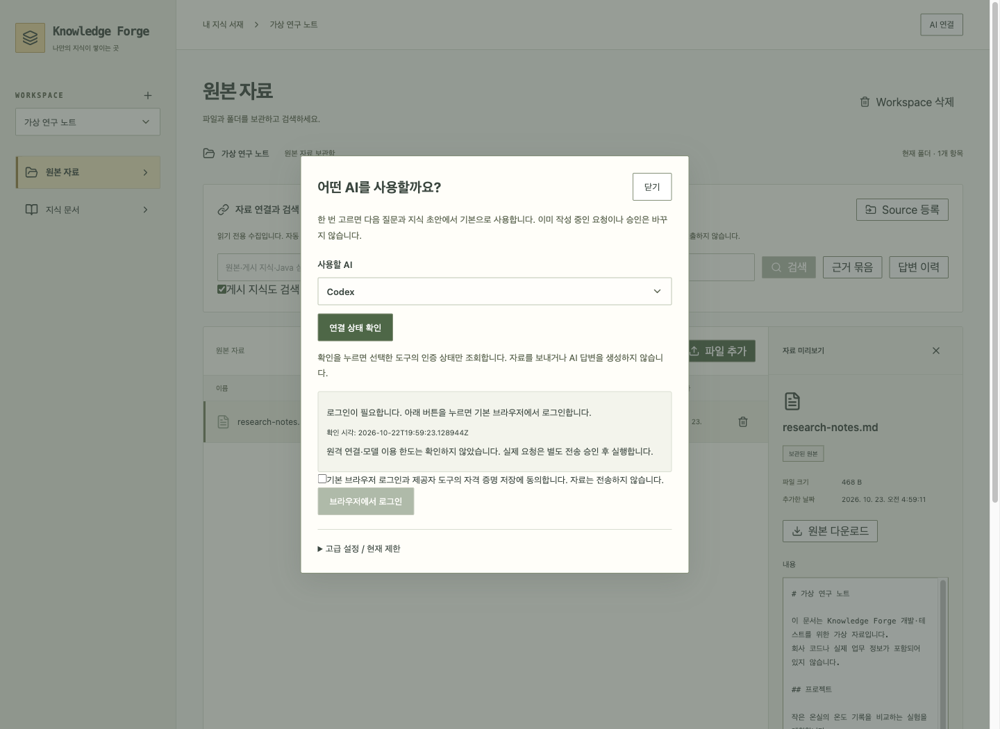

# AI 연결 — 제공자를 고르고 로그인하기

**0.1.2부터** 포함된 흐름입니다. 최신 [0.1.3 설치 파일·검증 기록](release-0.1.3-report.md)은 실제 앱 연결 버튼의 요청 오류와 한글 표시도 수정합니다. 0.1.1 DMG에는 이 흐름이 없습니다.

가상 자료·가상 인증 도구로 촬영한 화면입니다. 실제 계정 인증 성공을 뜻하지 않습니다.

## 사용 순서

1. 상단 **AI 연결**에서 Codex 또는 Claude를 고릅니다. 새 질문/초안의 기본 선택으로 기억합니다.
2. **연결 상태 확인**을 누릅니다. 설치 버전만 보는 것이 아니라 제공자 도구의 인증 상태를 확인합니다.
3. 로그인이 필요하면 자격 증명 저장 안내에 동의하고 **브라우저에서 로그인**을 누릅니다.
4. 기본 브라우저에서 계정 인증을 완료하면 앱이 인증 상태를 다시 확인합니다.
5. 자료를 고르고 질문합니다. **로그인 동의와 자료 전송 승인은 별개**입니다.

Codex는 새 Mac 빌드에 실행 도구를 동봉합니다. 사용자가 Node·CLI를 설치하거나 경로를 입력하지 않는 경로입니다.
Claude는 기존 도구가 인증 상태 명령을 지원할 때 연결/로그인을 제공합니다. **Claude 동봉은 배포 조건 확인 전이므로 아직 별도 설치 없는 흐름이 완성되지 않았습니다.**
오래된 도구를 추측으로 실행하지 않으며, 고급 경로 설정은 기본 화면 대신 접힌 고급 설정에 남깁니다.

## 상태를 정확히 구분하기

| 표시 | 의미 |
|---|---|
| 실행 도구 없음 | 앱이 해당 실행 파일을 시작하지 못함 |
| 지원하지 않는 인증 확인 | 안전하게 상태를 확인할 명령/프로필 계약이 맞지 않음 |
| 로그인 필요 | 도구가 미인증으로 응답함 |
| 인증 확인 | 도구가 인증됐다고 응답함. 원격 모델의 이용 가능/한도 보증은 아님 |
| 확인 실패 | 시간 초과·형식 불일치·실행 오류 등. 원문 오류나 토큰은 표시하지 않음 |

계정 인증은 기본 브라우저와 제공자 도구가 처리합니다. 앱은 비밀번호·토큰·이메일을 API/SQLite에 복사하지 않습니다.
3분 동안 기다리며 **로그인 중단**으로 대기 프로세스를 종료할 수 있습니다. 이미 저장된 자격 증명은 중단으로 회수되지 않으며 로그아웃도 아닙니다.
앱 종료 시 로그인 프로세스를 정리합니다. 재시작 후 이전 로그인 요청을 자동 재실행하지 않습니다.
로그인 대기 중 화면을 새로고침하면 요청 연결을 복구하지 않습니다. 기존 대기는 최대 3분 후 끝나며, 이후 연결 상태를 다시 확인하세요.
브라우저 자동 열기/콜백에 실패하는 환경의 수동 인증 코드 입력은 아직 지원하지 않습니다.

## 모델과 코드

- `ProviderConnection` 포트 → `ProviderConnectionAdapter`: 활성 실행 경로로 명시적 인증 조회. 5초/출력 제한, 한 번에 하나.
- Codex: `login status`의 알려진 응답만 인정. Claude: `auth --help`로 capability를 확인한 뒤 `auth status`의 JSON/종료 코드를 대조.
- 전용 Codex 스트림 프로필이 설정됐을 때 일반 프로필 인증으로 잘못 표시하지 않고 UNSUPPORTED로 처리합니다.
- `ProviderLogin` 포트 → `ProviderLoginAdapter`: 동의·기존 인증 확인 후 단일 로그인 작업. PENDING → AUTHENTICATED/FAILED/CANCELLED/TIMED_OUT.
- 로그인 작업은 메모리에만 보관합니다. DB는 v21 그대로입니다. 완료 시 exit 0만 믿지 않고 인증을 재확인합니다.
- `ProviderConnectionPanel`: 제공자 선택, 상태 확인, 로그인/대기/중단. 선택 변경 시 이전 응답 무시. 진행 중 승인·작업 제공자를 자동 변경하지 않습니다.
- `scripts/stage-codex.sh`: 공식 Codex 0.163.0 CPU별 아카이브·LICENSE·NOTICE 해시 확인. 네이티브 `supervisor`가 번들 내부 실행 경로를 Java에 전달합니다.

## 검증과 남은 범위

[검사별 결과와 재현 명령](connection-verification.md).

가상 CLI로 동의·상태 분류·시간/출력 제한·취소·종료·정보 비노출을 검사합니다. 실제 사용자 계정 로그인을 자동 실행하지 않습니다.
네이티브 컴파일과 UI 전체 검사를 동시에 실행했을 때 다수 기존 UI 테스트가 시간 제한으로 실패했습니다. 병렬 작업을 끝내고 worker 2개로 전체 201개를 다시 실행해 모두 통과했습니다. 기본 통합 빌드도 worker 2개로 제한하며 테스트를 제외하거나 시간 제한을 늘리지 않았습니다.
`scripts/provider-connection-smoke.mjs`는 실제 JAR에 가상 도구를 연결합니다. 모델 요청은 전혀 하지 않습니다.
2026-10-22 검증: 백엔드 전체 363건 중 362 통과·실제 AI 1 제외, 이후 추가한 HTTP 로그인 보호 검사를 포함한 통합 테스트 2건 통과. UI 201건·Rust 13건 통과, 프런트 빌드와 Maven verify 성공. 실제 JAR 연결 smoke도 동의 거부·로그인 대기·인증 재확인·누락 도구·출력 비노출을 통과했습니다.
실제 계정의 브라우저 인증·원격 생성·ARM 실기기 실행은 별도 확인입니다. GitHub 수집용 Git도 현재 별도 실행 환경에 의존합니다.
실제 JAR 화면을 브라우저에서 열어 AI 연결 → 미인증 → 동의 → 가상 로그인 → 인증 확인 → Claude 미설치 표시까지 확인했습니다. 이 검사는 실제 제공자의 로그인 창/계정을 사용하지 않았습니다.
마지막 검토에서 로그인 출력 한도 초과 경로도 읽은 바이트를 먼저 지우도록 수정했고, 로그인 어댑터 4개 테스트를 다시 통과했습니다.

공식 계약: [Codex 인증](https://learn.chatgpt.com/docs/app-server), [Claude 명령](https://code.claude.com/docs/en/cli-reference), [Claude 제품 포함 조건](https://code.claude.com/docs/en/legal-and-compliance).
