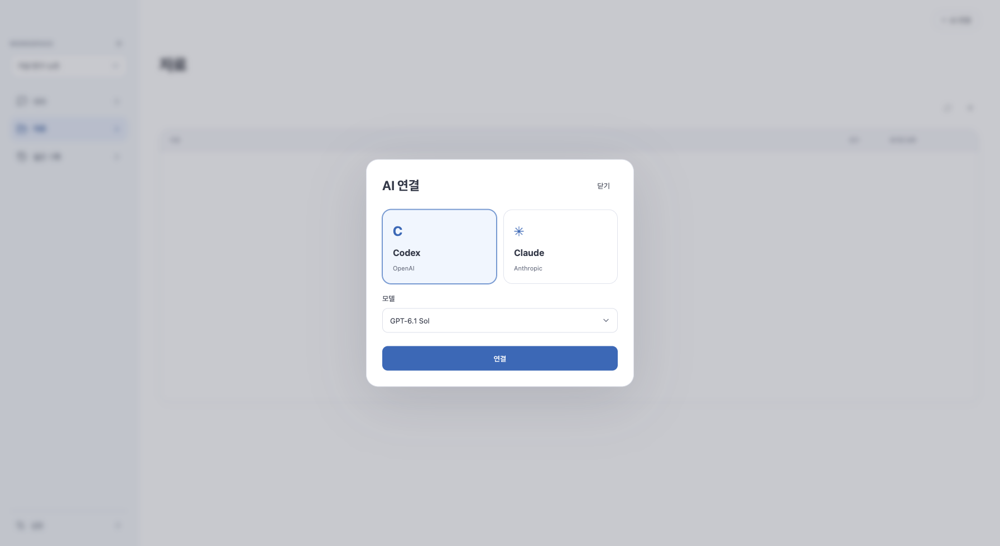

# AI 연결 — 제공자를 고르고 로그인하기

## 0.1.33 실행 도구 찾기

회사 사용자가 파일 경로를 직접 입력하는 것을 기본 절차로 삼지 않는다. 기본 연결에 실패하면 앱이 발견한 설치 도구를 이름으로 제안한다. 다른 회사용 도구를 선택하려면 **다른 AI 도구 찾기**를 사용한다. 경로 입력은 고급 설정으로 이동했다. [자동 탐색 범위·안전 경계](ai-tool-discovery.md)를 참고한다. 아래 수동 경로 설정 안내는 고급 사용자를 위한 보조 절차다.

현재 MVP에서는 GitHub 직접 연결·토큰 입력·브라우저 승인 기능을 제공하지 않습니다. 로컬 코드 폴더를 연결하세요. 아래 GitHub 인증 작업본 설명은 폐기된 구현 이력입니다.

## 회사 환경 연결 — 미배포 작업본

메인 화면에는 연결 안내 배너나 서비스 연결 버튼을 나열하지 않는다. 첫 실행에서 AI 로그인이 필요하거나 실행 도구가 없으면 AI 연결 모달만 한 번 표시한다. 이미 인증된 사용자는 방해하지 않으며, 확인 실패를 로그인 필요로 단정하지 않는다. 이후 AI 연결은 우측 상단에서 관리하고, GitHub·Notion·Jira/Confluence·MySQL은 설정 → 플러그인에서 연결한다. 최초 모달 표시 여부는 인증 성공과 별도로 저장한다. 모달을 닫아도 자료 기능은 사용할 수 있고 AI 질문에는 로그인이 필요하다. 브라우저 로그인은 명시적으로 버튼을 누를 때만 시작한다.

AI 연결의 **회사용 AI 실행 설정**은 Codex와 Claude 모두 지원한다. 현재 실행 경로를 보여주고, 실행 가능한 회사용 파일/스크립트의 절대 경로를 신뢰 확인 후 저장한다. 재시작 전까지 기존 실행 경로를 유지한다. 별칭과 옵션이 섞인 셸 명령은 받지 않는다. 로그인 필요 상태에서는 서비스 브라우저의 회사 계정·Google·SSO 안내를 따르도록 설명한다. 실제 회사용 래퍼의 CLI 호환성과 인증은 별도 검증이 필요하다.

작업본은 GitHub 비공개 저장소용 fine-grained 토큰 연결을 제공한다. 지정 저장소의 읽기 요청이 성공한 뒤에만 로컬 암호화 저장소에 저장하며, 인증 헤더는 다른 호스트나 리디렉션으로 전달하지 않는다. AI 로그인 없이도 자료 연결·검색을 사용할 수 있다. 회사 SSO 승인·저장소 권한은 GitHub에서 별도로 필요하며 Google 로그인 하나로 대체되지 않는다. 브라우저 원클릭 인증은 GitHub App 등록·회사 승인이 필요해 아직 제공하지 않는다. 현재 설치본0.1.31에는 이 변경이 포함되지 않았다.

회사 실행 파일은 `claude-work` 같은 명령 이름 또는 전체 경로로 지정할 수 있다. 사용자 표준 설치 위치와 절대 PATH만 탐색하며 셸 별칭·함수·명령 옵션을 실행하지 않는다. Codex에도 같은 규칙이 적용된다. 저장된 경로는 재시작 후 적용하며, 도구 발견·로그인 상태·실제 원격 답변 성공을 각각 구분한다.

0.1.8에서는 창을 열 때 로그인 상태를 자동 확인하고, 결과를 색·아이콘·큰 글씨로 표시합니다. 창을 닫아도 상단에 마지막 결과가 남습니다. [표시 의미](ai-connection-indicator.md) · [검증·배포](release-0.1.8-report.md).

**0.1.2부터** 포함된 흐름입니다. 0.1.7은 전용 로그인·답변 스트리밍을 연결합니다. [사용법](codex-managed-login.md) · [검증·배포 상태](release-0.1.7-report.md). 0.1.3에서 실제 앱 연결 버튼의 요청 오류와 한글 표시를 수정했습니다.

가상 자료·가상 인증 도구로 촬영한 화면입니다. 실제 계정 인증 성공을 뜻하지 않습니다.

## 사용 순서

1. 상단 **AI 연결**에서 Codex 또는 Claude를 고릅니다. 새 질문/초안의 기본 선택으로 기억합니다.
2. **연결 상태 확인**을 누릅니다. 설치 버전만 보는 것이 아니라 제공자 도구의 인증 상태를 확인합니다.
3. 로그인이 필요하면 자격 증명 저장 안내에 동의하고 **브라우저에서 로그인**을 누릅니다.
4. 기본 브라우저에서 계정 인증을 완료하면 앱이 인증 상태를 다시 확인합니다.
5. 자료를 고르고 질문합니다. **로그인 동의와 자료 전송 승인은 별개**입니다.

Codex는 새 Mac 빌드에 실행 도구를 동봉합니다. 사용자가 Node·CLI를 설치하거나 경로를 입력하지 않는 경로입니다.
Claude는 기존 도구가 인증 상태 명령을 지원할 때 연결/로그인을 제공합니다. **Claude 동봉은 아직 없습니다.** 공식 배포 조건을 확인했으며, 배포 주체의 약관·사용 방식 확인과 macOS 호환성 결정이 남았습니다. [쉬운 설명·코드 대조·완료 조건](claude-readiness.md).
오래된 도구를 추측으로 실행하지 않으며, 고급 경로 설정은 기본 화면 대신 접힌 고급 설정에 남깁니다.

## 상태를 정확히 구분하기

| 표시 | 의미 |
|---|---|
| 실행 도구 없음 | 앱이 해당 실행 파일을 시작하지 못함 |
| 지원하지 않는 인증 확인 | 안전하게 상태를 확인할 명령/프로필 계약이 맞지 않음 |
| 로그인 필요 | 도구가 미인증으로 응답함 |
| 인증 확인 | 도구가 인증됐다고 응답함. 원격 모델의 이용 가능/한도 보증은 아님 |
| 확인 실패 | 시간 초과·형식 불일치·실행 오류 등. 원문 오류나 토큰은 표시하지 않음 |

계정 인증은 기본 브라우저와 제공자 도구가 처리합니다. 앱은 비밀번호·토큰·이메일을 API/SQLite에 복사하지 않습니다.
3분 동안 기다리며 **로그인 중단**으로 대기 프로세스를 종료할 수 있습니다. 이미 저장된 자격 증명은 중단으로 회수되지 않으며 로그아웃도 아닙니다.
앱 종료 시 로그인 프로세스를 정리합니다. 재시작 후 이전 로그인 요청을 자동 재실행하지 않습니다.
로그인 대기 중 화면을 새로고침하면 요청 연결을 복구하지 않습니다. 기존 대기는 최대 3분 후 끝나며, 이후 연결 상태를 다시 확인하세요.
브라우저 자동 열기/콜백에 실패하는 환경의 수동 인증 코드 입력은 아직 지원하지 않습니다.

## 모델과 코드

- `ProviderConnection` 포트 → `ProviderConnectionAdapter`: 활성 실행 경로로 명시적 인증 조회. 명령당 30초/출력 제한, 한 번에 하나. 느린 첫 실행도 확인하되 무한 대기는 하지 않습니다.
- Codex: `login status`의 알려진 응답만 인정. Claude: `auth --help`로 capability를 확인한 뒤 `auth status`의 JSON/종료 코드를 대조.
- 전용 Codex 스트림 프로필이 설정됐을 때 일반 프로필 인증으로 잘못 표시하지 않고 UNSUPPORTED로 처리합니다.
- `ProviderLogin` 포트 → `ProviderLoginAdapter`: 동의·기존 인증 확인 후 단일 로그인 작업. PENDING → AUTHENTICATED/FAILED/CANCELLED/TIMED_OUT.
- 로그인 작업은 메모리에만 보관합니다. DB는 v21 그대로입니다. 완료 시 exit 0만 믿지 않고 인증을 재확인합니다.
- `ProviderConnectionPanel`: 제공자 선택, 상태 확인, 로그인/대기/중단. 선택 변경 시 이전 응답 무시. 진행 중 승인·작업 제공자를 자동 변경하지 않습니다.
- `scripts/stage-codex.sh`: 공식 Codex 0.163.0 CPU별 아카이브·LICENSE·NOTICE 해시 확인. 네이티브 `supervisor`가 번들 내부 실행 경로를 Java에 전달합니다.

## 검증과 남은 범위

[검사별 결과와 재현 명령](connection-verification.md).

가상 CLI로 동의·상태 분류·시간/출력 제한·취소·종료·정보 비노출을 검사합니다. 실제 사용자 계정 로그인을 자동 실행하지 않습니다.
네이티브 컴파일과 UI 전체 검사를 동시에 실행했을 때 다수 기존 UI 테스트가 시간 제한으로 실패했습니다. 병렬 작업을 끝내고 worker 2개로 전체 201개를 다시 실행해 모두 통과했습니다. 기본 통합 빌드도 worker 2개로 제한하며 테스트를 제외하거나 시간 제한을 늘리지 않았습니다.
`scripts/provider-connection-smoke.mjs`는 실제 JAR에 가상 도구를 연결합니다. 모델 요청은 전혀 하지 않습니다.
2026-10-22 검증: 백엔드 전체 363건 중 362 통과·실제 AI 1 제외, 이후 추가한 HTTP 로그인 보호 검사를 포함한 통합 테스트 2건 통과. UI 201건·Rust 13건 통과, 프런트 빌드와 Maven verify 성공. 실제 JAR 연결 smoke도 동의 거부·로그인 대기·인증 재확인·누락 도구·출력 비노출을 통과했습니다.
실제 계정의 브라우저 인증·원격 생성·ARM 실기기 실행은 별도 확인입니다. GitHub 수집용 Git은 0.1.5부터 앱에 포함합니다. [내장 Git](bundled-git.md).
실제 JAR 화면을 브라우저에서 열어 AI 연결 → 미인증 → 동의 → 가상 로그인 → 인증 확인 → Claude 미설치 표시까지 확인했습니다. 이 검사는 실제 제공자의 로그인 창/계정을 사용하지 않았습니다.
마지막 검토에서 로그인 출력 한도 초과 경로도 읽은 바이트를 먼저 지우도록 수정했고, 로그인 어댑터 4개 테스트를 다시 통과했습니다.

공식 계약: [Codex 인증](https://learn.chatgpt.com/docs/app-server), [Claude 명령](https://code.claude.com/docs/en/cli-reference), [Claude 제품 포함 조건](https://code.claude.com/docs/en/legal-and-compliance).
