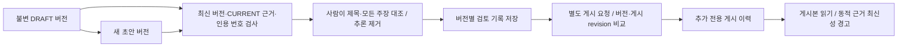

# 사람 검토와 명시적 게시

## 범위와 사용 순서

P3-3의 **사람 검토 경로**를 구현했습니다. 자동 의미 검증이나 AI가 사실성을 보증하는 기능은 아닙니다.
외부 AI 호출 없이 수동 초안과 AI 초안 모두 같은 경로를 사용합니다.

1. 지식 문서의 최신 버전을 열고 아래 보존된 근거와 제목·모든 주장을 직접 비교합니다.
2. 근거 없는 추론은 초안 편집으로 제거합니다. 본문에 `[E1]`처럼 실제 근거 번호를 표기합니다.
3. 검토자와 검토 기록을 적고 두 확인란을 직접 선택해 **사람 검토 기록 저장**을 누릅니다.
4. 별도 **검토한 버전 게시** 버튼을 누릅니다. 검토 저장은 게시가 아닙니다.
5. 이후 새 초안을 저장해도 기존 게시본은 유지됩니다. 새 버전은 다시 검토해야 합니다.

검토자 이름은 자기 기입이며 인증된 신원/전자서명이 아닙니다. 확인란은 사람의 진술이지
기계적 사실 증명이 아닙니다. 거짓 검토를 자동 탐지하지 못하므로 자동 의미 검증을 완료로 표시하지 않습니다.

## 구조와 안전 조건

- `PublicationService` → `PublicationStore` → `JdbcPublicationStore`, REST와 UI는 별도 어댑터입니다.
- SQLite v7: `knowledge_review(card_id,version)`과 `knowledge_publication(card_id,revision)`을 추가합니다.
- 검토에는 두 명시적 확인, 검토자 1~120자, 기록 1~4,000자가 필요합니다. 동일 버전 재검토는 409입니다.
- 본문은 유효한 `[E1]` 인용을 최소 하나 포함해야 하며 발견한 `[E…]` 번호가 범위를 벗어나면 거부합니다.
  이는 인용 문법 검사일 뿐 모든 문장/제목의 의미적 뒷받침 검사가 아닙니다. 그 책임은 사람 검토 단계에 있습니다.
- 검토와 게시 모두 최신 버전·모든 근거 CURRENT를 같은 트랜잭션에서 재확인합니다.
  CURRENT는 마지막 로컬 수집본과 동일함이며 원격 실시간 최신성은 아닙니다.
- 편집 시 검토는 이전 버전에 남고 새 버전으로 승계되지 않습니다. 검토/게시가 본문을 UPDATE하지 않습니다.
- 기존 `version.status=DRAFT`는 불변 생성 상태입니다. 검토/게시 상태는 별도 `/publication`에서 읽습니다.
  기존 VERIFIED/PUBLISHED 열거 값은 사용하지 않습니다. 사람 검토 완료를 자동 VERIFIED로 표시하지 않습니다.
- 게시 CAS는 `expectedVersion`과 `expectedPublicationRevision`을 비교하며 동일 버전 재게시는 차단합니다.
  현재 단일 DB 연결로 검토·원본 변경·편집·게시 트랜잭션을 직렬화합니다. 풀 확장 시 동시성 정책을 재검증해야 합니다.
- 게시 실패/충돌/새 초안/원본 변경·삭제가 이전 게시본을 지우지 않습니다. `/published`는 보존된 버전을 반환합니다.
- 지식 삭제는 검토/게시 이력을 cascade 삭제하지만 원본은 유지합니다. 원본 삭제는 근거 복사본과 게시본을 보존합니다.
- 게시 후 근거 변경은 조회 시 STALE/MISSING 경고로 표시합니다. 자동 게시 철회/폴링/의존 관계 전파는 아직 없습니다.

## REST 계약

공통 경로: `/api/workspaces/{workspaceId}/knowledge/{id}`. 변경 요청은 `X-Forge-Client: 1` 필수입니다.

| 메서드/경로 | 계약 |
|---|---|
| GET `/publication` | `latestVersion`, 최신 버전의 `review` 또는 null, 마지막 `publication` 또는 null, `publishedEvidence` |
| POST `/review` | `{expectedVersion,reviewer,note,claimsSupported:true,uncertaintyRemoved:true}` → 상태 200 |
| POST `/publication` | `{expectedVersion,expectedPublicationRevision}` → 상태 200. 최초 게시 revision 기대값은 0 |
| GET `/published` | 마지막 게시 버전의 기존 Document 형식. 없으면 404 |

Review: `{version,reviewer,note,reviewedAt}`. Publication: `{revision,version,publishedAt}`.
`publishedEvidence`는 게시 버전 근거의 현재 조회 결과입니다. 잘못된 입력/인용은 400,
버전/게시 충돌·검토 부재·변경/삭제 근거는 409, 다른 Workspace/없는 카드는 404입니다.
검토·게시 전체 이력 목록 API, 검토 철회·재게시·게시 취소 UX는 후속 범위입니다.

## 검증 기록

2026-10-21, 가상 자료만 사용. 실제 AI와 수동 브라우저 QA는 이번 작업에서 실행하지 않았습니다.
신규 백엔드 10개: 검토/게시 분리, 필수 확인, 인용 오류, 편집 후 재검토, STALE/MISSING,
DB 실패 보존, 동시 게시 한 건 성공, REST/Workspace 격리, 삭제 cascade.
추가 마이그레이션 1개: v6→v7 데이터 보존·검토 자동 생성 없음·재시작 게시 보존.
신규 프런트엔드 5개: 명시적 검토→게시, 실패 후 동의 초기화, 이전 버전/최신성 경고,
게시 충돌 보존, 화면 이탈 요청 중단. 첫 실행에서 beforeEach가 mock 함수를 반환해
cleanup hook으로 처리되는 테스트 오류가 있었으며 블록 반환으로 수정했습니다.

| 검증 | 결과 |
|---|---|
| `bash scripts/maven.sh test -Dtest=PublicationIntegrationTest,MigrationTest` | 17개 통과 |
| `npm --prefix frontend test` | 36개 통과 |
| `npm --prefix frontend run build` | TypeScript/Vite 성공 |
| `bash scripts/maven.sh clean verify` | 백엔드 109개 통과, 실제 CLI opt-in 1개 skip, 실행 JAR 성공 |
| `node scripts/smoke.mjs` | 실제 JAR HTTP·재시작 후 검토/게시 보존, 새 초안·원본 삭제 후 이전 게시본 유지 통과 |

JAR smoke는 테스트 전용 fake CLI를 사용하며 실제 모델의 의미적 정확성을 검증하지 않습니다.
측정 시각 2026-10-21T11:49:50Z, macOS Intel/Java 21: 시작 12,765ms, 재시작 18,053ms,
목록 p95 10.89ms, 검색 p95 30.12ms. 작은 가상 자료의 순차 요청 결과이며
대규모 처리·동시 수집·LLM 성능을 대표하지 않습니다. 원시 값은 `performance-phase3-foundation.json`에 있습니다.
미해결 테스트 실패는 없습니다. 기존 deprecated API, Mockito 동적 agent, Lucene vector/native access 경고는 남아 있습니다.
