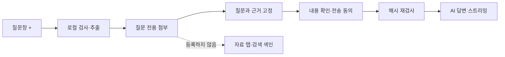
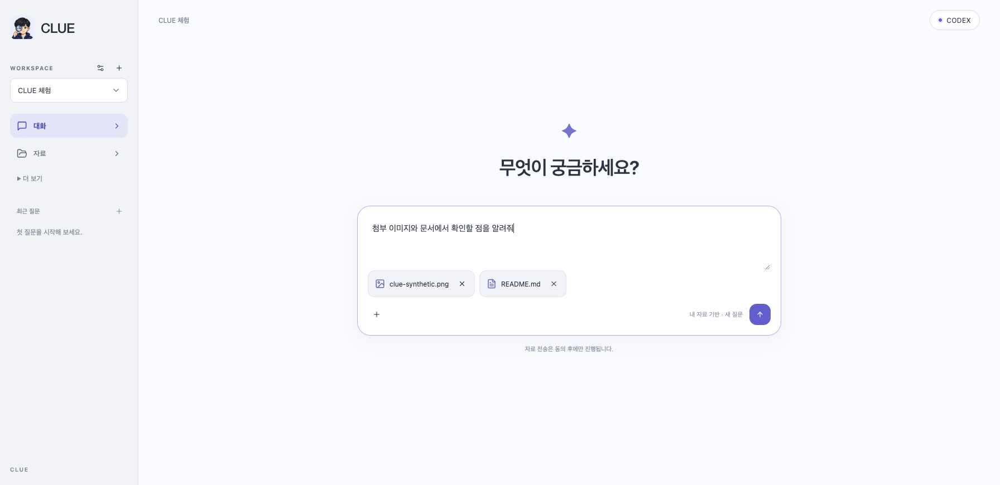

# 질문에 파일 첨부하기

질문창의 **+**를 누르고 파일을 고르세요. 파일을 끌어 놓거나 이미지를 붙여 넣어도 됩니다.
예: “이 이미지에서 이상한 부분을 찾아줘”, “이 문서를 짧게 정리해줘”.

- 이미지: PNG, JPEG. 이미지 질문은 **Codex**를 선택하세요.
- 문서: PDF, DOCX. UTF-8 텍스트·Markdown·CSV·JSON·일반 코드 파일도 지원합니다.
- 한 질문에 최대 4개, 파일당 5 MiB, 합계 10 MiB입니다.
- 문서는 앞 3,000자까지 사용합니다. 잘린 문서는 첨부 옆에 표시합니다. 스캔 PDF는 이미지로 첨부하세요.
- 첨부는 **해당 질문에만** 연결됩니다. 자료 탭에 등록하거나 다른 질문의 검색 색인에 넣지 않습니다.
- 파일 선택만으로 AI에 보내지 않습니다. 참고 자료를 확인하고 전송에 동의한 뒤 요청합니다.
- 첨부의 ×는 질문 전 제거, 질문 관리의 삭제는 질문·답변·연결된 첨부 삭제입니다. 원본 파일은 그대로입니다.

## 작동 원리

`attachment` 모듈의 서비스는 포트 `AttachmentReader`·`AttachmentStore`를 사용합니다. 어댑터는 Tika/ImageIO·SQLite JDBC입니다. 기존 `search`의 불변 근거 묶음과 `conversation`의 일회 승인/답변 작업에 연결했습니다.

DB v22의 `question_attachment`는 Workspace, 선택적인 질문 ID, 파일명, 형식, BLOB, SHA-256, 추출문, 잘림 여부를 보관합니다. 질문에 묶인 파일은 수정/재사용하지 않습니다. 질문·Workspace 삭제 시 함께 삭제합니다. 미사용 첨부는 24시간 후 정리하며 Workspace별 대기 20개·총 64 MiB로 제한합니다. v22로 연 자료를 구버전 앱으로 열지 마세요.

이미지는 최대 1,200만 화소·한 변 8,192px로 제한하고 PNG로 재인코딩하여 메타데이터를 제거합니다. PDF·DOCX·HTML은 기존 추출기를 사용하며 OCR·내장 파일 재귀 분석을 하지 않습니다. 텍스트·코드는 UTF-8로 읽고 바이너리 제어 문자·잘못된 인코딩을 거절합니다. UI에서 받은 MIME만 믿지 않고 실제 내용을 검사합니다.

이미지 바이트의 해시도 승인 대상입니다. 실행 직전 재검사한 복사본을 권한 600의 임시 파일로 만들고 Codex App Server의 `localImage` 입력으로 보냅니다. 이미지 설명문만 보내는 방식이 아닙니다. 종료·오류·취소 시 임시 폴더를 정리합니다. 도구 실행·네트워크 검색 제한과 전용 로그인 격리는 유지합니다. [Codex 입력 계약](https://learn.chatgpt.com/docs/app-server).

## API

- `POST /api/workspaces/{workspaceId}/attachments`: multipart `file`, 성공 201. ID·파일명·형식·크기·문자 수·잘림 여부만 반환합니다.
- `DELETE /api/workspaces/{workspaceId}/attachments/{id}`: 아직 질문에 연결되지 않은 첨부 제거, 성공 204. 연결된 첨부는 409입니다.
- 기존 `POST .../evidence-bundles`에 선택적인 `attachmentIds` 배열을 추가했습니다. 생략하면 기존과 같습니다. 교차 Workspace·중복·이미 연결된 첨부는 거절합니다.
- 기존 미리보기·승인·작업·SSE API를 그대로 사용합니다. 이미지+Claude 요청은 승인 전에 거절합니다.

## 검사 범위

가상 파일로 단위·통합·실제 브라우저 흐름을 검사했습니다. 실제 계정의 이미지 이해 품질이나 모든 문서 형식의 완벽한 추출을 보장하는 테스트는 아닙니다. 실행 결과·설치/배포 상태는 [릴리스 기록](release-0.1.11-report.md)에 별도로 기록합니다.

