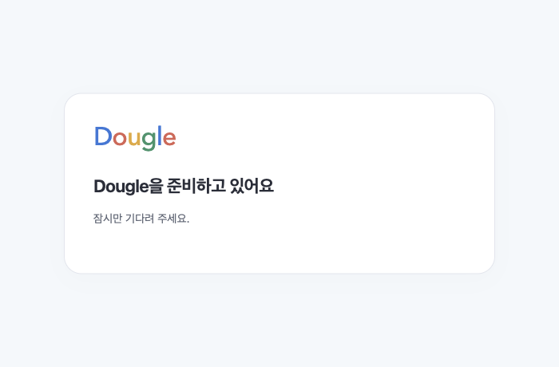
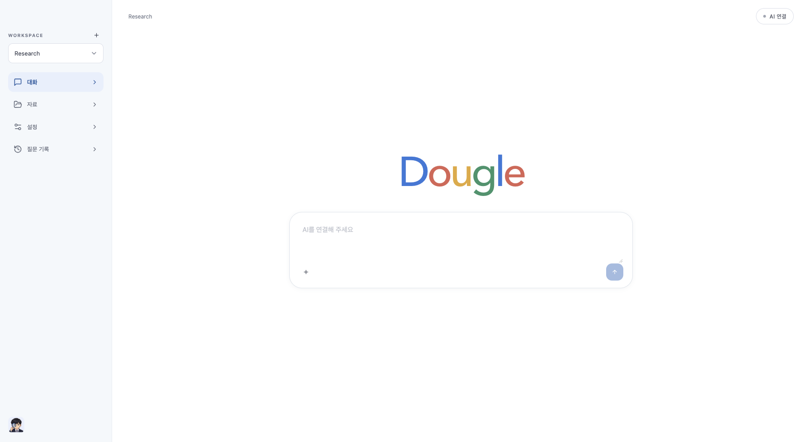
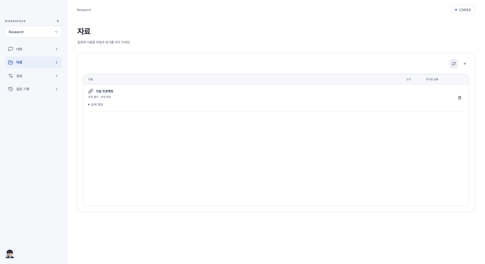
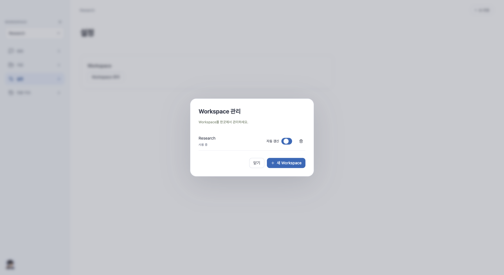

# Dougle 0.1.14

## 최종 빌드·로컬 설치 완료

최종 앱 소스는 `d56af1a`입니다. 양 CPU 설치 파일을 다시 만들고 이 Mac에 최종 0.1.14를 백업 후 재설치했습니다. 공개 자산 업로드·해시 검증·피드 승격은 진행 중입니다.

- 자료 목록 통합, 아이콘 동기화/추가, 파일 선택 후에만 미리보기, 자료 수정 대신 삭제/재등록.
- 중복 제목·안내·기록 화면의 새 질문·사이드바 로고 제거, 둥근 하단 캐릭터.
- 연결 전 비활성 입력창 안내, 프로필/동일 제공자 클릭·모델 변경 시 인증 유지.
- Workspace 관리의 자동 갱신 토글, DB v23 정책 저장/CAS/신규 자료 상속. 기존 개별 설정은 사용자가 변경하기 전 보존합니다.
- Workspace 이름의 공백/대소문자 중복 검사와 기존 서버 고유 제약 확인.
- 정상 시작 status 창은 숨기며 기본 페이지는 준비 중으로 표시합니다. 실제 종료/연결 실패에만 오류 안내를 표시하고, 네이티브 페이지에도 다색 로고를 적용합니다. 실패를 무한 로딩으로 감추거나 AI 요청을 재전송하지 않습니다.
- GitHub 저장소는 `thisisnew/dougle`. 새 앱은 새 피드를 사용하고, 구버전 업데이트 호환을 위해 공개 자산 URL의 기존 저장소 리디렉션을 유지합니다. 앱 ID·자료/인증 경로·번들 이름은 그대로입니다.

## 확인한 결과

- 최종 UI 전체 264건, TypeScript/Vite 빌드 통과.
- Rust 20건, 양 CPU 네이티브/JAR 빌드 통과. 두 CPU DMG 정적 검사·업데이트 서명·버전·현재 JAR 일치 검사 통과.
- Java 전체 실행은 **완전 통과가 아닙니다**: 최종 전체 실행 397개 결과에서 실패 1·정리 오류 1·실제 AI 검사 제외 1입니다. 변경 대상 Source 통합 25건·마이그레이션·이름 검사는 통과했습니다. 기존 `DesktopBootstrapTest`는 자원 close 관측 직후 context active를 검사하는 타이밍 실패이며 단독 재검사에서는 두 번 통과했습니다. 기존 `RelationSearchIntegrationTest`의 6개 기능 검사는 통과하지만 Spring 색인 작업이 살아 있는 동안 JUnit 임시 Lucene 폴더를 정리하며 DirectoryNotEmptyException이 발생합니다. 단독 재검사에서도 정리 오류가 남았습니다. 두 기존 테스트/앱 로직은 이번 변경 범위 밖이라 수정하거나 검사를 완화하지 않았습니다. 최초 모델 문서 누락은 보완했고 가상 로그인 시간 초과는 재검사 통과했습니다.
- 실제 브라우저에서 준비 페이지 다색 로고/오류 안내 숨김, 비활성 질문창, 중복 Workspace 차단, 자동 갱신 토글/새 Source 상속, 가상 로그인 후 프로필 재열기·같은 제공자/모델 변경·다른 제공자 왕복 시 연결 유지, 아이콘 동기화, 파일 클릭 시 미리보기/닫기, 질문 기록의 간결한 빈 상태·새 질문 버튼 없음·가로 넘침 없음을 확인했습니다. 가상 추론 호출도 0회입니다. OS 폴더 선택 대신 가상 폴더 등록만 fixture API로 수행했고 동기화·탐색은 UI로 검증했습니다.
- 최종 Intel DMG에서 실제 React/WebKit·로컬 수집/설정 검사를 통과했습니다. 네이티브 시작 관측 362회에서 status/중복 창이 없었고 메인 창을 40회 확인했습니다. HTTP 200/403, 자식 프로세스 종료도 통과했습니다.
- 이 Mac은 종료한 DB/앱 백업 후 최종본으로 교체하고 UI 200·미인증 API 403을 확인했습니다. 인증 내용은 읽거나 바꾸지 않았습니다. DB v23을 구버전 앱으로 열지 마세요.
- 실제 외부 AI 호출·ARM 실기기·Apple 공증은 검증 범위가 아닙니다.

