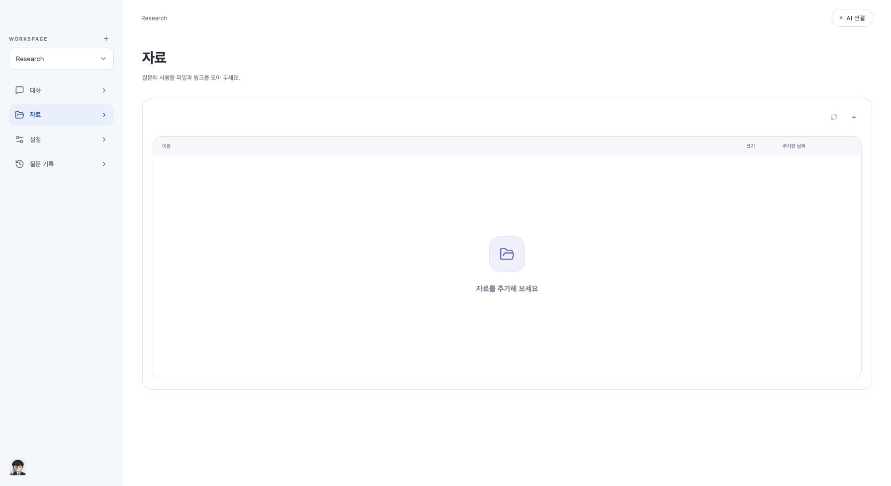

# Dougle 0.1.15

자료 목록의 빈 화면을 **‘자료를 추가해 보세요’** 한 줄로 바꾸고 ‘상단에서 자료를 추가하세요.’라는 반복 안내를 제거했습니다. 기능·DB v23·인증·자료 저장 방식은 변경하지 않습니다.

설정 화면은 중복 Workspace 제목/작은 버튼 대신 아이콘·이름·화살표가 정렬된 단일 클릭 행으로 정리했습니다. 관리창에서 설명 문구·‘새 Workspace’ 버튼·‘사용 중’ 표시를 제거하고 이름·자동 갱신·삭제·닫기만 남겼습니다. 새 Workspace는 기존 사이드바 +로 만듭니다. 설명이 없는 관리창의 접근성 참조도 제거했으며 제목·키보드 포커스는 유지합니다.

초기 0.1.15 로컬 설치 후 추가 피드백을 같은 미공개 버전에 반영 중입니다. 초기 초안 자산은 제거하고 새 JAR로 재검증·교체합니다.

UI 전체 264건(App 13건 포함)·Rust 20건·TypeScript/Vite/JAR·양 CPU 네이티브 빌드를 통과했습니다. 실제 브라우저에서 새 문구 한 줄, 반복 설명 없음, 가로 넘침 없음을 확인했습니다. 가상 추론 호출 0회입니다. 양 CPU 패키지 검증 및 재설치를 진행합니다. 이전 Java 전체 검사의 기존 종료/임시 폴더 정리 오류는 [0.1.14 보고서](release-0.1.14-report.md)에 기록되어 있으며 이번 문구 변경으로 해결된 것으로 보고하지 않습니다. 백엔드 소스는 변경하지 않았고 Java 전체 검사를 다시 수행하지 않았습니다. ARM 실기기·외부 AI·Apple 공증은 별도입니다.

