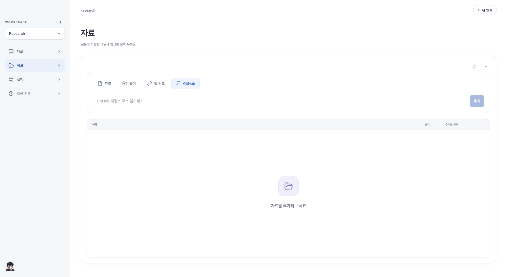
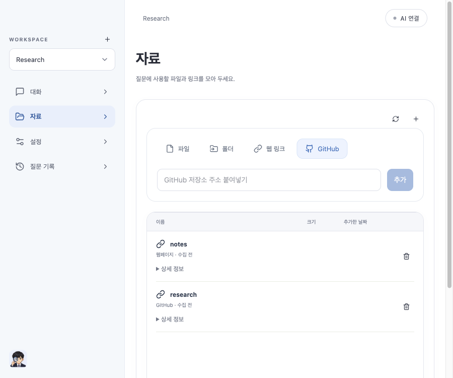
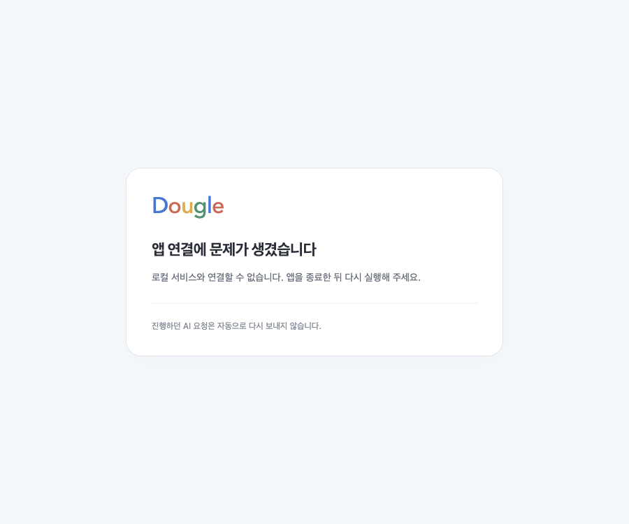

# Dougle 0.1.16 — 자료 추가 정리

자료 추가의 이름·분류 입력과 파일/폴더 설명을 제거했습니다. 종류는 드롭다운 대신 파일·폴더·웹 링크·GitHub 버튼으로 바로 고르고, 다음 행에는 선택 버튼 또는 주소 입력과 추가만 표시합니다. 작은 화면에서는 종류 버튼을 두 열로 배치합니다.

이름은 선택한 폴더명·URL 마지막 경로(없으면 호스트)·GitHub 저장소명에서 자동 생성합니다. URL 쿼리/fragment는 이름에 넣지 않고, 인코딩·제어문자·경로 구분자·120자 제한을 처리합니다. 신규 분류는 빈 문자열이며 기존 자료의 이름/분류와 검색 호환 API는 변경하지 않습니다. 폴더 전용 선택기·선택 취소·등록 실패 시 입력 보존·별도 수동 동기화·Workspace 자동 갱신 정책은 유지합니다.

오류 화면은 개별 오류 메시지에 있는 재실행 안내를 유지하고, 공통 하단의 중복 재실행 문장을 제거했습니다. AI 요청을 자동으로 재전송하지 않는 동작/안내는 유지합니다. 시작 HTML 회귀 검사로 중복 문구가 돌아오지 않도록 확인합니다.

DB v23·백엔드·인증·AI 전송 계약은 변경하지 않습니다. 최종 소스는 `7e43f6a`입니다. UI 전체 **275건(39파일)**, Rust **20건** 및 오류 HTML 변경 후 main **6건 재검사**를 통과했습니다(중복 합산하지 않음). TypeScript/Vite/JAR와 Intel·ARM 네이티브 빌드를 완료했습니다. 초기 병렬 빌드 중 UI 검사는 시간 초과가 있어 중단했고, 빌드 종료 후 단일 worker로 전체를 다시 실행해 통과했습니다.

가상 브라우저에서 GitHub/웹 링크를 UI로 등록하고 이름 `research`/`notes`, 빈 분류, 수집 전 상태를 확인했습니다. 파일/폴더에는 이름·분류 입력과 설명이 없고, 900px 화면에서도 가로 넘침이 없습니다. 오류 HTML을 같은 오류 메시지로 렌더링했을 때 재실행 문장이 한 번만 표시됨을 확인했습니다(실제 서비스 장애 재현이 아닌 화면 fixture). 브라우저 CDP 시간 초과는 같은 TaskSpace에서 새로고침 후 복구했습니다. 실제 AI 호출·외부 자료 동기화는 실행하지 않았습니다.

두 CPU 패키지 검증 및 로컬 재설치를 진행 중입니다. Java 전체 검사는 재실행하지 않았으며 기존 실패는 [0.1.14 기록](release-0.1.14-report.md)에 남겨 둡니다. ARM 실기기·외부 AI·Apple 공증은 포함하지 않습니다.

