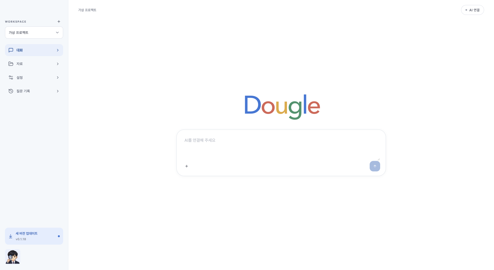

# Dougle 0.1.17 — 자동 갱신 주기와 하단 업데이트

## 변경

- 설정 → Workspace 관리: 자동 갱신 주기 선택, OFF 보존, 새 연결 자료 상속. DB v24는 주기와 신규 자료 등록 날짜를 저장합니다. 기존 자료의 알 수 없는 날짜는 비워 둡니다.
- 폴더 선택 즉시 등록, URL/GitHub Enter 등록, 추가 영역 유지, 공통 삭제 확인창, 질문 검색 아이콘과 모델 재연결 처리.
- 수동 CLI 경로 UI 대신 내장 Codex·설치된 Claude 표준 경로 탐색. 실제 Claude 인증/응답 성공을 보증하지 않습니다.
- 왼쪽 아래 업데이트 버튼. 자동 확인은 팝업 없이 새 버전만 표시하며 사용자 클릭 후 다운로드·설치를 확인합니다. 진행률·실패 후 재시도를 지원합니다.
- GitHub의 공개 릴리스와 `latest.json` 자산으로 새 버전을 찾고 기존 피드도 유지합니다. 릴리스 작성자는 버전을 높이고 서명된 양 CPU 패키지와 `latest.json`을 함께 공개해야 합니다. 임의 릴리스 노트나 DMG만으로 자동 설치하지 않습니다.

## 검증

UI 전체 286개(41파일), 업데이트 UI 최종 4개 및 ChatPanel 18개 재검사, Java 관련 52개, Rust 22개 통과. 전체 검사와 재검사 수는 합산하지 않습니다. ChatPanel 추가 검사는 인증 전·확인 중·인증 실패 상태의 disabled/강제 submit 차단, 연결 후 해제/미연결 복귀를 확인합니다. 자동 갱신 주기의 브라우저 저장·백엔드 재시작 유지와 AI 호출 0회를 확인했습니다. 새 버전 메타데이터 선택·draft/외부 자산 배제는 가상 단위 테스트입니다. UI/JAR 빌드 통과.

AI 연결 잠금은 기존 코드에서 `AUTHENTICATED`일 때만 해제합니다. 입력창 안내는 “AI를 연결해 주세요”이며 별도의 상단 안내문은 없습니다. 자료 미등록 시 질문 입력을 잠그는 정책은 사용자와 협의 중이며 아직 적용하지 않았습니다. 이미지는 질문 첨부만으로 질문할 수 있도록 유지하는 방향을 제안했습니다.

가상 브라우저에서도 입력창 disabled·전송 disabled·안내 placeholder를 확인했습니다. 아래 업데이트 배지는 실제 React 화면에 가상 네이티브 상태(0.1.18)를 전달한 디자인 검사이며, 0.1.18을 공개하거나 실제 다운로드한 증거는 아닙니다. 외부 AI 호출은 0회입니다.

## 설치 상태

양 CPU 최종 빌드·서명된 업데이트 아카이브·DMG 무결성/아키텍처/설치 복사본 검사를 통과했습니다. Intel 실제 WebKit UI 회귀와 시작 창 검사(main 창 40회 관측, 총 176회 표본에서 status/중복 창 없음)를 마쳤습니다. 이 Mac의 앱과 닫힌 DB를 백업한 후 0.1.17로 교체·재실행했습니다. 설치 JAR 일치·UI HTTP 200·미인증 API 403 확인 완료. 공개 릴리스/피드는 아직 0.1.16입니다. 백업은 `~/Library/Application Support/KnowledgeForgeBackups/2026-10-24T15-44-42.788Z-before-dougle`입니다. 사용자 DB나 인증 내용을 검증용으로 열지 않았습니다. 처음 WebKit 회귀는 시스템 Claude 자동 탐색으로 기존 PATH 격리 가정이 깨져 실패했습니다. 검증기만 임시 DB에 사라진 가상 CLI 경로를 저장·재시작하도록 바꿨고, 마지막 경로 초기화의 재시작 필요 조건도 맞춘 뒤 통과했습니다. 패키지 앱 코드는 이 검증기 수정으로 바뀌지 않습니다. DB v24 사용 후 0.1.16으로 다운그레이드하지 마세요. ARM 실기기·실제 AI·Apple 공증은 범위 밖입니다.
