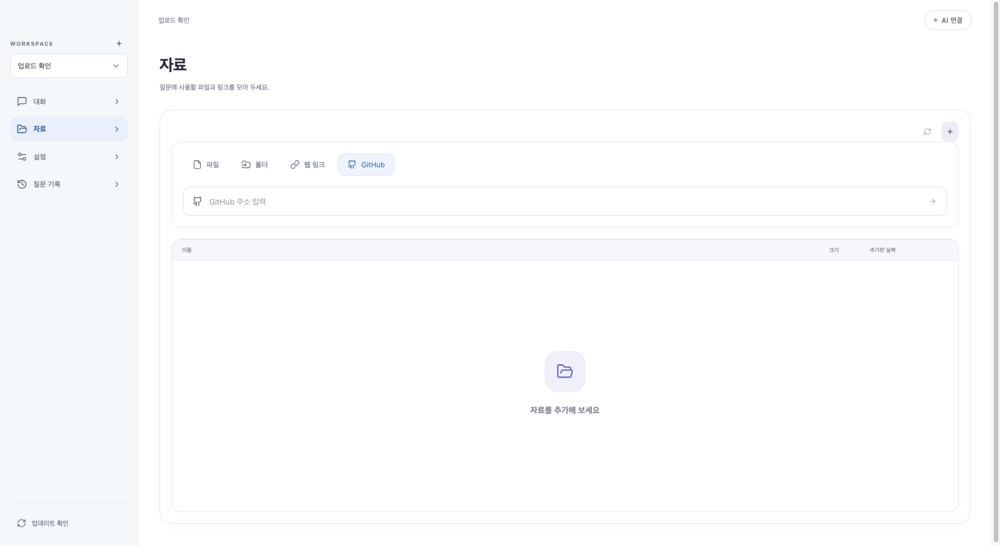
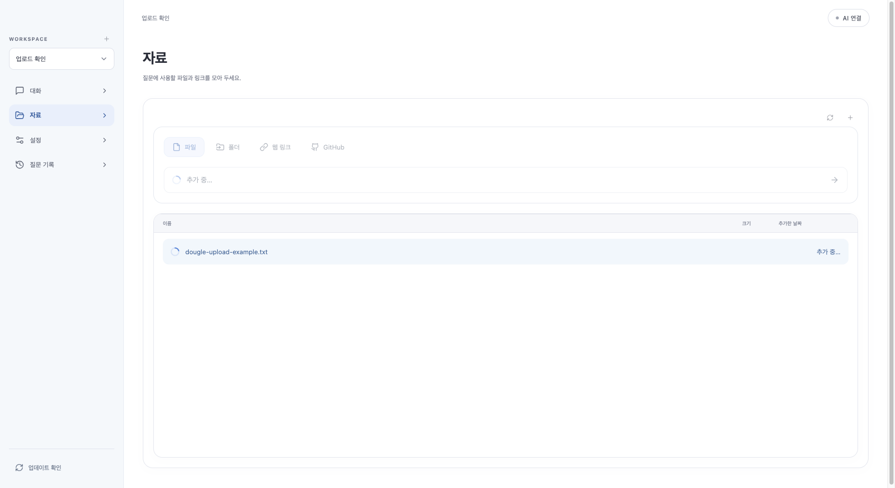

# 0.1.18 파일 추가 진행 표시

## 변경
- 추가 피드백: 왼쪽 아래 프로필 사진은 제거하고 데스크톱 업데이트 버튼만 유지합니다. Dock 아이콘은 바꾸지 않습니다.
- 파일·폴더 선택과 웹 링크·GitHub 입력을 같은 52px 높이·전체 폭·둥근 테두리로 통일했습니다. 왼쪽 종류 아이콘과 오른쪽 화살표 위치도 맞춥니다.
- 파일·폴더는 선택 즉시 추가하고 웹 링크·GitHub는 Enter 또는 화살표로 추가합니다. 별도 확인 단계는 늘리지 않습니다.
- 파일 선택 직후 ‘추가 중…’ 버튼 스피너와 파일명·진행 막대를 표시합니다.
- 진행 중 중복 선택/제출을 막고 완료·실패 시 해제합니다. 추가 영역은 계속 열어 둡니다.
- 실패 시 오류 안내와 재선택이 가능합니다. 파일 선택 취소는 업로드를 시작하지 않습니다.
- 접근성 상태 알림 및 모션 감소 설정을 지원합니다. 퍼센트는 추측하지 않습니다.
- AI/승인·자료 없는 질문 잠금 정책·DB/API는 변경하지 않습니다.

## 검증·배포
- UI 전체 295개(41파일) 통과. 지연 응답 동안 진행 표시/중복 방지, 완료·실패·재시도·선택 취소를 검사했습니다.
- TypeScript/Vite 및 JAR 빌드 통과. 백엔드 소스/API는 이번 작업에서 변경하지 않았습니다.
- 가상 자료 브라우저에서 네 종류 입력 영역이 모두 1369×52px임을 확인했습니다. URL 입력 내부 여백은 0px로 이중 테두리/들여쓰기 없이 정렬됩니다.
- 브라우저에서 테스트용 파일 요청만 잠시 보류해 실제 React 로딩 화면을 확인한 뒤 실제 로컬 업로드를 완료했습니다. 진행 표시 해제·추가 영역 유지·버튼 재활성화를 확인했습니다. 사용자 DB/사진은 사용하지 않았습니다.
- 프로필 제거 후 전체 295개를 다시 통과했습니다(중복 합산하지 않음). 최종 화면에서도 하단 이미지 0개·업데이트 버튼 유지 확인. 스크린샷의 업데이트 상태는 브라우저용 IPC fixture이며 실제 다운로드 검사가 아닙니다.
- 양 CPU 최종 DMG·업데이트 아카이브를 갱신하고 패키지 서명·서명 버전·CPU·DMG 무결성 검사를 통과했습니다. `release/latest.json`은 최종 패키지로 재생성했습니다. GitHub 릴리스 게시·커밋·푸시는 하지 않았습니다. 실제 AI·ARM 실기기 검사는 범위 밖입니다.

## 이 Mac 설치
- 최종 프로필 제거 JAR를 포함한 Intel DMG로 `/Applications/Knowledge Forge.app`을 교체·재실행했습니다. 설치 JAR와 빌드 JAR가 바이트 단위로 일치하며 UI 200/비인증 API 403을 확인했습니다.
- 백업: `/Users/thisisnew/Library/Application Support/KnowledgeForgeBackups/2026-10-24T16-11-48.862Z-before-dougle`. 앱을 종료한 뒤 DB 파일만 복사했고 인증 데이터는 건드리지 않았습니다.
- 같은 네이티브 0.1.18 빌드의 격리 시작 검사에서 메인 창 40회 관측, 시작 status/중복 창 없음 212회 관측, UI 200/API 403·자식 종료를 확인했습니다. 이후 프로필 제거는 React/JAR만 갱신했습니다.
- 공개 릴리스/피드는 기존 0.1.16이며 미공개 0.1.18 패키지에 후속 UI 요청을 합쳤습니다. Apple 공증·ARM 실제 실행·실제 AI 호출은 하지 않았습니다.

