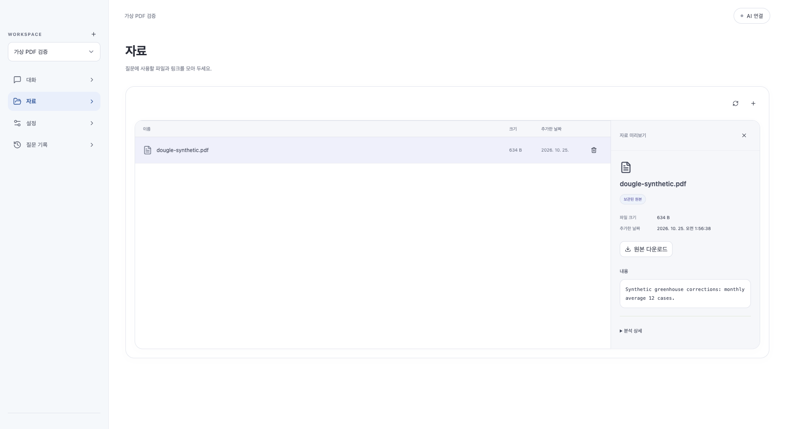
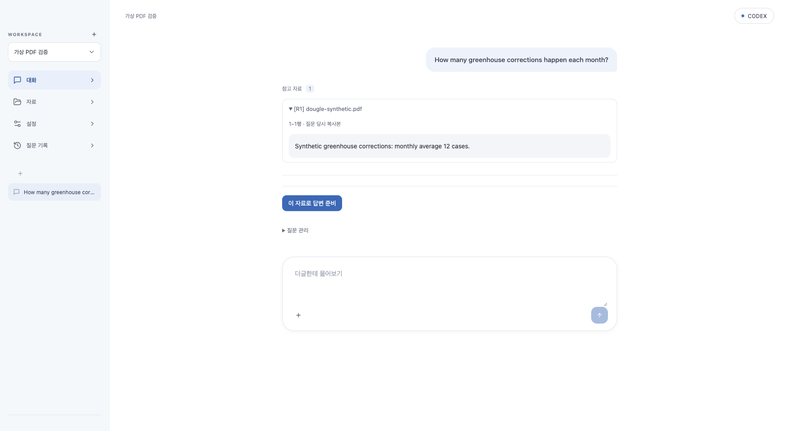

# 0.1.19 업로드 동기화·자연어 근거 검색

## 재현과 원인
- 동기화 버튼은 Source 목록만 보므로 업로드 파일만 있는 Workspace에서는 비활성화됐습니다.
- 질문에도 일반 키워드 검색의 AND 조건을 적용해 질문의 모든 분석 토큰이 문서에 있어야 했습니다. 문서에 없는 의문 표현 때문에 근거가 0개가 될 수 있었습니다.
- PDF는 업로드 시 Tika로 추출되지만 미리보기는 원본 바이트를 UTF-8로 해석해, 추출 성공 여부와 무관하게 지원하지 않는다고 표시했습니다.
- 가상 자료로 회귀 테스트 3개가 기존 코드에서 실패하는 것을 확인했습니다. 사용자 PDF 내용이나 개인 DB는 열지 않았으므로 해당 PDF의 실제 추출 상태를 단정하지 않습니다.

## 수정
- `POST /api/workspaces/{workspaceId}/files/sync`: 해당 Workspace의 업로드와 하위 폴더를 순회해 보관본을 재분석하고 검색 색인을 갱신합니다. Source 관리 자료는 기존 Source 동기화가 처리합니다. PC 원본을 다시 읽는 기능은 아니며 자동 AI 호출/외부 전송은 없습니다.
- 동기화는 업로드 파일만 있어도 가능하며 처리 중 회전 표시·중복 차단을 유지합니다. 개별 분석 실패를 표시하면서 연결 Source 동기화는 계속합니다.
- 질문 전용 `searchQuestion`은 중복 토큰을 제거하고 최소 한 단어가 일치하는 후보를 Lucene 점수로 정렬합니다. Workspace·분류·원본/게시 지식 필터와 근거 재검증을 유지합니다. 일반 키워드 검색의 AND 동작은 보존합니다. 의미 검색/동의어/정답 보장은 아닙니다.
- PDF 미리보기에 저장된 추출 텍스트를 표시합니다. 이미지형 PDF의 OCR은 추가하지 않습니다.
- 검색 결과 없음 안내는 자료가 없다고 단정하지 않고 ‘질문과 관련된 내용을 찾지 못했어요’로 구별합니다.
- 기존 질문의 근거 묶음은 불변입니다. 수정 후 동기화하고 질문을 다시 보내야 새 검색 결과를 사용합니다.

## 검증·배포
- Java 관련 78개 통과: 자연어 질문·기존 키워드 검색·Workspace/분류 격리·PDF 업로드/미리보기/근거 생성·하위 업로드 재분석·Source 제외·실패 집계·비인증 차단·근거 검증을 검사했습니다.
- UI 전체 297개(41파일), 최종 ChatPanel 19개 재검사 통과(중복 합산하지 않음). TypeScript/Vite/JAR 빌드 통과.
- 가상 PDF를 실제 브라우저 UI로 업로드하고 동기화 버튼·본문 미리보기를 확인했습니다. 가상 CLI 로그인 후 자연어 질문을 제출해 참고 자료 1개와 ‘monthly average 12 cases’ 인용을 확인했습니다. 답변 준비/전송은 하지 않았습니다.
- 처음 OR 조건을 공통 검색에 적용했을 때 기존 키워드 검색 회귀 1개가 실패하여 질문 전용 경로로 분리했고 관련 78개가 모두 통과했습니다.
- Intel/ARM64 빌드·DMG·업데이트 아카이브·서명/버전/CPU 검사 및 체크섬 검증을 통과했습니다. `release/latest.json`을 생성했고 공개 피드는 바꾸지 않았습니다. DB v24 유지. GitHub 공개·커밋·푸시하지 않았습니다. 실제 AI 호출·사용자 문서 분석·ARM 실기기 검사·공증은 하지 않습니다.
- Intel 격리 시작 검사는 첫 시도에서 시작 제한 시간 초과로 실패했습니다. 같은 최종 번들 재검사에서는 메인 창 40회, status/중복 창 없음 399회 관측, UI 200/비인증 API 403·자식 종료를 통과했습니다. 첫 타임아웃의 원인은 확정하지 않았으며 제한을 늘리거나 검사를 생략하지 않았습니다.

## 로컬 설치
`/Applications/Knowledge Forge.app`에 0.1.19를 설치·재실행하고 설치 JAR와 최종 빌드 JAR의 일치를 확인했습니다. 백업은 `/Users/thisisnew/Library/Application Support/KnowledgeForgeBackups/2026-10-24T22-18-33.730Z-before-dougle`입니다. 종료 후 DB 파일만 복사했고 실제 내용/인증 정보를 읽거나 바꾸지 않았습니다.

