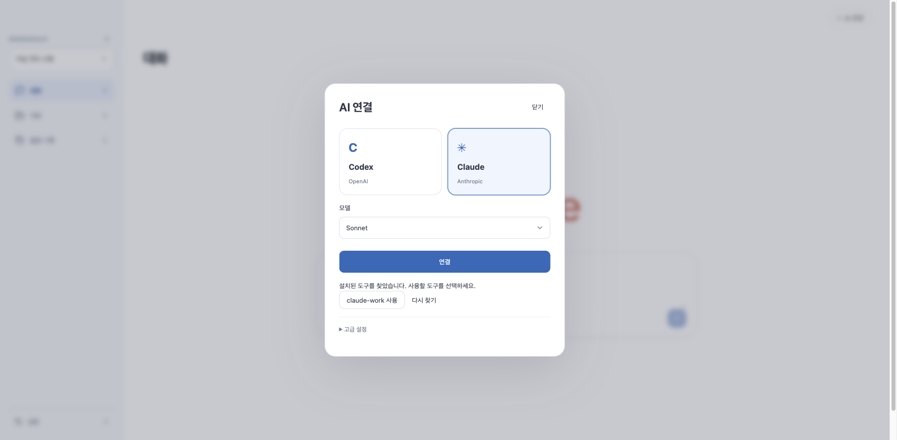

# Dougle 0.1.33 — AI 도구 자동 탐색

2026-10-28 22:29 KST [공개 완료](https://github.com/thisisnew/dougle/releases/tag/v0.1.33-preview.1). 공개 자산 3개 모두 GitHub의 크기·SHA-256 digest가 로컬 검증본과 일치하며 ARM 다운로드 HTTP 200을 확인했다. 로컬 Intel 앱도 이전 앱·정지된 데이터 백업 후 0.1.33으로 교체했다.

## 변경

Claude/Codex 실행 파일·회사별 명령·Node 버전 관리자 설치·단순 별칭/인자 전달 함수를 코드로 탐색한다. 사용자는 기본 연결 또는 발견한 도구 이름 선택을 사용하며 직접 경로 입력은 고급 설정이다. npm 심볼릭 링크 대상에 맞는 Node 실행 경로도 추가한다.

설정 저장은 앱 재시작 후 적용하며 다른 제공자의 설정과 실행 중 요청 binding을 보존한다. 셸 프로필이나 복잡한 회사 함수는 임의 실행하지 않는다. [지원 범위](ai-tool-discovery.md).

## 완료한 소스 검증

- Java 전체: 1,211개 중 24개 opt-in 생략, 실패·오류 0. 이후 Node 심볼릭 링크 실행 검사 1개를 추가하고 관련 46개를 재검사해 통과했다.
- UI: 640개 + 별도 인수 50개 통과. 최종 안내 문구는 관련 19개와 생산 빌드 재검사 통과.
- Node: 177개 통과.
- 임시 HOME·최소 PATH·실제 번들 검색 엔진으로 가상 회사용 CLI 자동 발견, 목록에서 선택, 재시작 후 인증 상태, 한국어 검색을 확인했다. 실제 AI 호출 0회.
- ego-browser에서 가상 API로 실제 생산 UI의 Claude 선택 → 연결 → `claude-work 사용` → 재시작 안내를 확인했다. 경로 입력 없이 선택하며 인증 완료로 잘못 표시하지 않는다.

## 배포

Intel DMG의 읽기 전용 마운트·설치 복사·서명·실제 WebView의 Workspace/AI 연결/업로드/다운로드/검색/CLI 설정 검사를 통과했다. ARM DMG의 CPU·무결성·서명·검색 모델 정적 검사와 두 CPU의 업데이트 아카이브 서명·현재 JAR 일치 검사도 통과했다.

첫 네이티브 검사의 기존 오류 문구 전용 기대가 새 탐색 결과 화면과 맞지 않아 수정했다. 단순히 성공 문구를 허용한 것이 아니라, 저장된 가상 Claude 실행 파일이 없으면 API는 계속 `TOOL_UNAVAILABLE`을 반환하는지 함께 검증한다. 재검사 통과.

Apple Silicon 실행·회사 계정 인증·복잡한 회사 셸 함수 지원·Apple 공증 완료를 의미하지 않는다. 실제 회사 계정에서 여전히 실패할 가능성은 남아 있다.

수동 설치 Preview이므로 공개 자산은 CPU별 DMG와 SHA-256 검증 목록으로 한정한다. 자동 업데이트용 아카이브는 로컬 검증용으로 생성하며 자동 업데이트 피드는 기존 상태를 유지한다.
