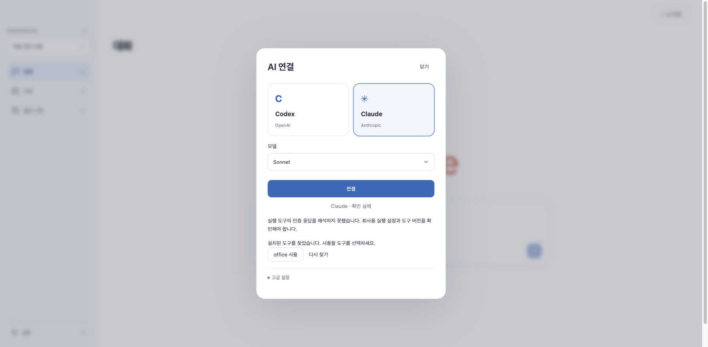

# Dougle 0.1.34 — 회사 계정 별칭 연결

2026-10-28 [공개 완료](https://github.com/thisisnew/dougle/releases/tag/v0.1.34-preview.1). 공개 자산3개 모두 GitHub 크기·SHA-256 digest와 로컬 검증본이 일치한다. 실제 회사 Mac 인증 성공은 미검증이다.

## 변경

- 환경변수를 포함하는 제한된 회사 별칭을 읽고 계정 폴더·허용된 인증 환경을 인증 확인, 브라우저 로그인 실행, 답변 실행에 동일하게 적용한다. 별칭 이름을 고정하지 않는다.
- 네이티브 호스트가 기본 Claude 절대 경로를 먼저 강제하여 별칭 탐색을 우회하던 경로를 제거한다.
- `다른 AI 도구 찾기` 버튼을 제거한다. 실패 시 자동 탐색과 짧은 오류 분류를 제공한다. 경로나 비밀정보를 오류 원문으로 표시하지 않는다.
- 셸 프로필을 실행하거나 Desktop 로그인 토큰을 추출하지 않는다. Claude 런타임 신규 동봉·자동 설치는 이번 범위가 아니다.

[상세 지원 범위와 한계](company-alias-connection.md).

## 소스 검증

- Java 전체 1,222개 중 25개 opt-in 생략, 실패/오류 0. 이후 별칭 로그인→인증 재확인 검사 1개 추가와 관련 27개 재검사 통과. 최종 XML 합계 1,223개/실패0/오류0/생략25.
- UI 전체641개, 별도 opt-in50개 통과. 생산 빌드 통과(기존 500KB 청크 경고 유지).
- Node177개, Rust24개 통과. 중복 제거한 네이티브 Claude 탐색의 전용 단위 검사1개도 함께 제거했다. 현재 탐색은 Java에서 검증한다.
- 별칭18개 검사: 실제 가상 프로세스의 프로필 의존 인증·답변 실행·로그인 후 재확인, Codex 격리, 비밀값 비노출, 셸 주입 거부, 여러 별칭 시 임의 선택 방지.
- ego-browser 가상 API/생산 UI: 별도 찾기 버튼 없이 연결→실패 원인→자동 후보 표시 확인. 실제 사용자 자료/계정은 사용하지 않았다.

## 배포 검증

첫 별칭 smoke는 인증·검색까지 진행한 뒤 기존 하네스가 실행파일 경로만 저장된다고 가정하는 검사에서 실패했다. 실제로 발견한 별칭 식별자와 저장/활성 설정이 정확히 같은지 검사하도록 변경했다. 실패를 회사 인증 성공으로 집계하지 않는다.

동봉 런타임의 빈 HOME 별칭/기본 도구/도구 없음3개 시나리오를 통과했다. 각 시나리오는 실제 번들 검색 모델 로딩·한국어 검색·저장/재시작 후 가상 인증을 포함하며 외부 AI를 호출하지 않는다.

Intel DMG 읽기 전용 마운트·복사·서명·실제 WebView의 Workspace/AI/파일 업로드·다운로드/검색/CLI 설정 검사를 통과했다. ARM DMG의 CPU·서명·모델·무결성 정적 검사와 두 CPU 업데이트 아카이브의 서명·버전·최종 JAR 일치도 통과했다. 실제 AI 호출은0회이며 회사 SSO·ARM 실행·Apple 공증은 미검증이다.

로컬 `/Applications/Dougle.app`은0.1.34로 교체했다. 종료된 DB와 이전 앱을 사용자 Library의 Dougle Backups에 백업했고, 설치본 버전·서명·Intel JAR 바이트 일치를 확인했다. Intel JAR SHA-256은 `b42dc256544e526ba03978f0748069120dfe551a3e7fdec492486acf479f7a7e`다.

공개 파일:

| 파일 | 바이트 | SHA-256 |
| --- | ---: | --- |
| Dougle_0.1.34_arm64.dmg | 477756314 | 938ca1fd9d2a6fefc76b59dcb3432a4b00021b48e048ca356f43c7734664ddc0 |
| Dougle_0.1.34_x86_64.dmg | 486077598 | abcefb1b0e36d5cf2fba03a717153703915805189d8a6b26970230cd186c0628 |
| SHA256SUMS-0.1.34-DMG | 181 | b0d9a1643bc194876600ab10a2a8de777a41b6a7740442b0a6ffb62c697ddca7 |

초안 업로드 중 생성 완료 전 체크섬 목록이 올라간 것을 크기/해시 검사에서 발견했고 최종181바이트 파일로 교체한 후 세 자산을 다시 대조했다. 공개 전에 모두 일치함을 확인했다. 자동 업데이트 피드는 기존 상태로 유지한다.
