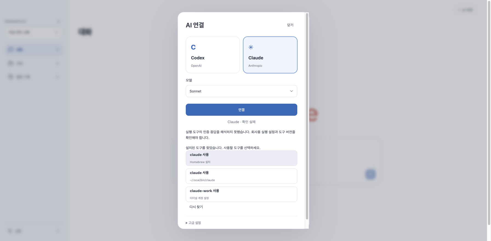

# Dougle 0.1.35 — 선택한 AI 환경 즉시 연결

2026-10-29 [공개·로컬 설치 완료](https://github.com/thisisnew/dougle/releases/tag/v0.1.35-preview.1). 공개3자산 크기·SHA-256이 로컬 검증본과 일치한다. 실제 회사 Mac 인증은 미검증이다.

## 원인과 변경

기존 기본 선택 UI는 경로 저장 API만 호출하고 재시작을 안내했다. 인증 확인과 활성화가 빠져 있었고 답변 실행기도 앱 시작 당시 경로를 고정했다. 회사 Mac의 재시작 후 실패 원인은 해당 환경에서 직접 확인하지 못했으므로 저장 실패나 특정 SSO 문제로 단정하지 않는다.

- 새 선택 API는 탐색된 명령의 인증 상태를 먼저 확인하고 활성 설정과 저장 설정을 함께 갱신한다. 답변·계획·진단 실행기는 같은 활성 명령을 사용한다.
- 로그인 필요 응답이면 선택 환경으로 브라우저 로그인을 이어가며, 연결 성공으로 표시하지 않는다.
- 미지원·시간 초과·해석 불가 응답이면 기존 설정을 유지한다. 동시 설정 변경·오래된 revision·탐색되지 않은 경로는 거부한다.
- 인증 확인·로그인·답변 생성 중에는 실행 환경 변경을 막는다. 이전 실행 환경에 대한 승인 바인딩은 새 환경에서 재사용하지 않는다.
- 후보를 세로 카드로 정렬하고 설치 위치/터미널 계정 설정을 구분한다. 같은 경로는 중복 표시하지 않는다. 기본 선택은 앱 재시작을 요구하지 않는다.
- 고급 수동 경로 저장은 기존 재시작 적용 API를 유지한다. 셸 초기화 실행·Desktop 토큰 추출·자동 AI 재전송을 추가하지 않는다.

## 검증 체크리스트

| 시나리오 | 증거/상태 |
| --- | --- |
| Codex 선택 후 인증·즉시 적용 | CliLiveConnectionTest, 통과 |
| Claude 선택 후 인증·즉시 적용 | CliLiveConnectionTest, 통과 |
| 선택 전에 만든 답변 실행기가 새 명령 사용 | 두 제공자 실제 가상 프로세스, 통과 |
| 다른 제공자 설정·승인 바인딩 유지 | 단위 검사 통과 |
| 새 환경의 승인 바인딩 변경 | 단위 검사 통과 |
| 동일 저장 설정에서 인스턴스 재생성·재인증 | 단위 검사 통과 |
| 로그인 필요→같은 환경 로그인→인증 재확인 | 가상 프로세스 검사 통과 |
| 시간 초과·오류·미지원 시 기존 설정 보존 | 네 실패 변형 통과 |
| 오래된 revision·미탐색 경로 실행 금지 | 실행 표시 파일 미생성 확인, 통과 |
| 실행 중 설정 변경 차단 | 실행 lease 및 실제 가상 답변 프로세스 검사 통과 |
| 화면의 연결 상태·모델 선택 즉시 반영 | 두 제공자 UI 검사 통과 |
| 로그인 필요 시 성공 표시 없이 동의/로그인 제공 | UI 검사 통과 |
| 중복 경로 제거·동명 설치/계정 구별 | UI 검사 통과 |
| 실제 브라우저 후보 정렬·선택→연결됨 | 가상 API + 생산 UI 통과, 480px 대화상자 가로 넘침 없음 |
| 좁은 창 연결 완료 화면 | 390px viewport, 343px 대화상자 가로 넘침 없음 |
| 새 HOME에서 저장·실제 JVM 종료/시작 후 유지 | 동봉 Java/JAR + 가상 CLI 시나리오 통과 |
| 잘못된 기본 Claude→회사 별칭 선택→재시작 없이 답변 | 두 제공자 답변 작업 SUCCEEDED, 정확한 R1 인용 결과 확인 |
| 재시작 후 저장한 회사 별칭으로 다시 답변 | 두 제공자 답변 작업 SUCCEEDED |
| 환경 전환 후 기존 답변 승인 재사용 | 실제 패키지 HTTP409 거절 확인 |
| Intel 설치본 실행·ARM 패키지 정적 검사 | 양쪽 통과, ARM 실행은 제외 |
| 공개 다운로드 무결성 | 공개3자산 크기·SHA-256 일치 |
| 회사 M5·실제 계정/SSO·모델 응답 | 미검증 |



## 검사 중 발견한 실패

초기 프로세스 테스트의 500ms 제한에서 인증 프로세스 시작이 시간 초과됐다. 운영 제한30초를 줄이지 않았으며 가상 정상 프로세스 제한은3초로 조정했다. 별도 sleep 실패 검사는 계속 시간 초과를 요구한다.

전체 Java 첫 실행은 테스트 1,220개 중 오류2개·실패0개·생략25개였다. 새 컨트롤러가 구체 어댑터 타입에 의존해 기존 인터페이스 대역을 주입하지 못한 오류다. 인증 포트에 선택 명령 확인을 명시하고 컨트롤러도 포트를 사용하도록 수정했다. 실제 생성 중 변경 차단 검사1개를 추가한 전체 재실행은1,221개 중1,196개 통과·실패0·오류0·opt-in 생략25개다. 이전 실행의 잔여 XML을 합산하지 않고 이번 실행에서 갱신된138개 보고서만 집계했다.

UI 최종650개와 별도 opt-in50개, Node177개, Rust24개 통과. 실제 외부 AI 호출0회. 가상 인증 성공을 회사 서비스 성공으로 취급하지 않는다. Apple 공증과 ARM 실기기 실행은 이번 검증에 포함되지 않는다.

추가 패키지 시나리오의 첫 실행은 재시작 직후 검색 모델 초기화 중에 질문을 보내503으로 거절됐다. 인증은 이미 통과했으며 이503을 인증 실패로 취급하지 않는다. 검사가 검색 READY를 확인한 다음 질문하도록 수정하고 재실행해 양쪽 제공자의 재시작 전·후 답변을 확인했다. 실제 모델·회사 네트워크를 호출하지 않는 가상 답변이다.

재현:

```sh
bash scripts/maven.sh -q -Dtest=CliLiveConnectionTest,ProviderConnectionIntegrationTest,CliLaunchIntegrationTest test
node scripts/fresh-install-smoke.mjs "$PWD/desktop/src-tauri/resources" --profile-alias --live-selection
```

두 번째 명령은 현재 빌드된 앱 리소스가 필요하며 임시 HOME/SQLite만 사용한다. 사용자의 로그인·자료는 사용하지 않는다.

## 설치·배포 증거

Intel DMG의 실제 네이티브 WebView에서 Workspace·AI 연결 화면·한글·업로드/다운로드/검색·CLI 설정 검사를 통과했다. ARM DMG는 아키텍처·서명·검색 엔진·무결성 정적 검사만 수행했다. 양쪽 업데이트 아카이브의 서명·버전·최종 JAR 일치도 확인했다.

로컬 앱과 종료된 데이터 디렉토리를 Dougle Backups에 백업하고 `/Applications/Dougle.app`을0.1.35로 설치했다. 버전·서명·패키지 JAR 바이트 일치를 확인했다. [기계 판독 검증 요약](evaluations/live-connection-035.json)에 CPU별 JAR 해시와 검증 한계를 남겼다.

| 공개 파일 | 바이트 | SHA-256 |
| --- | ---: | --- |
| Dougle_0.1.35_arm64.dmg | 476790543 | fe180d4ae7e8c2d96e5ce1e6d1e3bef6b6473cb6ea76e2c8aec50b270d35ccf5 |
| Dougle_0.1.35_x86_64.dmg | 485760405 | cbc92348d42def9d7469493cb5a2fb42cd3766c130b5216397ca50730ad0050c |
| SHA256SUMS-0.1.35-DMG | 181 | c173c5d58c87719288b92d07c77a6ffc386097e1815c2011725bbd49ec24554e |

릴리스는 Preview이며 자동 업데이트 피드는 유지한다. 회사 M5의 실제 계정·네트워크·도구 버전은 이 테스트 환경에서 재현하지 못했으며 정상 연결을 보장하지 않는다.
