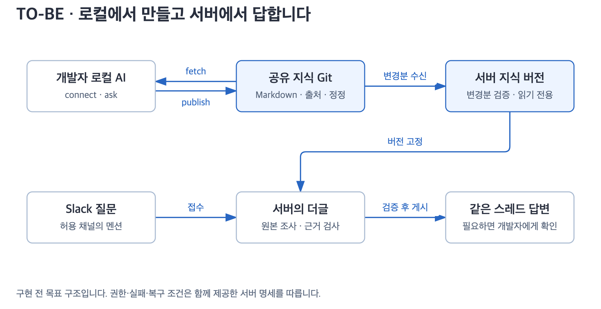

# 서버 전환 설계 · TO-BE

**개발자는 로컬 AI로 지식을 만들고 공유합니다. 서버는 공유된 지식을 읽고 필요한 원본을 확인해 Slack에서 답합니다.**

> 상태: 구현 전 개발 명세. 작성일: 2026-11-08. 현재 배포된 로컬 봇과 구분합니다. 이 문서 추가로 서버 실행·자동 동기화·DB 접근이 활성화되지는 않습니다.

[그림 확대](diagrams/overview.svg) · [현재 구조](../design.md) · [개발 순서](implementation.md) · [필수 테스트 명세](testing/README.md)

## 개발자가 읽는 순서

| 문서 | 구현 전에 결정하거나 알아야 할 내용 |
|---|---|
| 이 문서 | 범위, 기본 결정, 회사에서 확인할 사항 |
| [구조와 코드 경계](architecture.md) | 실행 역할, 기존 코드 재사용, 엔진·저장소 인터페이스 |
| [지식 공유·갱신](knowledge.md) | connect/publish/fetch, 버전 고정, 변경분 반영, 검색 |
| [문의 처리·데이터 모델](runtime.md) | 상태 전이, 병렬 작업, 대화, 예산, 게시·복구 |
| [자료 접근·운영 조회](access.md) | 읽기와 공개 권한, BigQuery·운영 DB, 개발자 요청 |
| [배포·운영](operations.md) | 서버 구성, 설정, 관측, 중지, 이전·복구 절차 |
| [구현·수용 기준](implementation.md) | 작업 단위, 의존 순서, 실패 주입, 성능·회사 검증 |
| [테스트 실행 명세](testing/README.md) | 110개 사례의 준비·절차·합격 조건·증거, 출시 차단 기준 |

문서의 “합니다”는 목표 구현의 규칙입니다. 현재 구현은 `현재`로, 도입 여부를 나중에 결정할 항목은 `후속`으로 표시합니다. 숫자로 정한 제한·시간은 별도 표시가 없으면 초기 제안값이며 실측 결과가 아닙니다. 설정 이름과 모듈 경로도 새로 구현할 계약입니다.

## 유지할 제품 경험

- 개발자는 기존 로컬 connect·ask·publish·fetch를 계속 사용합니다. 스킬만 쓰는 사람에게 서버나 Python 설치를 요구하지 않습니다.
- 일반 사용자는 Slack에서 질문합니다. Claude Code·Codex 계정이나 로컬 설치가 필요하지 않습니다.
- 근거를 확인한 답변은 자동 게시합니다. 운영 조회·개발자 도움·내부 오류는 담당자에게 요청합니다.
- 개발자 DM 전송이 확인되면 고객 스레드에 대기 안내를 남깁니다. 결과 보충 후 같은 스레드에 답합니다.
- 개발자가 직접 응대하기로 하면 그 문의의 자동 답변을 종료합니다. 결과 입력에 시간 필드를 요구하지 않습니다.
- 답변은 존댓말로 쓰고 질문의 핵심·영향·다음 행동부터 설명합니다. 공개 답변에는 출처 목록과 서명을 붙이지 않으며 내부 근거는 보관합니다.
- 짧게 답하기 위한 표현 규칙은 조사 범위를 줄이지 않습니다. 코드 질문에는 코드, 현재 상태 질문에는 적절한 최신 조회가 필요합니다.

## 첫 서버 버전의 결정

| ID | 결정 | 이유와 영향 |
|---|---|---|
| D01 | 기존 레포 안에 서버 실행 방식을 추가합니다. | 스킬·근거 검사·Slack 표현을 공통으로 유지합니다. |
| D02 | Linux 컨테이너 한 배포 단위로 시작합니다. | 별도 마이크로서비스·Kubernetes 도입을 전제하지 않습니다. |
| D03 | 서버 운영 기록은 PostgreSQL에 둡니다. | 병렬 작업, 소유권, 게시 예약을 트랜잭션으로 처리합니다. 로컬 SQLite는 유지합니다. |
| D04 | 업무 지식의 공유 형식은 Markdown + Git입니다. | 기존 publish/fetch와 호환됩니다. DB에는 처리 기록과 조회용 메타데이터를 둡니다. |
| D05 | Socket Mode 수신기 1개와 제한된 작업자로 시작합니다. | 기존 Slack 앱을 유지하고 공개 수신 URL 없이 운영합니다. |
| D06 | 조사 작업자 초기 동시 실행은 2건입니다. | 실제 메모리·비용·도구 한도를 측정한 뒤 늘립니다. 같은 스레드는 직렬 처리합니다. |
| D07 | 질문은 고정된 지식 버전을 읽고, 공통 지식 수정은 전담 갱신기가 처리합니다. | 조사 중 덮어쓰기와 질문 간 충돌을 막습니다. |
| D08 | 서버는 허용한 저장소의 지식을 자동 수신하되 자동 publish는 하지 않습니다. | 지식 사용과 외부 공유의 권한을 구분합니다. |
| D09 | 회사가 승인한 서비스 인증과 읽기 전용 연결을 사용합니다. | 개인 PC의 로그인·키체인·VDI 세션을 복사하지 않습니다. |
| D10 | 모델 엔진 교체는 기존 실행·근거 검증 계약을 통과한 뒤 진행합니다. | 프롬프트만 옮겨 도구 성공 기록을 잃는 회귀를 막습니다. |
| D11 | 공개 게시 주체는 전용 게시기 하나로 제한합니다. | 엔진의 Slack 쓰기를 막고 게시 직전 권한·상태를 다시 확인합니다. |
| D12 | 의도적 중지와 장애·배포를 구분합니다. | 중지 중 새 질문은 무시하되 이미 접수한 문의는 유실하지 않습니다. |

D03은 이번 서버 목표의 선택입니다. 작은 단일 실행 서버에서 SQLite를 쓰는 것이 불가능하다는 뜻은 아닙니다. 여러 서버에서 SQLite 파일을 공유하는 구조는 채택하지 않습니다.

## 첫 버전에서 하지 않을 일

전체 원본을 매번 다시 내재화하는 reload, 임베딩·벡터 DB의 선제 도입, 개인 VDI 화면 자동 조작, DB 쓰기·운영 명령 실행, 다중 회사 대상 SaaS는 범위 밖입니다. Slack 일반 메시지 자동 감지는 [기존 설계안](../dougle-bot/channel-detection-design.md)을 후속으로 연결합니다. 첫 서버 버전은 허용 채널의 `@dougle` 멘션만 받습니다.

기존 schedule은 서버의 수신 방식으로 사용하지 않습니다. 로컬 사용자를 위한 지원 종료·이전 안내는 별도 변경으로 결정하며 이번 문서에서 삭제하지 않습니다.

## 회사에서 확정할 사항

| 항목 | 초기 설계 기준 | 운영 시작 전 필요한 확인 |
|---|---|---|
| 배포 위치 | 사내망 접근 가능한 Linux 실행 환경 | 클라우드·망 구간·컨테이너 운영 방식·책임자 |
| AI | 회사 과금 계정, `Engine` 교체 가능 | 허용 모델·인증·외부 전송 범위·한도 |
| PostgreSQL | 관리형 우선, 암호화·백업 | 제공 버전·접속·복구 목표 |
| Slack | 기존 앱, 서비스용 비밀 저장소 | 앱 관리자·대상 채널·개발용 별도 앱 |
| 지식 저장소 | 등록 저장소·브랜치·경로만 수신 | 저장소 소유자·자료별 공개 범위 |
| 원본 조회 | 코드·문서·BigQuery 연결부터 | 서비스 계정 권한·데이터 지연·대상 식별자 |
| 운영 DB | 승인된 읽기 연결이 있을 때만 사용 | VDI 외 접근 허용 여부·읽기 복제본·허용 뷰 |
| 내부 지원 | 도메인별 담당자와 대체 담당자 | DM 수신자·지원 시간·보관 기간 |

확정되지 않은 회사 자원은 가짜 연결로 개발합니다. 실연동이 필요한 수용 검증은 미실행으로 남기며 다른 검사가 통과했다고 대신 표시하지 않습니다.

## 완료의 의미

개발자 PC를 끈 상태에서 질문을 받고, 다른 질문을 병렬 처리하며, 재시작 후에도 대화와 게시 기록을 복원해야 합니다. 근거 부족·권한 거부·개발자 직접 응대·전송 결과 불명 상황에서 임의로 답하거나 중복 게시하면 완료로 보지 않습니다.

개발 순서는 [구현·수용 기준](implementation.md), 구현 후 실제 검사는 [테스트 실행 명세](testing/README.md)를 따릅니다. 기본 수용 기준 90개에 회사 연동 12개·성능 5개·로컬 회귀 3개를 더했습니다. 모두 구현 후 실행할 계획이며 이 문서 묶음 자체는 서버 기능을 구현하거나 검증한 결과가 아닙니다.

[문서·그림 검토 기록](review.json) · [그림 원본과 제작 방법](diagrams/README.md)
